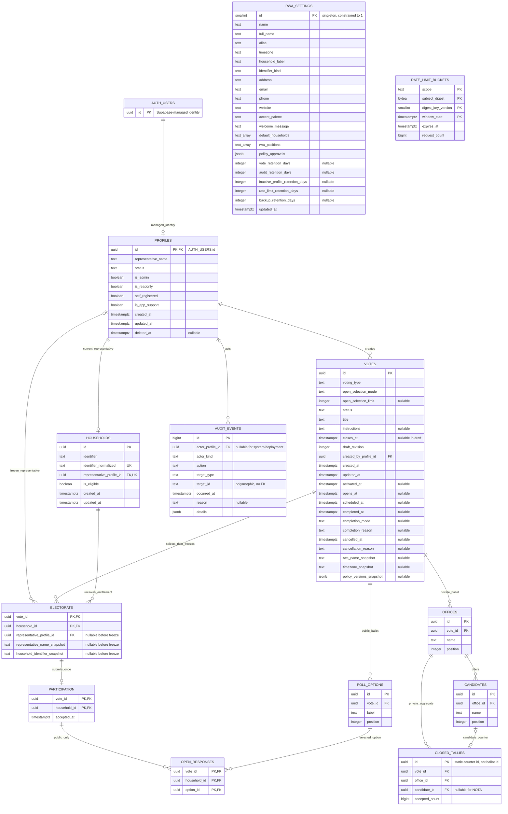

# Database: Civic Pulse

## 1. Scope and governing requirements

[PRD.md](./PRD.md) governs product behavior; [ARCHITECTURE.md](./ARCHITECTURE.md) governs implementation and privacy boundaries. This model supports one RWA, initially 500 eligible households and 100 concurrent users.

Use Supabase PostgreSQL as the authoritative store, with Supabase Auth, row-level security (RLS), guarded SQL RPCs, and versioned Supabase migrations. Normal database calls use a server-side Supabase client carrying the verified user's session; do not use raw `pg` or a service-role client for ordinary voting/results access. Require TLS, encrypted storage/backups, and the supported network restrictions for each connection path. Assume clients can call the Supabase API directly, even though browser application journeys go through Next.js.

The design implements assumptions A1-A7 provisionally. Production activation requires recorded approvals, including retention/recovery policy, PRIVATE VOTING assurance, publication timing, the session policy, bylaws confirming NOTA handling, and early completion. Under A7, optional printable exports are not signatures, legal certification, backups, or authoritative records; replacing physical signatures is not a version 1 requirement.

### Required boundaries

- One designated representative and one entitlement per household per vote.
- `PUBLIC` and `PRIVATE` are voting types; `DRAFT`, `SCHEDULED`, `ACTIVE`, `COMPLETED`, and `CANCELLED` are separate lifecycle states.
- PUBLIC VOTING supports configured single- or multi-select ballots. Publish aggregate option counts during the active poll without identities; publish identities and each household's final selection set only after completion.
- PRIVATE VOTING stores cumulative candidate/NOTA counters, never individual ballots. Participation records contain no choices.
- Freeze ballot configuration, electorate and representative identity snapshots at activation. The deadline is set at activation and may then only be moved by an administrator, with a reason, while the vote is active. The RWA name is also saved as an internal snapshot, but screens and exports show the current RWA name.
- One atomic, durable participation per entitlement. PUBLIC submissions retain a replaceable current selection set until closure; PRIVATE ballots are one-time. Terminal votes cannot reopen.
- Derive results, turnout, percentages, and reports from authoritative records; do not store duplicate editable results.
- CSV export is required for version 1. PDF is optional; its controls and acceptance checks apply only when implemented. Neither voting nor recovery depends on PDF generation.

There are no tenant, campaign, nomination, signature, attachment, notification, report-file, or individual closed-ballot tables. Supabase Auth owns authentication identities, OTPs, and sessions; do not add parallel application authentication tables. No Redis or separate identity service is required.

## 2. Conventions

Migration `20261114100000_numbered_pagination` adds only
`public.get_list_page(text, integer, integer, jsonb, uuid)`, owned by `cp_owner`,
with fixed empty `search_path`, no public/anon/service-role execution grant and
authenticated execution. Current enabled-member/committee checks precede any
count; participation and responses additionally call the existing guarded
parent routine before exposing metadata. Member vote counts explicitly restrict
the electorate to the caller, even for committee roles. PUBLIC named response
counts group by respondent household through existence, not selection count.
No PRIVATE/active named-response metadata is available.

The six UI datasets use exact filtered counts and sort-key anchor lookup to
support numbered pages while existing HTTP cursor routines stay unchanged.
Count/anchor use one materialized filtered-key statement snapshot; only one
anchor is returned, never all account/ballot projections. UI totals remain
live across requests. This adds no table, policy, index, tally store, write
workflow or migration-at-startup behavior. Apply before deploying the numbered
UI; review performance at approved scale rather than claiming count costs
are constant. See [API pagination](./API.md#22-pagination-and-filtering).

Migration `20261115100000_resident_table_controls` adds
`public.get_resident_table_page(integer, integer, jsonb, text, text)`, owned by
`cp_owner` with an empty search path and authenticated-only execution. Its current
enabled-committee check precedes all reads. It joins the existing directory view
and profiles to sort/filter the full authorized directory before returning at
most 100 ordered profile IDs and exact count/page metadata in one statement.
Sort expressions are allowlisted; filter values are bound. Null sort values come
last, then lowercase representative name and UUID stabilize ties. Name matching
is literal case-insensitive substring matching, not Auth email search; changed
bounds use `profiles.updated_at` (inclusive start/exclusive end). Existing
`get_list_page`, cursor APIs, tables, grants to members and voting rules are
unchanged. Apply the new routine before this Residents application revision;
local disposable PostgreSQL testing is not hosted migration authorization.

Migration `20261116100000_resident_identifier_contains` replaces only that routine
to accept `identifierContains`, normalized with the existing household key helper
and matched literally using `strpos` before paging/counting. Normalized length
must be 1–100 characters. Existing exact `identifier` remains supported, including
for older application revisions; privileges, guards, sort order and metadata
shape are unchanged. No wildcard operators or typo-distance search are introduced.

Migration `20261117100000_resident_source_sort` adds `source` to the same
routine's sort allowlist, ordering `self_registered` false then true ascending
(Admin-registered then Self-registered) and the reverse descending, before
paging. Lowercase name/UUID tie-breakers, boolean source filters, metadata and
authenticated committee-only execution remain unchanged.

The Votes concept overview reads exact counts from frozen `electorate` joined to
vote status and, for responses, its `participation` row. Every query uses the
verified user's client and explicitly filters the representative profile ID, even
when RLS also permits administrator reads. Card turnout reuses the authorized
result routine and is narrowed server-side to counts/percentage. No direct tally
grant, schema migration or new RPC is added; no PRIVATE selection is retrieved.

Browser appearance (`light`/`dark`/`system`) is not stored in `profiles`,
`rwa_settings` or any vote row. It needs no migration or new grant. Existing RWA
accent values remain unchanged; appearance variants are presentation tokens.
The dedicated browser key contains no identity, entitlement, participation or
choice data and does not relax the prohibition on persisted ballot selections.

| Concern | Convention |
|---|---|
| Identifiers | Internal entity IDs use database-generated UUIDs, except `profiles.id`, which references the Supabase Auth user ID. UUIDs are not authorization tokens. |
| Time | All instants use `timestamptz`; database connections use UTC. Display using the frozen IANA timezone. |
| Clock | Use `clock_timestamp()` after acquiring the vote lock for submission admission, not transaction-start `now()`. |
| Required columns | Every listed column is `NOT NULL` unless marked nullable. |
| Enumerations | Use `text` with explicit `CHECK` allowlists; no unconstrained status/type strings. |
| Strings | Store trimmed plain text. Reject empty required strings and control characters inappropriate to the field. Do not accept rich HTML. |
| Normalization | Use one versioned server/database-compatible normalization policy. Email: trim and lowercase consistently, without provider-specific rewriting. Household keys: trim, Unicode-normalize, and case-fold consistently. Preserve household display labels separately. |
| Deletion | Foreign keys use `ON DELETE RESTRICT` and `ON UPDATE RESTRICT` unless stated otherwise. Never cascade a live vote deletion. |
| Concurrency | Lock the parent vote before any electorate, ballot, participation, response, or counter write; lifecycle operations use the same order. |
| Counts | Aggregate counters use nonnegative `bigint`. Represent counts safely across the PostgreSQL/TypeScript boundary; do not silently coerce arbitrary `bigint` to JavaScript `number`. |

Proposed implementation bounds are 254 characters for email, 100 for household labels/keys, 200 for names and ballot labels, 300 for titles/questions, 10,000 for instructions/context, and 2,000 for reasons. Apply identical bounds in request validation and database checks. These are technical safeguards, not additional voting rules; verify them against pilot data before release.

## 3. Tables and columns

### 3.1 `rwa_settings`

Exactly one row, maintained through controlled setup and audited administrative operations.

| Column | Type | Keys / rules |
|---|---|---|
| `id` | `smallint` | PK; `CHECK (id = 1)`. |
| `name` | `text` | Non-empty official RWA name; kept equal to the administrator-managed `full_name` and shown on screens and exports. Votes still store a separate activation-time `rwa_name_snapshot` as an internal historical record. |
| `timezone` | `text` | Valid IANA timezone, validated against PostgreSQL timezone names and supported application timezone data. |
| `household_label` | `text` | RWA-wide singular display name for a household (1-40 characters of single-line plain text, such as `Flat` or `Villa`); defaults to `Household`; display-only. |
| `identifier_kind` | `text` | `NUMBER` or `ID`; names identifier values together with the household label (for example `Flat Number`); defaults to `NUMBER`; display-only. |
| `full_name` | `text` | Administrator-managed official organization name; defaults to `Residents Welfare Association` and is synchronized to `name`. |
| `alias` | `text` | Compact plain-text brand name for headers; defaults to `RWA`. |
| `address` | `text` | Optional multi-line plain-text organization address up to 500 characters; defaults to `RWA Address`; empty text hides it. Shown when set to signed-in members, on the public privacy page and on PDF results. |
| `email` | `text` | Optional organization contact email (empty or a valid address up to 254 characters); defaults to `rwa@email.com`. Shown when set to signed-in members and on PDF results. |
| `phone` | `text` | Optional organization contact phone up to 40 characters; defaults to `+91 123 456 7890`; empty text hides it. Shown when set to signed-in members and on PDF results. |
| `website` | `text` | Optional HTTP(S) URL; defaults to empty text. Shown in the signed-in footer when set. |
| `accent_palette` | `text` | One of `TEAL` (default), `BLUE`, `FOREST`, `PLUM`, `SLATE`, `AMBER`; maps to a contrast-checked accent in the design tokens. |
| `welcome_message` | `text` | Optional plain-text message up to 300 characters, no markup; empty by default. |
| `default_households` | `text[]` | Admin-managed household identifier list. When non-empty it is the only set of identifiers accepted when an administrator adds or moves an account's household (enforced by the application) and by resident self-registration (enforced by `self_register_resident`; served to the public `/register` page through the service-role-only `get_self_registration_households`); readable through the full settings projection by enabled RWA Admin/ReadOnly accounts, not exposed to Residents; up to 1000 single-line entries of 1-100 characters, unique after household key normalization; empty by default. |
| `rwa_positions` | `text[]` | Admin-managed office-name suggestions for PRIVATE drafts; readable through the full settings projection by enabled RWA Admin/ReadOnly accounts, not exposed to Residents; up to 50 single-line entries of 1-200 characters, unique after normalization; defaults to President, Vice-President, Secretary, Joint-Secretary, Treasurer. |
| `policy_approvals` | `jsonb` | Object keyed exactly by A1-A7; empty object allowed during setup. Structure below. |
| `vote_retention_days` | `integer`, nullable | Positive approved period after completion/cancellation; null means unapproved, not unlimited. |
| `audit_retention_days` | `integer`, nullable | Positive approved period after event creation. |
| `inactive_profile_retention_days` | `integer`, nullable | Positive approved period after soft deletion, subject to historical references and coordinated Auth removal. |
| `rate_limit_retention_days` | `integer`, nullable | Positive cleanup period after bucket expiry. |
| `backup_retention_days` | `integer`, nullable | Positive approved backup expiry; must match provider configuration. |
| `updated_at` | `timestamptz` | Database-assigned modification time. |

Each approval entry contains a non-empty `version`, `approved_at`, `approved_by_profile_id`, `approving_authority`, and non-empty `decision`. Record the actual approving authority, not merely the administrator entering the record. The decision records the approved assumption and any operational qualification, not a ballot or secret. Validate JSON shape and allowed keys in the protected settings operation; verify the recording profile there. JSON profile references are historical attribution, not foreign keys. Audit policy changes and retain that evidence for the approved period.

Approvals are invalidated when their associated decision/version changes. Activation checks all seven current approvals and every required retention value. Provider, region, recovery objectives, and backup capability approval are deployment release gates, not extra application entities.

### 3.2 `profiles` and managed `auth.users`

Supabase owns `auth.users` and its authentication schema. Its user UUID and registered email are the identity source; do not recreate its tables, change their internal columns, or duplicate email/verification/session state in application tables. Provisioning normalizes registered email and rejects ambiguous identities through the supported Auth administrative API. Only the following application profile is defined here.

| Column | Type | Keys / rules |
|---|---|---|
| `id` | `uuid` | PK and FK to `auth.users.id`; `ON DELETE RESTRICT`. No independently generated profile ID. |
| `representative_name` | `text` | Non-empty current name. |
| `status` | `text` | `ENABLED`, `SUSPENDED`, or `DELETED`; default `SUSPENDED` until provisioning is complete. |
| `is_admin` | `boolean` | Default false; the `rwa-admin` write-management role; does not grant voting entitlement. |
| `is_readonly` | `boolean` | Default false; mutually exclusive with `is_admin`. Grants authorized committee reads only, never management writes or voting entitlement. A household is optional; without one the observer reads the committee scope but has no ballot. |
| `self_registered` | `boolean` | Default false; true only for profiles created by the public `/register` workflow. Provenance for administrator review, never a capability. |
| `is_app_support` | `boolean` | Default false; true only for the developer/support identity granted RWA-controlled App Support Access. Constraint `profiles_app_support_readonly` requires such a profile to be read-only (`is_readonly`), non-admin and non-self-registered. The profile is managed only through `set_app_support_access`; triggers block ordinary edits and any household assignment. |
| `created_at` | `timestamptz` | Database creation time. |
| `updated_at` | `timestamptz` | Database modification time. |
| `deleted_at` | `timestamptz`, nullable | Present exactly when status is `DELETED`. |

Keep profile IDs stable across email/register edits and suspension; do not create replacement identities to bypass frozen assignments. Current role/status come from this table, never user-editable Auth metadata. Only administrators may change roles; profile role transitions are atomic, audited and preserve the final-enabled-admin safeguard. Members and observers cannot update these fields directly. Historical electorate references remain stable. No passwords, date of birth, phone numbers, or ownership documents are application data requirements.

The user-facing role code `voter` is derived when both management flags are
false; there is no separate voter-role column. Personas are titled Resident
(`voter`), RWA Admin (`rwa-admin`) and RWA ReadOnly (`rwa-readonly`).

Suspension/soft deletion blocks application access immediately through profile checks in RLS and guarded functions, including with an already-issued JWT. Use supported Auth administrative operations for session revocation, bans, email changes, and identity removal as applicable; do not promise instant invalidation of every issued JWT. Auth administrative calls and profile changes are not one transaction: surface partial failures and use retry-safe operations. Keep a profile blocked throughout an identity-change workflow until the Auth identity and register association are verified consistent.

### 3.3 `households`

Migration `20261111100000_resident_directory.sql` retains a read-only
`public.resident_directory` view joining profiles to their optional households.
It was applied to the confirmed disposable project during the subsequently
reverted Residents-tab experiment. The current unified Residents screen uses
this view through the guarded table-window routine for globally sorted/filtered
IDs, then enriches only the authorized page with current profiles and assignments. Consolidation
changes no schema or grants. It remains immutable migration history: `security_invoker` applies
the caller's underlying RLS policies, only `authenticated` has SELECT, and no
writes or new voting permissions are granted. Do not drop it or repair migration
history merely to roll back the application.

| Column | Type | Keys / rules |
|---|---|---|
| `id` | `uuid` | PK; stable across identifier edits. |
| `identifier` | `text` | Non-empty current display label. |
| `identifier_normalized` | `text` | Unique canonical household key. |
| `representative_profile_id` | `uuid` | FK to `profiles.id`; unique. |
| `is_eligible` | `boolean` | Current register eligibility; default false. |
| `created_at` | `timestamptz` | Database creation time. |
| `updated_at` | `timestamptz` | Database modification time. |

Each household has exactly one current representative; a profile represents at most one current household. Administrators may exist without a household. Reassignment affects future activation only. Current register eligibility changes never rewrite an activated electorate.

### 3.4 Managed authentication behavior (no application tables)

- Disable public signup. Request six-digit email OTPs through Supabase Auth with `shouldCreateUser: false` and the `{{ .Token }}` email template.
- Configure custom SMTP, code expiry, resend cooldown, and request/verification limits in Auth; validate same-day login bursts for 500 households. Do not assume built-in SMTP is production-ready.
- Return generic request acknowledgements and safe retry guidance without exposing account existence. Never persist or log codes, tokens, cookies, or email content in application records.
- Use `@supabase/ssr` and supported server-side identity verification/refresh. Do not authorize from an unverified cookie session object or invent parallel opaque sessions.
- Native time-boxing, idle timeout, and single-session controls require Supabase Pro or higher under the architecture's planning assumptions. Approve the actual persistent-session policy under A4; do not promise 30-minute idle or 12-hour absolute expiry on Free.
- Check current profile suspension/role on every protected operation. Sign-out or Auth administration alone may not immediately invalidate existing JWTs.
- Auth manages its own records and lifecycle through supported interfaces. Approve relevant Auth retention/provider controls without adding custom challenge/session cleanup SQL.

### 3.5 `votes`

| Column | Type | Keys / rules |
|---|---|---|
| `id` | `uuid` | PK. |
| `voting_type` | `text` | `PUBLIC` or `PRIVATE`. |
| `open_selection_mode` | `text` | `SINGLE` or `MULTIPLE`; existing votes default to `SINGLE`. PRIVATE votes are fixed to `SINGLE`. |
| `open_selection_limit` | `integer`, nullable | `1` for `SINGLE`; `2` to `100` for capped `MULTIPLE`; `NULL` allows any number of configured options. |
| `status` | `text` | `DRAFT`, `SCHEDULED`, `ACTIVE`, `COMPLETED`, or `CANCELLED`; default `DRAFT`. |
| `title` | `text` | Title/question; may be empty while drafting, required at activation. |
| `instructions` | `text`, nullable | PUBLIC context or PRIVATE instructions; non-empty PRIVATE instructions required at activation. |
| `closes_at` | `timestamptz`, nullable | Required and strictly future at activation; afterwards changeable only by the guarded `change_vote_deadline` routine while `ACTIVE`. |
| `draft_revision` | `integer` | Positive; increment on every draft edit, including child/electorate edits. |
| `created_by_profile_id` | `uuid` | FK to `profiles.id`. |
| `created_at` | `timestamptz` | Creation time. |
| `updated_at` | `timestamptz` | Modification time, including lifecycle transitions. |
| `activated_at` | `timestamptz`, nullable | Effective start: immediate activation time, or scheduled opening time (already stored while scheduled). |
| `opens_at` | `timestamptz`, nullable | Scheduled effective opening, strictly between scheduling confirmation and closure; null for immediate activation. |
| `scheduled_at` | `timestamptz`, nullable | Database time when scheduling froze the vote; null for immediate activation or after withdrawal. |
| `completed_at` | `timestamptz`, nullable | Effective completion: deadline or confirmed early-completion time. |
| `completion_mode` | `text`, nullable | `DEADLINE` or `EARLY`; present only when completed. |
| `completion_reason` | `text`, nullable | Non-empty for early completion; null for deadline completion. |
| `cancelled_at` | `timestamptz`, nullable | Effective cancellation time; present only when cancelled. |
| `cancellation_reason` | `text`, nullable | Non-empty exactly when cancelled. |
| `rwa_name_snapshot` | `text`, nullable | RWA name frozen at activation. |
| `timezone_snapshot` | `text`, nullable | IANA timezone frozen at activation. |
| `policy_versions_snapshot` | `jsonb`, nullable | Frozen object mapping A1-A7 to approved version strings; no mutable settings lookup for historical notices. |

State-dependent checks require activation/deadline/snapshot fields for non-drafts; completion fields only for `COMPLETED`; cancellation fields only for `CANCELLED`. Drafts have no terminal/activation fields. Require `activated_at < closes_at`; deadline completion has `completed_at = closes_at`; early completion and cancellation occur at or after activation and strictly before the deadline.

Legal transitions are `DRAFT -> ACTIVE`, `DRAFT -> SCHEDULED -> ACTIVE`, strictly pre-opening `SCHEDULED -> DRAFT`, and `ACTIVE -> COMPLETED/CANCELLED`. `schedule_vote` delegates to the same guarded freeze helper as activation. Both initialize PRIVATE counters and frozen electorate snapshots atomically. `open_if_due` locks the parent and checks `clock_timestamp()`; Cron and authorized discovery/detail/submission calls use it. If both opening and closure have elapsed, the vote completes at its deadline without admitting a ballot. `withdraw_vote_schedule` requires confirmation/reason, clears snapshots/counters/opening fields, advances the revision and audits the previous opening. Neither scheduled nor active ballot content can be edited. A partial `(status, opens_at, id)` scheduling index bounds due processing. Existing five-second lock limits apply before the opening/submission lock. No API role gets direct writes or direct execution of internal helpers.

Scheduled summary discovery retains `can_view_vote`, while offices/options use
`can_view_ballot` and candidates use the strengthened `can_view_office`: residents
cannot directly read the ballot before opening through PostgREST. The member
projection also strips options/offices while scheduled. Administrators may inspect
the frozen ballot. These policies do not expose active choice totals.

Register import adds no data table. `check_register_import(text,text,uuid,boolean)`
and `import_register_household(text,text,uuid,boolean)` require a current enabled
administrator, use the existing identifier normalization and profile constraints,
and never update existing records. Assignment locks the profile and uses the
guarded `create_household` routine/audit. Exact concurrent retries return
`EXISTING`; mismatched names, eligibility, assignments or unsuitable profiles
return `CONFLICT`. Auth identities are resolved/provisioned separately through
supported server-only APIs, never queried by `cp_owner`. Imported profiles remain
suspended; enabling is the existing separate confirmed workflow. See API 4.3.

### 3.6 `offices`

| Column | Type | Keys / rules |
|---|---|---|
| `id` | `uuid` | PK. |
| `vote_id` | `uuid` | FK to `votes.id`; parent must be PRIVATE. |
| `name` | `text` | Non-empty office name. |
| `position` | `integer` | Positive display order; unique within vote. |

Add unique `(vote_id, id)` for composite references. Reject duplicate normalized office names within a vote through the protected draft editor/activation validation. PUBLIC votes have no offices.

### 3.7 `candidates`

| Column | Type | Keys / rules |
|---|---|---|
| `id` | `uuid` | PK. |
| `office_id` | `uuid` | FK to `offices.id`. |
| `name` | `text` | Non-empty candidate display name. |
| `position` | `integer` | Positive display order; unique within office. |

Add unique `(office_id, id)` for composite references. Candidates are ballot labels, not account references: candidacy does not require a login or confer eligibility. Reject indistinguishable normalized names within one office; administrators must disambiguate labels where necessary. NOTA (None of the Above) is a built-in counted choice, not a candidate/account.

### 3.8 `poll_options`

| Column | Type | Keys / rules |
|---|---|---|
| `id` | `uuid` | PK. |
| `vote_id` | `uuid` | FK to `votes.id`; parent must be PUBLIC. |
| `label` | `text` | Non-empty option label. |
| `position` | `integer` | Positive display order; unique within vote. |

Add unique `(vote_id, id)` for composite references. Activation requires at least two distinct normalized labels. PRIVATE votes have no poll options.

### 3.9 `electorate`

This table holds the administrator-selected household set while drafting and the frozen entitlement set after activation; a second draft-electorate table is unnecessary.

| Column | Type | Keys / rules |
|---|---|---|
| `vote_id` | `uuid` | PK component; FK to `votes.id`. |
| `household_id` | `uuid` | PK component; FK to `households.id`. |
| `representative_profile_id` | `uuid`, nullable | FK to `profiles.id`; populated at activation. |
| `representative_name_snapshot` | `text`, nullable | Populated from the register at activation. |
| `household_identifier_snapshot` | `text`, nullable | Household display label at activation. |

PK `(vote_id, household_id)` prevents duplicate household entitlements. Unique `(vote_id, representative_profile_id)` prevents multiple entitlements per representative in the same vote; draft nulls are allowed.

Activation requires a non-empty selected electorate; every selected household must currently be eligible with an enabled representative. Re-read and lock selected households/profiles consistently during activation so concurrent register changes cannot produce a mixed snapshot. Either a register edit precedes the snapshot or follows it.

All snapshot fields are null in drafts and non-null after activation, enforced by protected operations and parent-aware database guards. After activation, no electorate insert/update/delete is permitted except coherent approved retention deletion. Later suspension blocks access without deleting the entitlement or changing the turnout denominator.

### 3.10 `participation`

| Column | Type | Keys / rules |
|---|---|---|
| `vote_id` | `uuid` | PK component. |
| `household_id` | `uuid` | PK component. |
| `accepted_at` | `timestamptz` | Database acceptance time captured after admission checks. |

PK `(vote_id, household_id)` is also a composite FK to `electorate(vote_id, household_id)`. It is the authoritative exactly-once record and uncertainty-recovery lookup. No selected option, candidate, ballot identifier, request identifier, IP address, or session identifier is stored here.

Participation timestamps must never appear with PRIVATE choice data. RWA Admins and RWA ReadOnly observers may monitor participation; Residents may query their own status. PRIVATE result/export projections exclude household and participation lists.

### 3.11 `open_responses`

| Column | Type | Keys / rules |
|---|---|---|
| `vote_id` | `uuid` | PK component; vote must be PUBLIC. |
| `household_id` | `uuid` | PK component. |
| `option_id` | `uuid` | Required selected option. |

PK `(vote_id, household_id, option_id)` makes each selected option unique for a household. Composite FK `(vote_id, household_id)` references `participation(vote_id, household_id)`; composite FK `(vote_id, option_id)` references `poll_options(vote_id, id)`, preventing responses without participation or cross-vote choices.

At least one response accompanies every PUBLIC participation in the same transaction. `SINGLE` allows exactly one option; `MULTIPLE` enforces its configured maximum, if any. The response set is atomically replaced on an active PUBLIC resubmission; only the latest set remains. Resolve respondent name/household from frozen electorate snapshots, not current profiles/register. Do not duplicate identity or submission timestamps in response rows. There are no change-history rows or stored PUBLIC counters.

### 3.12 `closed_tallies`

| Column | Type | Keys / rules |
|---|---|---|
| `id` | `uuid` | PK; static counter identifier, never a ballot identifier. |
| `vote_id` | `uuid` | Parent vote; must be PRIVATE. |
| `office_id` | `uuid` | Owning office. |
| `candidate_id` | `uuid`, nullable | Null denotes this office's explicit NOTA counter. |
| `accepted_count` | `bigint` | Default 0; `CHECK (accepted_count >= 0)`. |

Composite FK `(vote_id, office_id)` references `offices(vote_id, id)`. Composite FK `(office_id, candidate_id)` references `candidates(office_id, id)` when candidate is non-null.

Create a unique partial index on `(office_id, candidate_id)` where candidate is non-null and a unique partial index on `(office_id)` where candidate is null. This produces one counter per candidate and exactly one NOTA counter per office once activation initializes the full set.

Counters contain **no** account/household reference, shared ballot ID, response row, creation/update timestamp, actor, session, or per-update history. Initialize all counters to zero atomically at activation, then allow increments only through the submission routine. Counter IDs remain unchanged across submissions. No direct runtime reads or writes are allowed.

### 3.13 `audit_events`

| Column | Type | Keys / rules |
|---|---|---|
| `id` | `bigint GENERATED ALWAYS AS IDENTITY` | PK; append order, not a ballot identifier. |
| `actor_profile_id` | `uuid`, nullable | FK to `profiles.id`; null only for an identified system/deployment actor. |
| `actor_kind` | `text` | `PROFILE`, `SYSTEM`, or `DEPLOYMENT`; profile actor requires profile FK. |
| `action` | `text` | Allowlisted administrative action. |
| `target_type` | `text` | Allowlisted record category, including `VOTE`, `HOUSEHOLD`, `PROFILE`, `SETTINGS`, or `RETENTION`. |
| `target_id` | `text` | Stable affected record identifier; intentionally not a polymorphic FK. |
| `occurred_at` | `timestamptz` | Actual processing time. |
| `reason` | `text`, nullable | Required for cancellation and early completion; bounded and checked for inappropriate sensitive input. |
| `details` | `jsonb` | Default empty object; action-specific allowlisted metadata only. |

Actions cover controlled administrator bootstrap, register changes, role/status changes, draft edits, activation, completion, cancellation, policy changes, settings changes, and retention deletion. Details may include revision, changed field names, effective lifecycle time, and approved policy version. Do not copy full records, emails, authentication material, contact details, or ballot payloads into JSON.

Application-database administrative mutation and audit insertion commit together; Auth administrative calls require the retry-safe cross-service workflow described below. Do not emit per-voter PRIVATE submission audit events or counter deltas. Audit targets intentionally survive target deletion; events remain until their separate approved expiry. Profile FK restrictions may delay profile/Auth identity hard deletion until audit expiry.

### 3.14 `rate_limit_buckets`

| Column | Type | Keys / rules |
|---|---|---|
| `scope` | `text` | PK component; allowlisted endpoint/purpose and subject dimension. |
| `subject_digest` | `bytea` | PK component; 32-byte keyed HMAC of normalized email, trusted client IP, or authenticated profile identifier. |
| `digest_key_version` | `smallint` | PK component; positive rate-limit key version. |
| `window_start` | `timestamptz` | PK component; fixed-window start. |
| `expires_at` | `timestamptz` | End of enforcement window; greater than start. |
| `request_count` | `bigint` | Positive atomic counter. |

PK `(scope, subject_digest, digest_key_version, window_start)`. Use shared application counters only for limits needed beyond Supabase Auth controls, such as server endpoint/export limits and additional code-request abuse protection. Increment/check applicable buckets atomically before accepting an operation. Rate-limit failures must persist their counters independently of rejected domain transactions.

Use a dedicated secret-manager HMAC key for rate-limit subjects, not Auth signing material. Do not store raw IP addresses or raw unregistered emails. Key rotation must preserve enforcement for existing windows, not reset abuse budgets. Exact endpoint thresholds are controlled operational configuration validated during the pilot. Follow Supabase's supported trusted-IP forwarding setup for proxied Auth calls; never trust arbitrary forwarded headers. These counters do not replace Auth's own limits and must not be directly writable through the public API.

The public launch additions introduce **no schema migration or contact-message
table**. Contact enquiries use the existing `consume_rate_limit` routine and
buckets with `contact.email` (3 per normalized email per hour) and `contact.global`
(30 per hour, using a fixed HMAC subject) before sending through Resend. Names,
reply addresses and message bodies are not stored in application tables or audit
events. Provider/mailbox retention is separate from database retention and needs
approval. Public metadata and Google verification are configuration, not RWA
settings records. The optional analytics preference is browser-local consent,
not ballot state; it does not permit storing selections in browser storage.

Resident self-registration uses the same routine with `register.self.email`
(3 per normalized email per hour), `register.self.household` (5 per normalized
household identifier per hour, a new `household` HMAC subject kind) and
`register.self.global` (100 per hour, fixed HMAC subject). Thresholds are
provisional pilot settings.

## 4. Relationships and ER diagram

`AUTH_USERS` is Supabase-managed and shown only to explain `profiles.id`; it is not an application-owned table. `rwa_settings` is a singleton, not a tenant parent. `rate_limit_buckets` has no identifying foreign keys. Composite primary/foreign keys are shown by marking each participating column; position uniqueness is scoped to its parent vote or office. The diagram shows structural optionality, including incomplete drafts; activation enforces required office/candidate/option/electorate cardinalities. `PARTICIPATION` reaches the vote through the composite `ELECTORATE` key. For PRIVATE elections, each candidate has at most one initialized counter and each office also has one null-candidate NOTA counter. There is deliberately no relationship from participation to PRIVATE choices or tallies.

## 5. Integrity, validation, and transaction boundaries

### Database enforcement

Use primary/unique/foreign keys and local `CHECK` constraints for row-local rules. PostgreSQL `CHECK` constraints do not enforce cross-table or aggregate rules: use protected routines and database triggers for parent type/state, freezing, lifecycle transitions, and aggregate consistency. Parent-aware write guards acquire the parent vote lock before checking state, including draft edits.

Use deferred constraint triggers to verify submission consistency at transaction end:

- Every participating PUBLIC household has at least one response, every response belongs to a participant, configured selection limits are respected, and PRIVATE votes have no PUBLIC responses.
- For each PRIVATE office, sum of candidate counters plus the NOTA counter equals participation count.
- PRIVATE counter membership exactly matches the frozen candidate set plus one NOTA counter per office; PUBLIC votes have no closed counters.

Limit checks to affected votes, and validate again at completion/read publication. All mutation paths use the parent lock so checks cannot race another writer. Constraint failures roll back the whole operation; they must not be converted into success or silent repairs.

### Draft editing and activation

1. Authenticate an enabled current administrator; lock the vote.
2. Require `DRAFT` and the previewed `draft_revision`; reject stale edits/activation.
3. Validate type-specific configuration, normalized distinct labels, deadline, and selected eligible households.
4. Lock/re-read selected register rows and settings in a documented consistent order shared with register/policy operations.
5. Require approved A1-A7 decisions and retention settings.
6. Snapshot representatives, labels, RWA name/timezone, and approved policy versions; initialize PRIVATE counters.
7. Recheck the future deadline using the database clock and atomically set `ACTIVE`, activation time, and audit event.

Draft edits, including voting-type changes, are allowed only while no submission can exist. A type change removes incompatible draft children atomically; activation rejects mixed ballot shapes. Non-draft configuration and snapshots cannot be updated even by ordinary administrative database operations.

### Submission

1. In `cast_vote`, require non-null `auth.uid()` from the verified JWT context; lock the vote, then the caller's profile, and recheck enabled status and frozen entitlement. Profile locking serializes admission against suspension/deletion. Do not lock or modify Supabase-managed session tables.
2. Reconcile overdue lifecycle state. Require `ACTIVE` and database time strictly before `closes_at` after acquiring locks.
3. Resolve the household from the frozen electorate and authenticated profile, not client-provided identity.
4. Reject existing participation for PRIVATE. For PRIVATE, validate exactly one candidate or explicit NOTA choice for every office, no omissions, repeated offices, foreign candidates, or extra fields. For PUBLIC, validate at least one distinct owned option within the configured selection rule.
5. On first submission, insert one participation row and the selected PUBLIC option row(s), or all PRIVATE counter increments, in the same transaction. A PUBLIC resubmission replaces only that household's current option set, without adding participation. Lock offices/counters in stable ID order.
6. Commit durably before returning a participation-only acknowledgement.

Per-vote serialization is intentional at the stated scale. Unique participation remains the last defense against retries and concurrent sessions. No email, rendering, network call, or report generation occurs inside this transaction.

Check `clock_timestamp()` after acquiring all admission locks, immediately before accepting participation and choices. Client click time or HTTP arrival does not reserve acceptance. A transaction admitted strictly before the deadline may commit afterwards; one that waits past the cutoff is rejected.

If overdue reconciliation completes a vote while rejecting submission, commit reconciliation before returning the domain rejection; do not throw an exception that rolls the transition back. A database/invariant failure must instead roll back and surface an error.

Use `synchronous_commit = on` for accepted submissions and verify managed-service durability/failover guarantees. This does not by itself promise zero-data-loss regional recovery.

### Completion, cancellation, and results

- Supabase Cron invokes restricted, idempotent SQL maintenance initially once per minute. Authorized service reads/submission handling may invoke narrowly scoped overdue reconciliation; plain download responses perform no unrelated mutations. Deadline enforcement does not depend on Cron availability, and database pausing prevents Cron execution.
- All transitions take the same vote-row lock. Deadline completion is idempotent and uses the deadline as effective completion time.
- Early completion/cancellation require administrator confirmation and a reason. Reconcile overdue status first; cancellation cannot override a due completion. Include the early-completion label and reason in the shared screen/export projection.
- Before marking completed, verify participation/response/tally invariants. On mismatch, block completion/publication/exports and alert operators without exposing choices; submissions remain blocked by the deadline.
- Publish active PUBLIC aggregate counts/turnout and active PRIVATE aggregate turnout to enabled administrators and frozen eligible representatives without active choices. The separate participation RPC may reveal household submission status to admins for follow-up during active PRIVATE elections; members cannot access that list. Hide active PRIVATE candidate/NOTA totals and all cancelled choices.
- Read one authorized SQL projection for active PUBLIC aggregates and completed results; only completed PUBLIC results include names, and only completed projections may be exported. Obtain multi-part data in one consistent database snapshot inside that RPC, not separate Supabase requests assumed to share a transaction; materialize the authorized projection before rendering outside the transaction.
- Eligible denominator is frozen electorate size, including suspended representatives. Submitted denominator is participation count. PUBLIC option totals count selected options and may exceed participation; PRIVATE totals are protected counters.
- Election candidate/NOTA percentages and each PUBLIC option percentage use submitted households as their denominator; the projection also derives an eligible-household share for the result bars. Multi-select PUBLIC percentages may sum above 100%. The highest-count candidate wins even when NOTA has more votes; NOTA is tallied separately and cannot win. Equally highest positive candidate or poll-option totals are labelled "Tie" without selecting a winner. Zero ballots or no candidate votes (including all-NOTA ballots) have no winner. Zero denominators display not applicable/no-votes rather than invalid arithmetic.
- Do not persist turnout, rounded percentages, leaders, PDF generation time, or export files. Derive active PUBLIC totals from current response rows; compute completed projections deterministically from final vote data and the report generation clock.

## 6. Query-driven indexes

Primary keys and unique constraints create their own B-tree indexes. Avoid duplicates of those indexes.

| Query / enforcement | Index |
|---|---|
| Authentication identity / profile lookup | Supabase manages Auth email lookup/indexes; `profiles(id)` PK serves `auth.uid()` lookups. Do not add application email indexes or modify managed Auth indexes. |
| Register lookup / duplicate household rejection | Unique `households(identifier_normalized)`. |
| Current representative lookup / ambiguity prevention | Unique `households(representative_profile_id)`. |
| Own vote list and frozen entitlement authorization | Unique `electorate(vote_id, representative_profile_id)` plus `electorate(representative_profile_id, vote_id)` for profile-first lookup and policy checks. |
| Household history / FK checks | `electorate(household_id, vote_id)`; PK already serves vote-first reads. |
| Member submission status and turnout | `participation` composite PK `(vote_id, household_id)`; no extra status index. |
| Ballot ordering | Unique `offices(vote_id, position)`, `candidates(office_id, position)`, `poll_options(vote_id, position)`. |
| Composite ownership FKs | Unique `offices(vote_id, id)`, `candidates(office_id, id)`, `poll_options(vote_id, id)`. |
| PUBLIC option totals and complete named-response joins | `open_responses(vote_id, option_id, household_id)`; PK serves electorate/participation joins. |
| PRIVATE counter lookup / ownership | Two partial unique indexes described above, plus `closed_tallies(vote_id, office_id)` for complete protected tally reads and parent FK access. |
| Administrator vote list with stable cursor | `votes(created_at DESC, id DESC)`; filter small status/type sets without speculative extra indexes. |
| Creator FK and profile cleanup | `votes(created_by_profile_id)`. |
| Due-vote scheduler | Partial `votes(closes_at, id)` where status is `ACTIVE`. |
| Audit history, newest first | `audit_events(occurred_at DESC, id DESC)`; bounded actor and Details substring filters (Details covers reason plus allowlisted JSON values) preserve the order and do not add fuzzy or JSON GIN indexes. |
| Profile audit references / FK cleanup | `audit_events(actor_profile_id)`; omit a separate general target-history index until a target-filtered journey needs it. |
| Rate-limit lookup and cleanup | Composite PK and `rate_limit_buckets(expires_at)`. |

Named-response pages use stable household-ID keyset pagination over the vote-prefixed primary key and join snapshots/options; exports deliberately read all authorized respondents. Audit and administrator vote lists use timestamp-plus-ID cursors. Do not add fuzzy search, JSON GIN indexes, materialized views, partitions, or cached tally tables for this MVP.

Verify plans with `EXPLAIN (ANALYZE, BUFFERS)` on synthetic 500-household data and load-test 100 concurrent users, including contention on one vote. Require p95 page/API latency below two seconds and acknowledgement below three seconds, excluding email/network conditions.

## 7. Ownership, authorization, and row-level security

### Database roles and object ownership

| Role | Privileges |
|---|---|
| Deployment/migration role | Deployment-only DDL and reviewed migrations; unavailable to the application. |
| Protected routine owner | Non-login role owning required routines, with minimum underlying data privileges. No operator credentials exposed to users. |
| `anon` | No application-data access or execution of protected user/maintenance RPCs. Authentication uses the supported Auth endpoints. |
| `authenticated` | User JWT context; only required RLS-filtered safe reads and explicitly granted user RPCs. No direct protected writes, choice-table reads, DDL, grants, or schema creation. |
| Privileged provisioning client | Server-only Supabase administrative credentials for controlled Auth provisioning/administration; never used for ordinary ballots, results, or exports. Bypasses RLS where applicable, so isolate and audit it. |
| Maintenance role | Supabase Cron scheduling role with narrowly scoped completion/retention entry points; not callable by `anon` or `authenticated` and not dependent on an end-user JWT. |
| Infrastructure operator | Restricted, audited break-glass/provider access; outside application-user anonymity assurance A2. |

Revoke `PUBLIC` execution on application routines and unsafe schema creation privileges. Use narrowly scoped `SECURITY DEFINER` routines with fixed trusted `search_path`, schema-qualified objects, no dynamic SQL, explicit argument validation, and no unrestricted helper execution grants.

Protected user-callable entry points explicitly validate non-null `auth.uid()`, the matching current profile's enabled status/role, required capability, and frozen entitlement. Never accept an actor/household argument as proof of identity or trust user-editable JWT metadata for role. Server routes verify identity through supported Auth methods before calling with the user's session; SQL permissions must independently remain safe against direct Supabase API calls. Do not pass custom session digests into RPCs.

No runtime routine returns active PRIVATE candidate/NOTA counters; completed PRIVATE counters are exposed only through the authorized result projection. Active PRIVATE turnout is derived from aggregate participation and includes no identities; household-level participation status is exposed only to authorized RWA Admin and RWA ReadOnly callers of the guarded monitoring RPC. Active PUBLIC aggregate counts are derived from current responses, but individual active responses remain inaccessible. Submission routines return own-participation status only. Runtime cannot update/delete audit events; append occurs only inside approved administrative operations. Retention deletion is a separate restricted operation, not an audit-edit capability.

**Implementation notes (migrations `20261024100000`-`20261024100400`).**
- The protected routine owner is the non-login role `cp_owner`; it owns every application table and routine and has no privileges in the Supabase `auth` schema. `profiles` is created by the migration role (which holds `REFERENCES` on `auth.users`) and then transferred to `cp_owner`.
- Routines read the caller from the verified JWT claims through `app_private.current_uid()` (the same source as `auth.uid()`) so `cp_owner` never needs access to the managed `auth` schema. The validation requirement is unchanged: non-null identity, current enabled profile, role, entitlement.
- Submission, activation and deadline-change routines mark their transaction with the settings `cp.submission` / `cp.activation` / `cp.deadline_change`. Triggers reject participation, response and counter writes, and any change to an active vote's `closes_at`, without them. These are guards against ad hoc writes, not authorization.
- Protected routines raise an exception whose message is a stable code (`VOTE_FROZEN`, `FORBIDDEN`, `ACTIVATION_BLOCKED`, ...; SQLSTATE `P0001`). `src/server/db/errors.ts` maps allowlisted codes to API errors and never forwards database text.
- Server-only routines (`provision_profile`, `enable_profile`, `consume_rate_limit`, and later `self_register_resident`, `get_self_registration_households`, `provision_profile_with_household` and `set_app_support_access`) are executable by `service_role` alone and re-check the `service_role` claim. Deployment procedures live in `app_private` and are not exposed through the Data API (see `supabase/README.md`).

**Draft routines (migration `20261024120000`).** `create_draft`, `get_admin_vote`, `update_draft`, `preview_draft` and `get_rwa_display` are `SECURITY DEFINER`, executable by `authenticated` only, and re-derive the caller from the JWT (current enabled administrator; `get_rwa_display` needs any enabled member).
- `update_draft` locks the parent vote first, rejects non-drafts with `VOTE_FROZEN`, then checks the expected revision (`STALE_REVISION`). It validates every field itself (the database, not the web tier, is the authority), applies the change and its audit event in one transaction, and increments `draft_revision` exactly once. An empty change set is not an edit: no revision change, no audit event.
- A supplied collection replaces the whole collection. Supplied child ids must already belong to this draft and, for candidates, to the same office; new children get server-generated ids. Normalised names/labels and positions must be distinct within their scope. A type change deletes the other shape's children in the same transaction; offices on a PUBLIC draft (or options on a PRIVATE one) are rejected, never reinterpreted.
- The three `position` uniqueness constraints are `DEFERRABLE INITIALLY IMMEDIATE`, so reordering or swapping positions inside one atomic replace works. The routines defer them only for the duration of the replace and verify them again before returning.
- Newly selected households must be eligible when added; a household that was already selected and later becomes ineligible may stay (preview flags it) so the administrator can see and fix the change. Draft electorate rows carry no representative snapshot; activation writes them.
- `preview_draft` takes a share lock, requires the exact revision, never changes data, and returns readiness plus safe blocker codes/messages. It mirrors the structural activation guard and adds the register and settings checks that activation will re-read under lock; it is advice, not a guarantee.
- `get_rwa_display` returns the RWA name and time zone to enabled members (never approvals or retention), because `rwa_settings` stays unreadable to every API role.

**PUBLIC multi-select (migration `20261027100000`).** Existing votes remain single-select. Draft edits persist `open_selection_mode` and `open_selection_limit` together, and database constraints reject inconsistent values or multi-select configuration on PRIVATE elections. `open_responses` stores one row per selected option; `participation` remains one row per household. The guarded submission routes multi-select choices through the same vote-first lock/deadline checks, then replaces the whole response set atomically. Deferred invariants require every participating PUBLIC household to have at least one owned choice and enforce the configured maximum. Results count selections per option, use submitted households as the share denominator, and page completed named responses once per household with an array of choice labels.

**Lifecycle routines (migrations `20261024130000`, `20261024130100`).** `activate_vote`, `complete_vote_early` and `cancel_vote` are administrator-session routines (current enabled administrator, explicit `confirmed`); `complete_due_votes` (Cron) and `reconcile_vote` (server-only) never accept a time, target list or batch size from a caller.
- **One lock order everywhere:** vote, then the selected households (by id), then their profiles (by id), then settings. Activation takes the register and settings under lock, re-runs the readiness checks, writes the frozen representative/household snapshot, initialises one zero counter per candidate plus one NOTA counter per office, freezes the RWA name, time zone and A1-A7 versions, and sets `ACTIVE` with its audit event in one transaction. A register or settings change waits for an in-flight activation, so a snapshot cannot tear.
- **Deadlines belong to the database clock.** `complete_if_due` completes a vote whose deadline has passed, verifies the invariants first (a mismatch blocks completion and is logged, never exposing choices), and records the **deadline** as the completion time; the processing time is audit context only. `complete_due_votes` handles up to 50 due votes per run, each in its own subtransaction, so one failure never undoes the others and the result reports `{completed, blocked}`.
- **Overdue actions.** Early completion or cancellation of a vote whose deadline has passed completes it at the deadline and *commits* that, then returns `{applied: false, reason: "DEADLINE_PASSED"}` (the API answers `409 LIFECYCLE_CONFLICT`). Raising instead would roll the reconciliation back. A repeat against a terminal vote raises `LIFECYCLE_CONFLICT` with the current state as DETAIL.
- **Cron.** Migration `20261024130000` creates the non-login `cp_scheduler` role (it can execute `public.complete_due_votes()` and nothing else: no table access, no other routine) and, where `pg_cron` exists, schedules `set role cp_scheduler; select public.complete_due_votes()` every minute under the name `civic-pulse-complete-due-votes`. Where `pg_cron` is absent (a bare local PostgreSQL) scheduling is skipped with a notice; the deadline is still enforced by the database clock on every request. Verified on a hosted Supabase project: the job exists, runs each minute, and completes a due vote with the deadline as its completion time.

**Deadline changes (migration `20261105100000`).** `change_vote_deadline(vote, closesAt, confirmed, reason)` is an administrator-session routine for `ACTIVE` votes of either type. It locks the vote (serializing with submissions, Cron and the other lifecycle routines), handles an overdue vote exactly like early completion/cancellation (completes at the deadline, commits, returns `{applied: false, reason: "DEADLINE_PASSED"}`), and otherwise requires the new deadline to be at least 5 minutes after the database clock (`VALIDATION_FAILED`, DETAIL `DEADLINE_TOO_SOON`) and different from the current one (DETAIL `DEADLINE_UNCHANGED`). There is no upper bound or change count. The reason is cleaned like other lifecycle reasons and stored only in the `VOTE_DEADLINE_CHANGED` audit event with `{previousClosesAt, closesAt, direction}`. `guard_vote_update` is recreated so an active vote's `closes_at` may change only under the routine's `cp.deadline_change` transaction flag and only while the vote stays `ACTIVE`; every other frozen column, and any terminal vote, stays immutable. Admission, live results, reconciliation and `complete_due_votes` read `closes_at` afresh, so they follow the new deadline without other changes.
**Retention, monitoring and the health ping (migration `20261024160000`).**
- `run_maintenance()` is executable only by the non-login `cp_scheduler` role (Cron job `civic-pulse-maintenance`, daily). No arguments, so no time, target or batch size can be supplied. It deletes, in bounded batches under the current approved settings (a null value skips that task): expired terminal votes (≤10 per run, each in its own transaction, responses/counters, participation, electorate, ballot, then the vote, with a `RETENTION_DELETED` audit carrying only kind, voting type and status), expired audit events (≤1000, one count-only trace), expired rate buckets (≤5000, never one still inside its window) and deleted profiles nothing refers to (≤50). A failing item rolls back alone and is reported.
- The guards stay closed: deleting vote data needs the transaction flag `cp.retention` **and** the row's vote to be terminal and past `vote_retention_days`, re-checked in each trigger (`retention_delete_allowed`); an audit row can leave only with `cp.audit_retention` and only if older than `audit_retention_days` (`guard_audit_delete`); updates stay forbidden.
- A deleted profile leaves an orphaned Auth identity (`profiles -> auth.users` is restrictive, so the profile goes first). Removal is `npm run ops -- auth-orphans --apply` through the Auth administration API, never direct table cleanup, and never for an identity under 24 hours old.
- `operational_status()` (service role only) returns counts, never identities or choices: active and overdue votes, invariant failures, policy readiness, and pending retention work. `health_ping()` backs the health route.
- The operator-only `npm run ops -- config-check` CLI uses existing configuration/register/setup tables, `app_private.draft_blockers`, list/timezone validation and `operational_status()` in a bounded repeatable-read/read-only transaction. `CONFIG_DATABASE_URL` must allow unfiltered operator reads; `row_security=off` causes restricted reads to fail rather than report false zeroes. A transaction-local service-role claim authorizes the existing status call, and rollback clears it. No schema, grant, role or RPC is added; no lifecycle reconciliation or row mutation occurs. The report separately checks missing A1-A7 keys because `operational_status.policyReady` currently tests retention presence only. Output is configuration summaries and counts, never resident records or PRIVATE counters. See [Operations](./OPERATIONS.md#read-only-rwa-configuration-inspection).
- `list_audit_events` additionally allows the detail keys `kind`, `count` and `status`.

- **Deferred triggers must be `SECURITY DEFINER`.** The invariant checks are deferred constraint triggers that fire at commit. PostgreSQL 18 runs a deferred trigger as the role that queued it; PostgreSQL 17 (Supabase today) runs it as the role current at commit, i.e. the signed-in caller. A plain trigger function therefore passed on 18 and failed with "permission denied" on 17. `check_vote_invariants` and `check_vote_invariants_on_vote` are now `SECURITY DEFINER`, and a security test requires every deferred user trigger to be one.

**Submission routines (migration `20261024140000`).** `cast_vote(vote, submission)` and `get_my_participation(vote)` are member-session routines: identity comes only from the verified JWT and the household only from the frozen electorate.
- **Order of checks.** Shape (`confirmed: true`, only `optionId`/`selections`; identity, household, timestamp, count and idempotency fields are rejected) → entitlement read *without* locking (a caller outside the electorate, or naming a draft or unknown vote, gets `NOT_FOUND` and can never queue behind a vote's lock) → lock the vote, then the caller's profile (`FOR SHARE`, so a concurrent suspension serialises with admission) and recheck `ENABLED` → overdue/terminal check → reject prior PRIVATE participation but permit PUBLIC resubmission → full type-specific validation against the frozen ballot → a **final `clock_timestamp()` check after every admission lock, immediately before acceptance** → insert participation and one PUBLIC response on first submission, update only the existing PUBLIC response on resubmission, or increment every PRIVATE counter once in stable office-id order.
- **Deadline semantics.** A request that waited past the cutoff for a lock is refused even though it was sent earlier; a transaction admitted strictly before the cutoff may commit afterwards (and is counted, because completion waits for the vote lock). An overdue vote is completed at its deadline and that is **committed** while the routine returns `{accepted: false, reason: "VOTING_CLOSED"}` rather than raising, which would roll the reconciliation back.
- **Bounded and durable.** The routine sets `lock_timeout = 5s`, `statement_timeout = 15s` and `synchronous_commit = on` for its transaction. A lock or statement timeout (`55P03`, `57014`) maps to `503 DEPENDENCY_UNAVAILABLE`, a retryable error that is never presented as a rejection; an uncertain first submission is checked through `get_my_participation`. For an uncertain PUBLIC replacement, that status confirms participation but does not reveal the current choice; the same intended choice may be resubmitted while the vote is active.
- **Privacy.** The return value is participation only. There is no audit event, receipt, per-ballot PRIVATE record, or timestamp joinable to a counter (`closed_tallies` has only aggregate columns; a test pins the column lists of `closed_tallies` and `participation`).
- **Cross-vote guard defects fixed here.** The Phase 4 structural activation guard (`assert_structurally_activatable`) and the Phase 9 `draft_blockers` inspected the offices and counters of *every* vote, so one PRIVATE vote with a non-zero counter, or any other draft with an empty office, blocked the activation of every other PRIVATE vote. This was invisible until ballots existed. Both are corrected, with a regression test.

**Member reads, results, monitoring and audit (migration `20261024150000`).** Five session routines, all `SECURITY DEFINER`, re-deriving identity from the JWT:
- `list_member_votes` / `get_member_vote` read only the caller's own frozen entitlement and own participation flag (an administrator outside the electorate may read a non-draft ballot but gets `entitled: false`). Listing order is active-by-deadline then finished-newest-first via a `(rank, key, id)` keyset.
- `get_vote_results` is the single source for the screen, API and CSV. It share-locks the vote, runs `verify_vote_invariants` and raises `RESULTS_INTEGRITY_ERROR` on a mismatch instead of repairing it, and counts the frozen electorate as the denominator (including households suspended later). An unexpired ACTIVE PUBLIC vote returns option aggregates and turnout only; ACTIVE PRIVATE returns turnout only with empty options/offices arrays. Both have null `namedResponses`/`namedPage`. Cancelled votes remain unavailable. COMPLETED PUBLIC named responses come from the frozen electorate snapshot, never the live register; completed PRIVATE results return aggregates only. `p_limit` defaults to a bounded page; `null` is accepted only for completed-result exports.
- `get_vote_participation` shows frozen name, household identifier and submitted flag only (never a choice or time) and refuses drafts. Enabled admins and readonly observers may call it. `list_audit_events` copies only allowlisted `details` keys and returns the event reason separately for display within Details. Migration `20261118100000` adds bounded case-insensitive literal searches over actor name/kind and combined Details content (the event reason plus displayed detail keys/values); `get_audit_list_page` uses the same filters for exact totals and cursor anchors without changing descending event order.
- The security test's function allowlist lists all five. Choice storage (`open_responses`, `closed_tallies`) stays unreadable by every API role, administrators included.

**Configurable identifier wording (migration `20261030100000`, superseded by `20261103110000`).** `rwa_settings.identifier_label` defaults to `Household identifier` and stores one bounded, plain-text RWA display label. `get_household_identifier_label()` is an enabled-member RPC returning only that value; `update_household_identifier_label(label)` is administrator-only, rechecks current role in the database, updates the singleton and appends `RWA_IDENTIFIER_LABEL_UPDATED` atomically. Neither routine grants direct table access. This label is presentation-only: changing it does not update household identifiers, normalization keys, uniqueness, snapshots or historical vote data.

**RWA profile settings (migrations `20261031100000`, `20261101100000`).** The singleton also stores the official full name, alias, address, contact email, phone, optional website, accent palette and welcome message with bounded database checks and the requested defaults. Existing official names are copied into `full_name` without changing `name`; deployment initialization writes both columns. `get_rwa_profile()` is available to enabled admins and readonly observers; `update_rwa_profile(settings)` remains administrator-only. Updates keep `name` equal to `full_name` and append an audit event containing only changed field names. `get_rwa_branding()` is the enabled-member display projection. `get_public_rwa_identity()` returns only full name, alias, address and palette and is executable by `service_role` alone (it re-checks the claim), so `anon` still executes no routine and the Next.js server supplies the sign-in and privacy pages. Screens and exports use the current name; each vote's `rwa_name_snapshot` is kept unchanged as an internal historical record. The replaced alias-only routine `get_rwa_alias()` is dropped by the second migration.

**Household label and identifier kind (migration `20261103110000`).** `rwa_settings.identifier_label` is replaced by `household_label` (default `Household`) and `identifier_kind` (`NUMBER` or `ID`, default `NUMBER`). Existing labels are backfilled by stripping a trailing Number/No./ID/Identifier word (so `Flat Number` becomes `Flat` + `NUMBER`, `Villa ID` becomes `Villa` + `ID`, and the default `Household identifier` becomes `Household` + `NUMBER`). `get_household_identifier_label()` and `update_household_identifier_label(text)` are dropped; `get_rwa_profile()` and `get_rwa_branding()` both return `householdLabel` and `identifierKind`, `get_public_rwa_identity()` adds `householdLabel`, and `update_rwa_profile(settings)` accepts and audits the two new keys. Historical `RWA_IDENTIFIER_LABEL_UPDATED` audit events remain readable.

**Suggestion lists (migration `20261104100000`).** `rwa_settings` gains `default_households` and `rwa_positions` (above), validated by `app_private.is_valid_settings_list(items, max_items, max_length)` check constraints. `get_rwa_profile()` returns `defaultHouseholds` and `rwaPositions`; `update_rwa_profile(settings)` requires both keys (arrays of strings, unique after `normalize_key`) and audits them by field name only. `get_rwa_branding()` and `get_public_rwa_identity()` deliberately do not expose them.

**Amber accent palette (migration `20261105100000`).** `rwa_settings.accent_palette` and the administrator-only `update_rwa_profile(settings)` validation accept `AMBER` in addition to the five existing contrast-checked choices.

**PUBLIC/PRIVATE voting types (migration `20261103100000`).** The voting types formerly stored as `OPEN` and `CLOSED` are renamed to `PUBLIC` and `PRIVATE`. The migration rewrites existing `votes.voting_type` values with user triggers briefly disabled, recreates the type check and the PRIVATE single-select check (`votes_private_single_select`), and replaces every routine that compared the old values. Internal column and routine names (`open_selection_mode`, `guard_open_response`, `guard_closed_tally`, `cast_open_vote_multiple`), error codes such as `VOTING_CLOSED`, and historical audit details are unchanged; the audit page displays old `OPEN`/`CLOSED` details as PUBLIC/PRIVATE.

**Resident self-registration (migration `20261109100000`).** `profiles` gains `self_registered boolean not null default false`, and the audit action allowlist adds `PROFILE_SELF_REGISTERED`. `self_register_resident(auth_user_id, name, identifier)` is `SECURITY DEFINER`, executable by `service_role` alone and re-checks the claim before validating input with `clean_text`. It reports `REGISTER_CONFLICT` with DETAIL `DUPLICATE_EMAIL` when any profile (any status, including administrator-created or deleted) already uses the Auth identity. When `rwa_settings.default_households` is non-empty it then requires the identifier to match an entry under `normalize_key` (`VALIDATION_FAILED`, DETAIL `UNKNOWN_HOUSEHOLD`) and uses the configured spelling; separator variants such as `tower_b-303` are not equivalent to `Tower B 303`. It then reports `DUPLICATE_IDENTIFIER` when the normalized household identifier already exists. `get_self_registration_households()` (also service-role-only) returns the configured list, or an empty array, for the public picker. Otherwise, in one transaction, it inserts a `SUSPENDED`, non-admin, non-readonly profile with `self_registered = true`, an `is_eligible = false` household assigned to it, and one `PROFILE_SELF_REGISTERED` audit event (actor `SYSTEM`, details `householdId`, `isEligible`; `list_audit_events` shows only allowlisted keys, so the audit screen displays `isEligible` while `householdId` stays in the stored row). The existing primary/unique keys stay authoritative for concurrent requests and are mapped to the same DETAIL codes. The routine never enables a profile or makes a household eligible; administrators use the existing guarded `update_profile`/`update_household` workflows.

**Account with household (migration `20261110100000`).** `provision_profile_with_household(auth_user_id, name, is_admin, is_readonly, identifier, is_eligible, actor_profile_id)` is `SECURITY DEFINER`, executable by `service_role` alone, re-checks the claim and requires the actor to be a current enabled administrator (`FORBIDDEN` otherwise, including a null actor). It rejects an Auth identity that already has a profile (`REGISTER_CONFLICT`/`DUPLICATE_EMAIL`), then inserts a `SUSPENDED` profile and its household in one transaction, mapping a taken normalized identifier to `DUPLICATE_IDENTIFIER`, and appends `PROFILE_PROVISIONED` and `HOUSEHOLD_CREATED` audits for the administrator. The Default Households restriction for administrators is enforced by the application before this call. Moving an account to another household uses the existing `update_household` identifier change; assigning one to an account without a household uses `create_household`.

**App Support Access (migration `20261112100000`).** `profiles` gains `is_app_support boolean not null default false`, guarded by the check constraint `profiles_app_support_readonly` (a support profile must be `is_readonly`, not `is_admin`, and not `self_registered`), and the audit action allowlist adds `APP_SUPPORT_ACCESS_ENABLED` and `APP_SUPPORT_ACCESS_DISABLED`. The trigger `profiles_app_support_guard` blocks any insert or update touching a support profile unless the transaction sets `app.app_support_change = 'on'` (otherwise `LIFECYCLE_CONFLICT`, DETAIL `APP_SUPPORT_MANAGED`); `update_profile` and `enable_profile` are patched to refuse support profiles with the same code, and `households_app_support_guard` prevents assigning a household to one (`REGISTER_CONFLICT`, DETAIL `APP_SUPPORT_ACCOUNT`). `set_app_support_access(auth_user_id, enabled, actor_profile_id)` is `SECURITY DEFINER`, executable by `service_role` alone, re-checks the claim and requires a current enabled administrator actor. Enabling creates (or re-enables) an `ENABLED`, read-only, household-free support profile for the given Auth identity, refusing an identity already used by a non-support profile (`REGISTER_CONFLICT`/`APP_SUPPORT_EMAIL_IN_USE`) or a deleted one (`LIFECYCLE_CONFLICT`/`DELETED_PROFILE`); it suspends and audits every other enabled support profile. Disabling suspends the active support profile. It returns `{enabled, changed, revokedProfileIds}`, and because the support profile has no household it has no electorate row and cannot vote. The grant is created only by the RWA Admin through the settings control and can be revoked by them at any time.

**Readonly household optional (migration `20261113100000`).** `enable_profile` and `update_profile` are patched so a household is optional for `rwa-readonly` observers as well as `rwa-admin`: a management account (neither flag required to carry a household) can be enabled and read its authorized scope without an electorate row, and therefore without a ballot. Only an ordinary resident (neither management flag) still needs a household to be enabled. The same requirement now applies symmetrically when an enabled management account is changed to an ordinary resident: that transition is refused unless the account has a household, so no enabled resident is left without the household residents exist to represent. Both refusals raise `PROVISIONING_INCOMPLETE` with the machine-readable DETAIL `HOUSEHOLD_REQUIRED`. The last-enabled-administrator guard is evaluated before the household requirement, so demoting the final administrator still reports `LAST_ADMIN`.

### Application access

- Unauthenticated visitors cannot list members, votes, ballots, participation, or results.
- Enabled members access only votes whose frozen electorate names their profile; current reassignment does not transfer access to historical votes.
- Administrators manage register/drafts/lifecycle; administrators and readonly observers inspect authorized participation/results. Neither role permits voting for someone else.
- Completed PUBLIC named responses are available to the same authorized viewers as results. Never include registered email in result/export projections.
- Suspension/deletion overrides membership and administrative capability immediately. Every request, applicable RLS read, and protected database operation rechecks current profile state, even with a still-valid JWT.

### Row-level security decision

Enable RLS on **every application table**, including settings, profiles, audit, and rate-limit buckets. Start with revoked privileges/default-deny policies; RLS complements grants and guarded functions, not UI checks. Do not alter Supabase-managed Auth RLS or expose its tables.

| Table / surface | Authenticated direct-read policy | Mutation / protected access |
|---|---|---|
| `profiles` | Own enabled profile; enabled admins and readonly observers may read profiles needed for register administration. | Role, status, name, and assignments change only through guarded admin operations. Auth emails are obtained only through an authorized server-only register projection. |
| `households` | Enabled admin and readonly-observer register access; members obtain household labels through their authorized ballot/projection. | Guarded admin operations; representative uniqueness enforced. |
| `rwa_settings` | No direct client reads; enabled members obtain the display branding projection (including the household label and identifier kind) through a narrow safe RPC; public pages obtain name, alias, address, palette and household label only through a service-role-only routine. | Admin and readonly observers may call the guarded full-profile read; only admins may update it. Changed field names are audited. Other policy and retention changes remain controlled procedures. |
| `votes` | Enabled admins and readonly observers may read all; enabled members only non-drafts with their own frozen entitlement. | Guarded draft/lifecycle operations; freeze guards apply independently and remain administrator-only. |
| `offices`, `candidates`, `poll_options` | Same parent-vote visibility as `votes`; no unrelated ballot discovery. | Guarded draft edits only. |
| `electorate` | Own frozen entitlement only for enabled members; enabled admins and readonly observers may inspect the electorate. | Guarded draft selection/activation, then frozen. |
| `participation` | Own entitlement's status only for enabled members; enabled admins and readonly observers may inspect participation without choices. | Submission RPC only; approved terminal retention is separate. |
| `open_responses`, `closed_tallies` | No direct read policies or client table grants, including for application admins. | Submission RPC writes; completed authorized result RPC reads. |
| `audit_events` | Enabled administrators and readonly observers, with safe allowlisted fields. | Append within protected administrative operations; no user update/delete. |
| `rate_limit_buckets` | No client reads. | Server-only limiting operation and restricted cleanup; do not expose subject digests or allow callers to reset limits. |

RLS is row-based, not column redaction. Grant only safe columns where needed; otherwise return explicit RPC projections. Define enabled/admin and vote-visibility checks using narrowly scoped, non-recursive helper functions with trusted ownership/search paths; do not create circular `profiles`/`electorate`/`votes` policies. Helpers expose only necessary authorization decisions, never arbitrary records or choices.

`SECURITY DEFINER` owners may bypass RLS; therefore every exposed function must enforce its own identity, capability, type/state, and publication checks. Do not assume enabling RLS automatically constrains those owners or service credentials. Keep internal write/retention helpers non-executable by end users. Exclude private application tables from Realtime publications/change feeds, especially responses, participation, and counters.

Test anonymous/member/admin direct REST/RPC access, suspended profiles with existing JWTs, owner-bypass behavior, policy recursion, and function grants. Never weaken choice access by adding an "admin can read all tables" policy.

## 8. Sensitive data and privacy

- Names, household identifiers, registered emails, frozen identities, participation, and PUBLIC choices are restricted personal data. Minimize projections and access; do not collect additional resident attributes.
- Encrypt database connections, primary storage, replicas, WAL/backups, and provider exports. Keep encryption/HMAC keys in approved secret management, separate from database content and source control.
- Supabase Auth manages OTP/session material; do not copy it into application tables, audit events, logs, or exports. Keep administrative Auth credentials and rate-limit HMAC keys server-only.
- Disable request-body, SQL bind-parameter, cookie, email-content, and selection capture across the app, proxy, APM, error tracking, and database instrumentation. Operational logs contain allowlisted outcomes and safe support IDs only.
- Do not store PRIVATE request payloads, per-response counter history, change feeds, ballot receipts, cross-office submission IDs, or tally snapshots. Do not allow administrators to sample active counters for differencing.
- PRIVATE aggregate-only storage prevents ordinary stored identity-to-choice mappings but is not cryptographic anonymity. WAL/PITR, privileged instrumentation, backups at different instants, or a compromised process can correlate transactions/counter deltas. Low-turnout results can allow inference. Obtain A2 approval without promising stronger secrecy.
- On-demand CSV and optional PDF generation use the same authorization/projection as results; no public files, bearer download links, retained report copies, or emailed attachments. PRIVATE reports exclude household/voter lists; PUBLIC reports include frozen name, household, and choice, not email. Exports are derived outcomes, never the authoritative database or a recovery substitute.
- Apply approved lifecycle-aware retention. Never remove participation while a vote can accept submissions. Do not delete identity snapshots independently of their still-required PUBLIC decision record.
- Downloaded/printed records cannot be remotely revoked or erased and are not signatures or legal certification.

## 9. Migration, provisioning, and seed strategy

1. Keep ordered, immutable SQL migrations under `supabase\migrations`. Use Supabase's supported migration history/tooling; do not add a parallel application migration ledger.
2. Apply using deployment-only credentials and a migration advisory lock. Use transactional migrations where PostgreSQL permits; separately stage operations such as concurrent index creation when required.
3. Create tables, constraints, indexes, guards, RLS policies, protected routines, and grants together. Default-deny access until all required entry points exist. Never run migrations automatically on every app start.
4. Test fresh installation and upgrade from the prior release with synthetic data on real Supabase/PostgreSQL. Verify Auth-linked profiles, RLS/direct API denial, function ownership/search paths, revoked public privileges, constraints, freezing, and existing result invariants.
5. Prefer backward-compatible expand/contract changes. Schedule incompatible changes in maintenance mode, preferably with no active votes. Never change submission/counting semantics during active voting.
6. Do not use an old database restore as deployment rollback after accepted submissions. Roll back only a schema-compatible application, or apply a reviewed forward fix.

If existing real accounts/votes exist, explicitly map legacy identities to Auth-linked profiles and preserve every historical reference before cutover. Do not drop old identity data or copy old custom-auth migrations unchanged. Reconcile foreign keys, RLS, functions, and result invariants in staging; cut over outside active votes. Documented target changes do not imply any existing implementation has already migrated.

### Production provisioning

- Insert the singleton settings row with the approved RWA name/timezone. Leave unapproved policies/retention explicitly unset; do not seed fictional approvals.
- Provision the first Auth identity and enabled administrator profile against an approved registered address through a controlled deployment operation, audit it, and require normal OTP authentication.
- Import the approved household register through validated administrative operations, rejecting duplicate normalized households/emails and ambiguous assignments. No default credentials. Residents may also self-register through `/register`; those records stay suspended and ineligible until an administrator reviews them.
- Record real approvals and configure matching provider retention before enabling activation.
- Do not seed demo votes, synthetic participation, candidate counts, real OTPs, or active sessions into production.

Use server-only privileged Auth credentials solely for provisioning/administrative Auth calls and the server-side resident self-registration workflow. Supabase Auth public signup remains disabled. Provisioning is retry-safe: create or identify the approved Auth user, then create/validate the profile and household assignment and append the application audit event in a database transaction. New profiles default to `SUSPENDED` during setup; enable them only after the intended assignment is valid (an administrator may intentionally have no household). An Auth user without a valid enabled profile has no application access. If a step fails, surface the partial state for controlled retry/cleanup; do not acknowledge completed provisioning or delete a pre-existing identity as a blind rollback.

### Local/test/staging fixtures

Use synthetic identities and a local mail sink or approved staging recipients only. Cover both voting types, incomplete drafts, activated frozen electorates, suspension/reassignment, zero turnout, all-NOTA ballots, NOTA counts exceeding candidate counts, ties, cancellation, and long/multiscript report content. Construct accepted fixture submissions through the same protected submission path. Use separate databases/credentials per environment; never copy production registers or backups into development.

## 10. Retention, backup, and recovery

### Retention execution

- Run bounded, repeatable maintenance batches using approved current policy. Require explicit settings, not null-as-infinite defaults.
- Delete expired terminal vote data as one transaction: PUBLIC responses or PRIVATE counters, participation, electorate, candidate/office/option configuration, then the vote. Lock/revalidate terminal state first and write a minimal deletion audit event atomically.
- Keep audit evidence for its independently approved period; historical target identifiers intentionally remain without a target FK.
- Hard-delete an inactive profile only after its retention period and all electorate, vote-creator, household, and audit references permit removal. Prefer suspension/soft deletion until then; do not cascade historical evidence away. Coordinate later Auth identity removal through supported administration with explicit partial-failure recovery; `profiles -> auth.users` remains restrictive.
- Expire application rate buckets in bounded batches without resetting live abuse windows. Use supported Supabase Auth lifecycle/retention controls, not direct cleanup of managed session/OTP tables.
- Expire backups and WAL according to the approved backup policy. Deletion from primary storage does not imply immediate erasure from retained backups.

Maintain a restricted recovery record of deletions, suspensions, and revocations after each available restore point. This may use privacy-minimized administrative audit records exported into an approved encrypted operational recovery store; it must not contain ballots or secrets and is not a new resident-facing service. Its completeness, access, and expiry must be part of the approved runbook. Do not assume records in the restored database itself include later actions.

### Backups and recovery objectives

- Maintain automated encrypted off-site backups with restricted restore/export credentials and approved expiry. Supabase Free does not include automatic backups or PITR under the architecture's planning assumptions: arrange an external scheduled export and approved off-site storage. Supabase Cron alone is not an off-site backup. Validate actual quotas, costs, pausing, and provider capabilities before launch; approve a paid tier if required rather than weaken recovery.
- Enable provider-managed backups/WAL/PITR where available and approved. Daily backups or a paid tier alone do not prove completeness of acknowledged submissions.
- Agree and document RPO/RTO, backup cadence, restore window, geographic placement, replication/failover durability, and alerting in the operational runbook. No numerical recovery promise is inferred from this schema.
- Back up application data/schema, routines, RLS policies, grants, migration history, settings, and required Auth identities through a supported tested process. Do not assume a default database dump includes all Auth objects or external Auth/SMTP/Cron configuration. Capture necessary configuration securely and manage secret/key-version recovery separately in secret management.
- Restore initially into isolated maintenance-only infrastructure. Do not expose restored email jobs, sessions, ballots, or exports to users.
- Validate migration version, Auth-to-profile references, RLS/grants/direct API denial, Cron configuration, unique entitlements/participation, PUBLIC response ownership/counts, PRIVATE office totals, frozen snapshots, and lifecycle timestamps.
- Reapply later deletion/suspension/revocation records before access resumes. Apply supported Auth recovery/revocation procedures and verify existing-token scenarios; restored access must remain blocked by current profile state even if a JWT remains valid. Verify rate limits rather than restoring unsafe authentication access.
- A transactionally consistent backup may still omit acknowledged submissions. Prove accepted-data completeness before resuming an interrupted active vote. If completeness cannot be proven, remain in maintenance mode and follow the approved cancellation/replacement procedure.
- Reconcile elapsed deadlines using effective deadline timestamps; outages do not extend deadlines. Preserve cancelled-choice confidentiality throughout recovery.
- Test restoration before launch and repeat on an approved schedule and after material infrastructure changes. Recovery evidence must not disclose PRIVATE selections.
- PDFs/CSVs cannot restore Auth identities, frozen entitlements, participation, counter integrity, or permissions and must never substitute for database recovery.

## 11. Required implementation verification

This document specifies the intended schema; no executable schema or test evidence exists until implementation.

Required real-Supabase/PostgreSQL integration and release checks:

- Duplicate normalized register entries and ambiguous representatives are rejected.
- Draft revision conflicts, mixed voting-type configuration, invalid activation, and all post-activation configuration/electorate edits are rejected.
- A selected candidate/option cannot belong to a different office/vote.
- Concurrent submissions, retries, multiple sessions, and lost HTTP acknowledgements produce exactly one durable participation.
- Injected failure after participation and midway through PRIVATE counter updates leaves no partial submission.
- Exact-deadline and lock-wait-past-deadline submissions are rejected; a transaction admitted before the cutoff may commit afterwards. Completion/cancellation races preserve invariants.
- Suspension/reassignment cannot transfer an existing entitlement or rewrite historical PUBLIC identities.
- Administrators without their own entitlement cannot cast; cross-profile/object access, disallowed direct table access, active/cancelled choices, and unauthorized exports are denied. Exercise anonymous/member/admin direct Supabase REST/RPC calls as well as Next.js routes.
- Six-digit OTP expiry/single use, configured Auth limits, generic acknowledgements, disabled signup, provisioning partial failure/retry, supported session refresh/sign-out, and shared application limits are verified.
- Existing JWTs cannot bypass suspension, changed role, or entitlement checks; normal user requests never use service-role credentials.
- Completed page/CSV projections agree exactly on counts, identities, NOTA counts, candidate/option ties, NOTA-versus-candidate winner outcomes, early-completion labels/reasons, denominators, and no-votes states. Apply equivalent projection, multi-page/A4/grayscale/script coverage and failure checks to PDF only if implemented.
- PRIVATE ordinary records, APIs, reports, logs, and operational tooling reveal no individual choices or active tally snapshots.
- Query/load thresholds and backup restoration/completeness checks pass at the approved launch capacity.

Any lost/duplicate participation, partial submission, incorrect tally, unauthorized disclosure, or PRIVATE identity-to-choice exposure blocks release.
