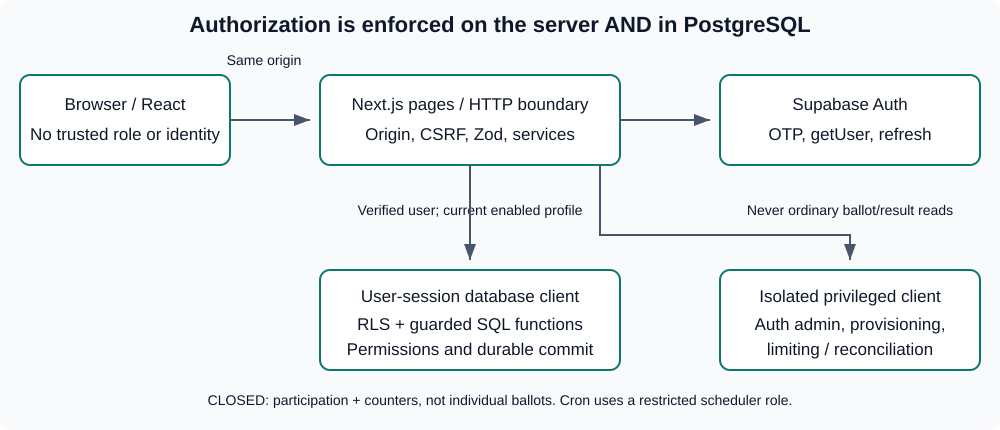

# Civic Pulse: technical guide for junior developers

Audience: a developer joining this codebase. Describes the current implementation; recheck the manifests and release evidence as the application evolves.

This guide explains the implemented code, not just the intended architecture. Read the [PRD](./PRD.md), [design system](./DESIGN_SYSTEM.md), [architecture](./ARCHITECTURE.md), [database contract](./DATABASE.md) and [API contract](./API.md) for authoritative requirements. The application is **not approved for production launch**; see the [launch audit](./LAUNCH_AUDIT.md).

Companion: [illustrated end-user guide](./USER_GUIDE.md). Printable/offline version: [technical guide HTML](./TECHNICAL_GUIDE.html). Open the HTML in a browser and use Print / Save as PDF.

## 1. What the application does

Civic Pulse serves one Resident Welfare Association (RWA). Residents (`voter` role) sign in with an emailed six-digit code and submit once for their frozen household entitlement. RWA Admins (`rwa-admin`) manage the register and votes; RWA ReadOnly committee observers (`rwa-readonly`) inspect authorized management data but cannot change it.

- **PUBLIC poll:** configured single-select or multi-select; one ballot and participation per household. Authorized completed results contain representative names, household identifiers and the final selected option set.
- **PRIVATE election:** one candidate or NOTA (None of the Above) for every office. Storage and results use aggregate counters, not retrievable individual ballots. NOTA is counted separately and never wins; the highest-count candidate is elected even if NOTA receives more votes.
- **Lifecycle:** Draft, Scheduled, Active, Completed or Cancelled. Type and status are different concepts.
- **Results:** private to entitled Residents and authorized RWA Admin/ReadOnly personas; CSV is required and PDF is implemented but can be disabled.
- **Operations:** audit history, bounded retention, encrypted backups/restore, health checks and maintenance mode.


Application-level PRIVATE privacy is not cryptographic anonymity. Privileged infrastructure operators, WAL/backups and very small electorates can allow inference. Never describe the system as secret from all operators.

## 2. Stack and boundaries

| Layer      | Implementation                                       | Why it matters                                                                                                                                        |
| ---------- | ---------------------------------------------------- | ----------------------------------------------------------------------------------------------------------------------------------------------------- |
| Runtime    | Node.js 24, npm, pinned lockfile                     | CI/hosting must use the supported Node major.                                                                                                         |
| Framework  | Next.js App Router 16, React 19, strict TypeScript   | Pages are usually server components; interactive forms use client components. Read the installed Next.js docs before applying old framework patterns. |
| UI         | Tailwind CSS, shared semantic tokens, Lucide icons   | Reuse components; do not introduce an alternate theme or UI framework.                                                                                |
| Validation | Zod request/response contracts                       | Types alone do not validate network input or database JSON.                                                                                           |
| Identity   | Supabase Auth email OTP and SSR cookie integration   | No custom password, OTP table or home-grown session store.                                                                                            |
| Database   | Supabase PostgreSQL 17, RLS, guarded functions, Cron | Database permissions remain effective when someone bypasses the web UI.                                                                               |
| Exports    | PDFKit/fontkit and CSV renderer                      | Generate private completed results on demand; no public stored reports.                                                                               |
| Tests      | Vitest, real PostgreSQL, Playwright, axe             | Different layers prove different things; mocks do not prove database permissions.                                                                     |



Key vocabulary:

| Term               | Meaning                                                                                                                                          |
| ------------------ | ------------------------------------------------------------------------------------------------------------------------------------------------ |
| Server component   | Runs on the server, can call server services directly, and must not send secrets to the browser.                                                 |
| Client component   | Uses browser state/events. Its checks help UX but are not authorization.                                                                         |
| RLS                | Row-level security: database policies restrict what a caller can read.                                                                           |
| RPC                | A database function called through Supabase; protected writes use these guarded routines.                                                        |
| `SECURITY DEFINER` | A function executes with its owner's privileges. It must independently validate the caller and pin a trusted search path.                        |
| Frozen electorate  | The households, representatives and historical names selected when a vote is activated. Later register edits do not transfer these entitlements. |
| Participation      | The fact that a frozen household submitted. For PRIVATE votes this is not a record of its selections.                                             |
| Acknowledgement    | The application says the transaction committed; it does not expose a PRIVATE selection receipt.                                                   |

## 3. First hour in the repository

1. Follow [LOCAL_SETUP.md](./LOCAL_SETUP.md) for the complete Windows setup and isolated Supabase test project. Never use production for development.
2. Inspect [package.json](../package.json), [.nvmrc](../.nvmrc), [.env.example](../.env.example), and [AGENTS.md](./AGENTS.md).
3. Put Node 24 on PATH. Use `npm ci` with the committed lockfile for a fresh checkout. The existing local guide also describes portable tools/corporate CA setup.
4. Supply your own ignored local environment configuration. Do not copy an actual developer's secrets or publish them in issues, screenshots or commits.
5. Start with `npm run dev`. Open the address reported by Next.js; ordinary local development uses port 3000.
6. Sign in with a deliberately provisioned test account. New installations require migrations, settings and a controlled first administrator; visiting the site does not create an admin.
7. Run `npm test`, `npm run typecheck` and `npm run lint`.
8. Trace one feature using section 5 before attempting changes.

Never disable certificate verification to solve corporate TLS problems. Configure the approved CA for the relevant tooling. Existing live-test helpers have a documented TLS-verification weakness; do not copy that pattern into new runtime/deployment code.

## 4. Folder and file map

The faithful Votes correction adds [vote-list-card.tsx](../src/components/votes/vote-list-card.tsx)
for rich server-rendered records and a compact scheduled row. The page uses exact
own-entitlement counts (explicit actor filtering through RLS, including admins)
and turnout narrowed from the existing result routine. It never uses mock totals
or forwards choices to the card. Status/type/history links retain pagination and
cancelled access. [vote-dashboard.test.ts](../tests/unit/vote-dashboard.test.ts)
checks scope, missing counts and aggregate-only projection; the existing live
capture exercises actual 02 active / 01 scheduled / 01 response and real 1-of-2
turnout in a disposable fixture. Those numbers are synthetic test outcomes, not
display constants. These screens are now grouped in the Resident persona folder;
recapture them from the application whenever this layout changes. No new
migration, endpoint or role-based voting entitlement
is introduced. Added summary/result reads must be included in hosting latency
and read-budget verification; they are not proof of the existing performance gate.

Appearance review additions: [theme constants/bootstrap](../src/shared/theme.ts),
[theme provider](../src/components/ui/theme-provider.tsx) and
[header switcher](../src/components/ui/theme-switcher.tsx) use a dedicated
`civic-pulse-theme` key containing only `light`, `dark` or `system`. System is the
default; invalid values are cleared before paint and blocked storage is handled
without losing page usability. `next-themes` owns media/preference/cross-tab
updates. The root alone suppresses the expected theme-attribute hydration mismatch;
other rendering errors must not be hidden. No ballot storage exception is added.

Sora/Manrope are self-hosted through Next's font loader. PDF fonts remain bundled
Inter/Noto. Semantic CSS tokens cover Platinum/Obsidian and all RWA accents, with
light print overrides. After user approval, the shared header, fields, notices,
tables/dialogs and resident/admin/public page surfaces now follow the same style;
top navigation and all functional contracts are retained. The [rollout test](../tests/e2e/visual-rollout.spec.ts)
uses real disposable fixtures and temporary redacted images across page families,
including native ballot review/submit and completed results. The current User
Guide is persona-first; screenshots are grouped under
`docs/images/user-guide/voter`, `rwa-admin` and `rwa-readonly`.
Capture only with `LIVE_AUTH=1` and `DOC_SCREENSHOTS=1` on the approved disposable
project. Use `PLAYWRIGHT_PRESERVE_GUIDE=1` when browser tests must not invoke the
guide-generation hook. To reuse an already-running local Next server instead of
starting a second server in the same checkout, set `PLAYWRIGHT_PORT` and
`PLAYWRIGHT_HOST` to its port and hostname. Regenerate this technical copy selectively with
`node --input-type=module -e "import {renderGuide} from './scripts/docs/render.mjs'; await renderGuide('TECHNICAL_GUIDE');"`.
[Unit tests](../tests/unit/theme.test.ts)
cover bootstrap/contrast; [browser tests](../tests/e2e/theme.spec.ts) cover actual
behavior. Focused persona captures use `--grep` with a named flow under the same
disposable-project/TLS/redaction safeguards. The old numbered pictures 68-74 are
archived; current captures are stored in the matching persona folders. Runtime
browser font requests never contact Google.

| Path                                                | Responsibility                                                                                                          |
| --------------------------------------------------- | ----------------------------------------------------------------------------------------------------------------------- |
| [src/app](../src/app)                               | Pages, layouts, loading/error boundaries and HTTP route handlers. Route-group parentheses do not appear in URLs.        |
| [src/components/ui](../src/components/ui)           | Buttons, fields, notices, dialogs, tables, pagination, badges and common layout.                                        |
| [src/components/ui/field.tsx](../src/components/ui/field.tsx) | Responsive inline form labels with adjacent click-to-open help and explicit errors. |
| [src/components/ui/select-menu.tsx](../src/components/ui/select-menu.tsx), [src/components/ui/field-classes.ts](../src/components/ui/field-classes.ts) | Shared keyboard-accessible dropdown with a menu constrained to its trigger width and common control sizing. |
| [src/components/admin/rwa-profile-form.tsx](../src/components/admin/rwa-profile-form.tsx) | Administrator RWA profile editor with six accent choices and responsive identity/identifier controls. |
| [src/components/admin/resident-identifier-filter.tsx](../src/components/admin/resident-identifier-filter.tsx) | Residents exact-identifier filter using the Settings label and all Default Households, with manual entry when the list is empty. |
| [supabase/migrations/20261105100000_add_amber_accent_palette.sql](../supabase/migrations/20261105100000_add_amber_accent_palette.sql) | Adds the Amber accent to the RWA settings constraint and guarded update validation. |
| [src/server/http/numbered-page.ts](../src/server/http/numbered-page.ts) | Validates generic numbered-page metadata and binds authorized anchors to existing list cursors; HTTP list APIs remain unchanged. |
| [supabase/migrations/20261114100000_numbered_pagination.sql](../supabase/migrations/20261114100000_numbered_pagination.sql) | Guarded filtered counts and bounded anchor lookup for the generic numbered UI list services. |
| [supabase/migrations/20261119100000_admin_vote_table_controls.sql](../supabase/migrations/20261119100000_admin_vote_table_controls.sql) | Committee-guarded Manage Votes sorting, filtering, exact totals and bounded page IDs; does not change the HTTP cursor API. |
| [supabase/migrations/20261120100000_admin_vote_turnout.sql](../supabase/migrations/20261120100000_admin_vote_turnout.sql) | Adds page-bounded aggregate turnout counts for Active/Completed Manage Votes rows; no choices or result totals. |
| [tests/integration/numbered-pagination.test.ts](../tests/integration/numbered-pagination.test.ts), [unit tests](../tests/unit/numbered-pagination.test.ts), [browser test](../tests/e2e/pagination-live.spec.ts) | Real SQL access/count/anchor/turnout checks, metadata/control validation and six-screen navigation/reflow coverage. |
| [src/components/admin](../src/components/admin)     | Account/household forms, draft editing, preview and lifecycle interaction.                                              |
| [src/components/admin/management-fields.tsx](../src/components/admin/management-fields.tsx) | Readonly committee presentation; management controls remain visible but disabled. |
| [src/components/admin/account-review-table.tsx](../src/components/admin/account-review-table.tsx) | Current-page multi-selection and separate account enablement/flat eligibility confirmations, administrator warning and per-record outcomes. |
| [src/components/admin/register-import-form.tsx](../src/components/admin/register-import-form.tsx) | Memory-only CSV upload/check, confirmed sequential import, progress/outcomes and account-review links. |
| [src/shared/contracts/register-import.ts](../src/shared/contracts/register-import.ts) | `csv-parse` parsing, 500-row/256-KiB bounds and strict import contracts. |
| [src/server/register/import.ts](../src/server/register/import.ts) | Retry-safe Auth orchestration and guarded import assignment; never enables accounts. |
| [src/app/admin/residents/page.tsx](../src/app/admin/residents/page.tsx) | Unified Residents directory: account/assignment review, role/status/source, identifier-contains and eligibility filters. |
| [src/app/admin/residents/new/page.tsx](../src/app/admin/residents/new/page.tsx), [details](../src/app/admin/residents/[id]/page.tsx) | Combined onboarding and resident maintenance. |
| [src/app/admin/residents/import/page.tsx](../src/app/admin/residents/import/page.tsx) | Protected CSV import reached from Residents. |
| [src/app/api/admin/households/import/route.ts](../src/app/api/admin/households/import/route.ts) | Per-row check/import endpoint with CSRF, current-admin checks and import budget. |
| [src/app/register/page.tsx](../src/app/register/page.tsx), [src/components/access/self-registration-form.tsx](../src/components/access/self-registration-form.tsx) | Public, `noindex` resident self-registration page and form with a hidden honeypot; picks from configured Default Households when any exist. |
| [src/components/ui/combobox-field.tsx](../src/components/ui/combobox-field.tsx) | Accessible type-to-filter combobox, strict options by default; partial/custom text is an explicit opt-in for directory search. |
| [src/components/admin/account-forms.tsx](../src/components/admin/account-forms.tsx) | Add Resident requires a household for voters (optional for management roles); its bordered form groups independent eligibility/enablement opt-ins in a wrapping horizontal row. Also owns the household assign/move section and profile editor. |
| [src/app/api/admin/accounts/[id]/household/route.ts](../src/app/api/admin/accounts/[id]/household/route.ts) | Assign or move an account's household (renaming keeps eligibility). |
| [src/components/admin/household-form.tsx](../src/components/admin/household-form.tsx) | Inline Save/Cancel eligibility editor in resident details with same-page refresh. Uses the existing guarded PATCH endpoint; account access and frozen electorates stay unchanged. |
| [src/app/api/register/route.ts](../src/app/api/register/route.ts), [src/server/register/self-registration.ts](../src/server/register/self-registration.ts) | CSRF-protected registration endpoint; budgets, Auth identity, service-role routine, cleanup and specific duplicate errors. |
| [src/app/api/admin/votes/[id]/schedule/route.ts](../src/app/api/admin/votes/[id]/schedule/route.ts) | Schedule a previewed draft and freeze it immediately. |
| [src/app/api/admin/votes/[id]/schedule/withdraw/route.ts](../src/app/api/admin/votes/[id]/schedule/withdraw/route.ts) | Confirmed, reasoned pre-opening return to draft. |
| [src/app/api/admin/votes/[id]/route.ts](../src/app/api/admin/votes/[id]/route.ts) | Revision-checked draft detail, editing and confirmed deletion; deletion is guarded and audited. |
| [src/components/admin/rwa-profile-form.tsx](../src/components/admin/rwa-profile-form.tsx) | Administrator form for RWA identity, contact, palette, welcome message and identifier wording. |
| [src/components/ui/rwa-branding.tsx](../src/components/ui/rwa-branding.tsx) | Plain-text signed-in footer contact block; welcome message appears only on the resident-facing Votes route (`/`), including for committee viewers, never on administration screens. |
| [src/components/ui/info-tip.tsx](../src/components/ui/info-tip.tsx) | Compact (i) disclosure that opens on mouse hover or click/tap and closes on Escape or an outside click; used for the NOTA rule. |
| [src/components/votes/nota-explanation.tsx](../src/components/votes/nota-explanation.tsx) | Shared NOTA rule text for the resident ballot and the administrator preview. |
| [src/components/votes/result-bars.tsx](../src/components/votes/result-bars.tsx) | Shared result rows ("Label 4/10 40%" above a bar) for options, candidates, NOTA and turnout. |
| [src/components/votes](../src/components/votes)     | Resident ballots, privacy notices, active deadline countdowns and results.                                               |
| [src/server](../src/server)                         | Server-only services. Do not import these into client components.                                                       |
| [src/server/settings](../src/server/settings) | Guarded RWA settings services and member-safe projections. |
| [src/server/settings/rwa-profile.ts](../src/server/settings/rwa-profile.ts) | Admin/ReadOnly full-profile reads, admin-only updates, enabled-member branding projection, service-role public identity read and server household wording. |
| [src/shared/contracts/household-terms.ts](../src/shared/contracts/household-terms.ts) | Household label and Number/ID identifier-kind contracts, suggestions, and `buildHouseholdTerms` (singular, plural, sentence-case and identifier wording). |
| [src/components/ui/household-terms.tsx](../src/components/ui/household-terms.tsx) | Client provider and `useHouseholdTerms()` hook; the app shell supplies the current terms. |
| [src/shared/contracts/rwa-profile.ts](../src/shared/contracts/rwa-profile.ts) | Strict RWA profile, member branding and public identity projections, palette list and telephone link helper. |
| [src/app/admin/settings/page.tsx](../src/app/admin/settings/page.tsx) | Protected Settings screen. |
| [src/app/api/admin/settings/route.ts](../src/app/api/admin/settings/route.ts) | CSRF-protected administrator profile update endpoint. |
| [src/shared](../src/shared)                         | Browser-safe contracts, validation, HTTP client, time formatting and countdown arithmetic.                              |
| [src/styles/globals.css](../src/styles/globals.css) | Shared Tailwind design tokens and global styling.                                                                       |
| [src/proxy.ts](../src/proxy.ts)                     | Page-request CSRF context, pre-render session refresh and maintenance page handling. Not the final authorization layer. |
| [src/instrumentation.ts](../src/instrumentation.ts) | Validate server environment on Node startup.                                                                            |
| [next.config.ts](../next.config.ts)                 | Security/cache headers, PDF dependencies and bundled-font tracing.                                                      |
| [supabase/migrations](../supabase/migrations)       | Ordered, immutable schema/guard/RLS/function migrations.                                                                |
| [scripts/ops](../scripts/ops)                       | Encrypted backup/restore, status, recovery-record and cleanup commands.                                                 |
| [scripts/ops/configuration.ts](../scripts/ops/configuration.ts) | Local operator-only, read-only RWA configuration and aggregate account/vote report. No public login bypass or resident/choice output. |
| [tests/unit/ops-configuration.test.ts](../tests/unit/ops-configuration.test.ts), [tests/integration/ops-configuration.test.ts](../tests/integration/ops-configuration.test.ts) | Report decisions, credential-safe errors, real PostgreSQL privacy/permissions/rollback and actual CLI exit behavior. |
| [tests](../tests)                                   | Unit, integration, live-service, browser and capacity suites.                                                           |
| [.github](../.github)                               | Validation, CodeQL and Dependabot configuration.                                                                        |
| [USER_GUIDE.md](./USER_GUIDE.md) | Active Resident (`voter`), RWA Admin (`rwa-admin`) and RWA ReadOnly (`rwa-readonly`) procedures; current captures are grouped by lowercase role code. |

Public launch additions are mapped in [Architecture](./ARCHITECTURE.md#public-discovery-and-contact-additions): server-rendered privacy/contact pages, a public metadata allowlist, robots/sitemap, an Open Graph image, escaped JSON-LD, breadcrumbs, opt-in public-only analytics and CSRF/rate-limited contact email. See [Deployment](./DEPLOYMENT.md#public-site-integrations) for provider settings and real delivery verification. Full document navigation between public information and authentication is intentional: an executed analytics script cannot be unloaded by simply removing a React component. Mocked delivery checks never prove inbox receipt.

The footer's **User Guide** link opens `/user-guide.html`, generated at
`public/user-guide.html` from the same Markdown and screenshots as the offline
edition. `npm run dev`/`npm run build` run the generator through lifecycle hooks.
The public edition disables repository-only links, contains no analytics/scripts,
uses a return-to-app anchor and defers screenshot loading. It is no-indexed and
not included in the sitemap. Do not publish the technical guide or serve arbitrary
repository files. A footer-only addition does not require screenshot recapture.

The selected F/**Open Conversation** favicon lives in
[src/app/icon.svg](../src/app/icon.svg). Next.js emits its metadata link for all
app pages. The web guide references the same asset; offline HTML does not depend
on an app server for its icon. The SVG preserves the selected teal conversation
bubble/check artwork at browser-tab sizes without a separate icon package.

Useful server entry points:

- [authorization/account.ts](../src/server/authorization/account.ts): verified identity, enabled profile and current role.
- [db/clients.ts](../src/server/db/clients.ts): separate user-session and privileged clients.
- [register/page-context.ts](../src/server/register/page-context.ts): page guards plus services' dependencies and CSRF token.
- [http/route.ts](../src/server/http/route.ts): consistent methods, support IDs, maintenance and safe errors.
- [http/request.ts](../src/server/http/request.ts): request-body, parameter and query parsing.
- [auth/dependencies.ts](../src/server/auth/dependencies.ts): Origin/CSRF guard and Auth dependencies.
- [auth/otp.ts](../src/server/auth/otp.ts): request code, verify and sign out.
- [votes/submission.ts](../src/server/votes/submission.ts): submission and participation status.
- [votes/member.ts](../src/server/votes/member.ts): entitled discovery/detail/results.
- [votes/lifecycle.ts](../src/server/votes/lifecycle.ts): activation/completion/cancellation, deadline changes and overdue reconciliation.
- [exports/results-export.ts](../src/server/exports/results-export.ts): complete private CSV/PDF response.
- [observability/logger.ts](../src/server/observability/logger.ts): allowlisted logs.

## 5. Trace a real feature: submit a ballot

Read these files in order:

1. [Vote page](../src/app/votes/[id]/page.tsx) obtains a guarded page context and authorized vote detail.
2. [BallotForm](../src/components/votes/ballot-form.tsx) renders choices and keeps unsent selections in component/page memory.
3. [Browser API helper](../src/shared/http/api-client.ts) sends a same-origin JSON request with a CSRF token and validates the response envelope.
4. [Submission route](../src/app/api/votes/[id]/submission/route.ts) checks Origin/CSRF, validates the ID/body and obtains an enabled member context.
5. [Submission service](../src/server/votes/submission.ts) enforces a profile budget and calls `cast_vote` using the member's own client.
6. [cast_vote migration](../supabase/migrations/20261024140000_cast_vote.sql) locks/rechecks/validates/writes atomically; [the PUBLIC multi-select migration](../supabase/migrations/20261027100000_open_multi_select.sql) adds selection-set replacement and dispatches single- versus multi-select submissions; [the NOTA migration](../supabase/migrations/20261028100000_nota_closed_elections.sql) names the built-in PRIVATE choice and changes its result projection; [the live PRIVATE turnout migration](../supabase/migrations/20261029100000_live_closed_turnout.sql) returns turnout without exposing office totals while the election is active.
7. [Identifier label migration](../supabase/migrations/20261030100000_configurable_identifier_label.sql) added the first RWA-wide display label; [the household label migration](../supabase/migrations/20261103110000_household_label_and_identifier_kind.sql) replaces it with a household label and a Number/ID identifier kind returned by the profile, branding and public identity routines. [The PUBLIC/PRIVATE migration](../supabase/migrations/20261103100000_public_private_voting.sql) renames the stored voting types.
8. [RWA profile migration](../supabase/migrations/20261031100000_rwa_profile_settings.sql) adds guarded profile settings with RWA Admin/ReadOnly reads and Admin-only updates, and [the branding migration](../supabase/migrations/20261101100000_rwa_branding_and_public_identity.sql) adds the accent palette, welcome message, the member branding projection and the service-role-only public identity routine. [The optional contact migration](../supabase/migrations/20261102100000_optional_rwa_contact_fields.sql) lets administrators leave the address, email and phone blank so they are hidden.
9. After commit the response is participation-only: `voteId` and `submitted: true`, wrapped in the common envelope.
10. A lost, malformed or unavailable acknowledgement triggers an own-participation check. The client must not blindly repeat a submission.

```text
Browser POST /api/votes/{id}/submission
  -> exact Origin + CSRF
  -> verified Auth identity + current enabled profile
  -> Zod/body/UUID validation and shared rate limit
  -> user-session RPC cast_vote
       -> lock vote, recheck entitlement/status/deadline
       -> insert unique participation
       -> PUBLIC: insert or replace the selected response set
          PRIVATE: increment one counter per office
       -> whole transaction commits, or all changes roll back
  -> safe acknowledgement (no PRIVATE selections)
```


The definitive deadline check uses the **database clock after locking**, not the browser clock, request arrival time or transaction-start time. A request waiting for a lock until the deadline is rejected. A transaction admitted before the deadline can commit afterward.

## 6. Authentication, sessions and authorization

### Sign-in flow

1. A controlled administrator provisions the email identity/profile, or the resident self-registers at `/register`. Supabase Auth public signup stays disabled: [self-registration](../src/server/register/self-registration.ts) uses the server's privileged Auth client, then the service-role routine `self_register_resident` creates a **suspended** profile (`self_registered = true`) and an **ineligible** household in one audited transaction. It checks the email first (any existing profile, `DUPLICATE_EMAIL`), then membership in the configured Default Households when any exist (`UNKNOWN_HOUSEHOLD`, also pre-checked before the Auth stage), then the normalized household (`DUPLICATE_IDENTIFIER`); budgets are per email, per household and global, with a honeypot field. An administrator must still enable the account and make the household eligible.
2. The code-request route normalizes/validates the email and returns generic guidance. It must not reveal whether an address is registered.
3. Supabase handles six-digit, expiring, single-use email codes. Production requires custom SMTP; test helpers can obtain codes through supported Auth administration without email.
4. Verification requires both a valid Auth session and a current enabled application profile.
5. The server-side SDK writes session cookies. [Shared cookie hardening](../src/server/auth/session-cookies.ts) applies HttpOnly, Secure in production, SameSite=Lax and a provisional 14-day sliding browser lifetime.
6. [Proxy session refresh](../src/server/auth/proxy-session.ts) refreshes before Server Component rendering and forwards new cookies to both browser and request. Server Components cannot themselves write cookies.
7. Protected APIs use `getUser` and current profile checks. Role comes from the database profile, not user-editable JWT metadata.
8. Sign out uses supported Auth behavior. Current application suspension/role checks remain essential because issued tokens are not universally revoked instantly.

CSRF context is a separate HttpOnly cookie; production uses a host-only Secure cookie and SameSite=Strict. The page exposes a derived token, not that secret context. Do not confuse CSRF and session cookies.

| Capability                      | Signed out | Resident (`voter`) | RWA ReadOnly (`rwa-readonly`) | RWA Admin (`rwa-admin`) |
| ------------------------------- | ---------- | --------------------------- | ---------------------- | ------------------- |
| Sign-in page/code flow          | Yes        | Yes                         | Yes                    | Yes                 |
| Member ballot                   | No         | Own frozen entitlement only | Own frozen entitlement | Own frozen entitlement |
| Administrative reads/downloads | No         | No                          | Authorized read scope  | Authorized read and write scope |
| Manage register/roles/drafts    | No         | No                          | No; controls disabled  | Yes                 |
| Active PUBLIC/PRIVATE projections | No       | Eligible voters: yes        | Authorized admin read scope; no active choices | Yes, no active choices |
| Individual PRIVATE selections  | No         | No                          | No                     | No                  |

The role flags are exclusive, only an administrator changes roles, and a
household is optional for both management roles — an enabled `rwa-admin` or
`rwa-readonly` without one reads its authorized scope but has no ballot, while an
ordinary resident needs a household before enablement. Neither management role
grants another household's ballot entitlement.

Suspended/deleted/unprovisioned identities do not gain access merely by holding a valid token. Management pages use a plain not-found for accounts without administrative read capability; mutation APIs require the current RWA Admin role. Inaccessible vote IDs are indistinguishable from nonexistent ones.

## 7. Database model and invariants

For the full column/key/cardinality diagram, see [the detailed Mermaid ERD in the database contract](./DATABASE.md#4-relationships-and-er-diagram). It shows Supabase Auth as an external identity and distinguishes PUBLIC response rows from PRIVATE aggregate counters.

Residents are reviewed in one table with their RLS-authorized flat assignment
and eligibility. The page defaults to the implicit `voter` role; selecting All Roles is explicit.

The register UI routes live only under `/admin/residents`. Former Accounts and
Households UI routes are removed and return 404, without redirects; navigation,
browser tests and screenshot workflows use Residents directly.
`listResidentTable` calls the enabled-committee-only `get_resident_table_page`
RPC from migration `20261115100000_resident_table_controls`. It returns only the
bounded ordered IDs and exact page/count metadata from one statement snapshot.
Allowlisted sorting and all filters run before pagination; the service validates
metadata and enriches only those IDs with profiles, households and supported Auth
identities, including current App Support flags. The older `listResidents` cursor
service remains compatible. Concurrent edits may move rows between requests.
Account API paths, filters and profile-ID ordering
and optional-household provisioning remain compatible; the stricter voter
requirement is in the admin form. Settings supplies allowed flat identifiers,
not assignments. Apply the new read-only routine before deploying this table
revision; the app does not migrate at startup. No voting permission is introduced.
Selections are current-page only and clear on sort/filter/page/size changes. The two
actions reuse the existing per-account/per-household PATCH endpoints, not a bulk
database write or new grant. Access and eligibility remain independent; admins
without flats can be enabled only through explicit inclusion and a warning.
Deleted/missing-assignment/already-satisfied rows are excluded as appropriate.
Every request rechecks permissions and commits separately. Uncertain failures stop
the batch; UI completion never rolls back earlier records or conceals an unknown
outcome. Existing mutation/provider limits apply; the actions need no new write routine.

The [table controls](../src/components/admin/resident-table-controls.tsx) replace
the separate Residents filter form with sortable/filterable column headings,
including the icon-only Source column immediately before Actions, and all controls in
**Sort & Filter** on phones. Source has no separate top filter; its ascending
order is Admin-registered then Self-registered, reversed for descending.
Migration `20261117100000_resident_source_sort.sql` adds the global `source`
sort key without changing the existing boolean source filter or API contracts.
Representative and identifier use literal case-insensitive substring matching;
names do not search Auth email. The page maps URL `identifier` to RPC
`identifierContains` after migration `20261116100000`; the old exact RPC filter
and cursor APIs remain compatible. Settings identifier suggestions accept partial
text via explicit `allowCustomValue` on the shared combobox; onboarding keeps its
strict default. Last Changed uses profile timestamps and inclusive/exclusive instant
bounds entered in the browser zone. Top-layer native popovers avoid table
clipping; their dropdown lists expand in flow within the scrollable panel.
Observers retain these controls outside management-disabled fields.
The **Clear filters** link removes active filter parameters and returns to page 1
while preserving the current sort, direction and page size.

CSV import checks every record without overwriting existing state, then applies
ready rows independently. Exact retries are skipped; conflicting identifiers,
names, roles, assignments or eligibility are reported. Auth provisioning and
database writes are not one transaction. Newly provisioned profiles remain
suspended; administrators use the existing confirmed account workflow to enable
them after review. Unknown/partial failures stop subsequent rows and require a
recheck, not blind account deletion. CSV records remain in page memory only.

Scheduling uses the same guarded freeze helper as immediate activation.
`opens_at` is the effective start and `scheduled_at` is the confirmation/freeze
time; `activated_at` stores the effective start even while scheduled. Ballot,
electorate and representative snapshots freeze now, not at opening. RLS and the
member projection hide candidates/options before opening. Database-time
reconciliation under the vote lock opens due votes, and a missed whole window
completes at the original deadline. Strictly before opening, a confirmed reasoned
withdrawal clears snapshots and zero counters, advances the revision, and requires
new preview. It never reopens an active or terminal vote. See the architecture
implementation map and API/schema sections for exact paths/contracts.

| Entity                   | Relationship and purpose                                                                               |
| ------------------------ | ------------------------------------------------------------------------------------------------------ |
| `auth.users`             | Managed Supabase identity; email/verification/session state is not duplicated in application profiles. |
| `profiles`               | Stable Auth user ID, representative name, enabled/suspended/deleted status and mutually exclusive `rwa-admin`/`rwa-readonly` flags.             |
| `households`             | Unique normalized label and one current representative; controls future eligibility selection.         |
| `rwa_settings` | Singleton RWA identity/contact profile, household label, identifier kind, timezone, actual A1-A7 approvals and approved retention periods. |
| `votes`                  | Type, PUBLIC selection mode/limit, status, revision, deadline, terminal reasons and frozen display metadata. |
| `offices` / `candidates` | PRIVATE ballot structure with parent ownership and ordered positions.                                   |
| `poll_options`           | PUBLIC ballot choices.                                                                                   |
| `electorate`             | One frozen entitlement per vote/household, frozen representative and historical labels.                |
| `participation`          | One accepted submission per entitlement. No PRIVATE choices.                                            |
| `open_responses`         | Attributable selected-option rows. Published only through authorized completed results.                |
| `closed_tallies`         | Candidate/NOTA counters per office. No per-voter PRIVATE record.                                         |
| `audit_events`           | Administrative actor/action/record/time/reason, not payloads or OTPs.                                  |
| `rate_limit_buckets`     | Shared atomic limiter state with HMAC-derived subjects rather than raw emails.                         |

```text
auth.users -- profiles -- households
                  \          \
                   \       electorate -- votes -- offices -- candidates
                    \          |            \-- poll_options
                     historical representative
                               |
                         participation
                         /           \
                PUBLIC response    PRIVATE aggregate counters*

* Diagram shows the atomic workflow, NOT a stored per-person link
  from participation to a particular PRIVATE choice.
```

Critical constraints:

- Unique participation and whole-transaction rollback prevent duplicate/partial ballots.
- Frozen content and representatives cannot be edited after activation; an active deadline moves only through the audited deadline change.
- Candidate IDs must belong to the submitted office/vote.
- For each completed PRIVATE office, candidate counts plus NOTA equal submitted ballots.
- Every PUBLIC participation has at least one selected option and obeys its configured cap. Multi-select option counts can exceed participation. Invariant failure withholds results rather than fabricating a fix.
- Terminal votes cannot reopen. Accepted submissions cannot be edited, deleted manually or withdrawn.
- Counts/audit bigints use decimal strings across API boundaries to avoid unsafe JavaScript coercion.
- Current suspension blocks access without erasing accepted participation or changing the frozen turnout denominator.

### Permissions

All application tables have RLS and restricted grants. Ordinary users/admins cannot directly read choice tables or write application tables. Guarded functions independently check identity and capability. Restricted non-login owners have fixed search paths; private data is not published to Realtime.

The privileged client bypasses RLS: use it only in the established provisioning/Auth administration, limiter and narrowly scoped reconciliation paths. Do not use it for ordinary ballot/result access.

### Migration map

| Migration suffix                     | Responsibility                                                       |
| ------------------------------------ | -------------------------------------------------------------------- |
| `100000_core_schema`                 | Owners, tables, keys, constraints and indexes.                       |
| `100100_guards_and_helpers`          | Identity/visibility, lifecycle guards and invariants.                |
| `100200_rls_and_grants`              | Policies, safe column access and restricted execution.               |
| `100300_audit_settings_provisioning` | Audit, deployment settings/admin bootstrap and profile provisioning. |
| `100400_rate_limiting`               | Atomic supplemental application limiter.                             |
| `110000_register_administration`     | Household/account routines and last-admin guard.                     |
| `120000_vote_drafts`                 | Draft revision/ballot/electorate/preview routines.                   |
| `130000_activation_lifecycle`        | Freeze, lifecycle and restricted due-completion scheduling.          |
| `130100_deferred_trigger_definer`    | Consistent deferred-trigger execution semantics.                     |
| `140000_cast_vote`                   | Atomic submission and participation-status routine.                  |
| `150000_member_votes_results`        | Authorized discovery, results, participation and audit projections.  |
| `160000_retention_maintenance`       | Bounded retention, readiness/status and maintenance scheduling.      |
| `261000_open_poll_live_results_and_changes` | Active PUBLIC aggregates and guarded response replacement. |
| `271000_open_multi_select`           | PUBLIC selection configuration, multi-option storage, grouped named results. |
| `281000_nota_closed_elections`       | Built-in NOTA choice and PRIVATE results projection. |
| `291000_live_closed_turnout`         | Aggregate turnout during active PRIVATE elections. |
| `301000_configurable_identifier_label` | RWA-wide configurable display label for identifier values. |
| `311000_rwa_profile_settings` | Admin/ReadOnly profile reads and Admin-only RWA profile updates through an audited RPC. |
| `1101000_rwa_branding_and_public_identity` | Accent palette, welcome message, member branding projection and service-role-only public identity. |
| `20261102100000_optional_rwa_contact_fields` | Optional (blank, hidden) RWA address, email and phone. |
| `20261103100000_public_private_voting` | Renames stored voting types OPEN/CLOSED to PUBLIC/PRIVATE in data, checks and routines. |
| `20261103110000_household_label_and_identifier_kind` | Household label and Number/ID identifier kind replace the identifier label. |
| `20261104100000_rwa_default_lists` | Admin-managed Default Households and RWA Positions suggestions; full settings reads are available to Admin/ReadOnly. |
| `20261105100000_change_vote_deadline` | Audited `change_vote_deadline` routine; the vote guard lets only it move an active vote's deadline. |
| `20261106100000_register_import` | Current-admin import checks and retry-safe household assignment without enabling accounts. |
| `20261107100000_scheduled_opening` | Frozen scheduled state, database-clock opening, direct-read ballot privacy and pre-opening withdrawal. |
| `20261108100000_readonly_committee_role` | Exclusive observer role, admin-equivalent reads, admin-only mutations/role changes and household-enabled voting. |
| `20261109100000_resident_self_registration` | `profiles.self_registered`, `PROFILE_SELF_REGISTERED` audit action, service-role-only `get_self_registration_households` and `self_register_resident` (suspended profile + ineligible household, limited to configured Default Households when set). |
| `20261110100000_account_with_household` | Service-role-only `provision_profile_with_household`: administrator-created suspended profile plus household in one audited transaction. |
| `20261111100000_resident_directory` | Existing security-invoker view now supplies filtered, flat/name-ordered Residents IDs; current profile/assignment enrichment remains RLS-scoped. |

Use the exact ordered filenames in [migrations](../supabase/migrations); do not rewrite an applied migration. New changes require a new versioned migration and fresh/upgrade tests. Never run migrations at application startup or use a reset on an existing real database.

## 8. Lifecycle and register workflows


Drafts can be incomplete. Every edit increments `draftRevision`; an update includes the expected revision. A stale edit receives a conflict rather than overwriting someone else's work. Preview identifies its version, and activation must confirm that same version.

Activation checks ballot validity, current selected representatives, future deadline, approvals and retention configuration. It freezes the electorate, historical identity/display data and ballot. Editing a household later affects future votes only. While the vote is Active an administrator may move only its deadline (later or earlier, at least 5 minutes ahead, with an audited reason) through `change_vote_deadline`.

Supabase Cron completes due votes and runs bounded retention. The scheduling role has narrow function grants. Scheduled completion records the deadline as effective completion time even if processing is late. Authorized reads may reconcile an overdue vote, but the transactional deadline remains authoritative.

Register changes span Auth and application records; they are not one distributed transaction:

- Create a profile suspended; ordinary residents need a household before enabling.
- Email changes preflight identity ownership, block access and verify Auth consistency before restoring prior access.
- Provider failures surface partial-workflow errors. Do not silently enable an inconsistent account.
- Repeated suspension/deletion status can retry an incomplete Auth ban. A deleted profile is not restored or edited.
- At least one enabled administrator must remain.


## 9. Pages and HTTP entry points

| URL                                  | Main use                                                                                  |
| ------------------------------------ | ----------------------------------------------------------------------------------------- |
| `/sign-in`                           | Registered email, code verification, resend and recovery.                                 |
| `/`                                  | Member's entitled votes, filters and own participation. Admins also see management links. |
| `/votes/{id}`                        | Authorized ballot, submitted state or terminal context.                                   |
| `/votes/{id}/results`                | Completed totals, authorized named PUBLIC responses and downloads.                          |
| `/admin/residents`, `/new`, `/{id}` | Unified directory, combined provisioning, details, role/access and assignment changes. |
| `/admin/residents/import`, `/households/{id}` | CSV import and future-vote eligibility editor. |
| Former `/admin/accounts`, `/admin/households` UI trees | Removed; return 404 without redirects. Use Residents instead. |
| `/admin/votes`, `/new`, `/{id}`      | Draft creation/editing or frozen lifecycle detail.                                        |
| `/admin/votes/{id}/preview`          | Version-bound preview/readiness and activation.                                           |
| `/admin/votes/{id}/participation`    | Participation monitor with no choices.                                                    |
| `/admin/audit`                       | Administrative history.                                                                   |

HTTP groups mirror the same services:

- `/api/auth/code`, `/verify`, `/sign-out`.
- `/api/votes`, `/api/votes/{id}`, `/{id}/participation`, `/{id}/submission`, `/{id}/results`, `/{id}/exports/{format}`.
- `/api/admin/accounts` and `/api/admin/households`, plus record IDs.
- `/api/admin/votes`, record IDs, `/preview`, `/activate`, `/complete`, `/cancel`, `/deadline`, `/participation`.
- `/api/admin/audit`.
- `/api/internal/health`.

Read [API.md](./API.md) for exact methods and schemas. Pages call services directly; do not have a Server Component HTTP-fetch the application's own API.

### Errors and pagination

```json
{
  "error": {
    "code": "VALIDATION_FAILED",
    "message": "Check the fields.",
    "fieldErrors": []
  },
  "requestId": "random-support-identifier"
}
```

Success envelopes use `data`, errors use `error`; paginated responses include `page`. HTTP `204` has no JSON body. Error bodies never contain provider internals, tokens or submitted choices.

| Status | Typical meaning                                                                          |
| ------ | ---------------------------------------------------------------------------------------- |
| 401    | No verified session.                                                                     |
| 403    | Denied capability, blocked account or failed browser mutation protection.                |
| 404    | Missing/inaccessible object or unsupported authorized format.                            |
| 409    | Duplicate, stale revision, lifecycle conflict or vote no longer open.                    |
| 422    | Invalid fields, IDs or filters.                                                          |
| 429    | Budget exceeded; follow retry guidance.                                                  |
| 503    | Dependency/export/partial provisioning unavailable; do not assume a ballot was rejected. |

The browser helper converts malformed envelopes to `INVALID_RESPONSE` rather than throwing through a form. Endpoint success payloads still need their own contracts; the generic helper does not deeply validate every `data` shape.

Lists use bounded keyset cursors tied to endpoint/filters. Never invent offsets, assume the first page contains all records, or accept cursor content as authorization.

## 10. Results, exports and UI conventions

The database result projection is validated and transformed in [shared result contracts](../src/shared/contracts/results.ts). Screen, CSV and PDF derive from it, not separate counting implementations.

- Frozen eligible households are the turnout denominator.
- Per-office `percent` uses submitted ballots and `eligiblePercent` uses eligible households (shown in the bars); zero denominators are not applicable.
- Zero ballots or zero candidate votes have no winner. Positive tied candidate leaders remain ties. NOTA is not a candidate and cannot win.
- Verify the NOTA winner rule against bylaws, along with the early-completion rule, before real voting.
- PUBLIC names/households are frozen snapshots, with no email in exports.
- PRIVATE exports contain aggregate data only.
- Rendering completes before success headers. A render error returns a clean failure, not a partially successful document.
- Current process-local render slots: eight CSV, two PDF, bounded wait. These are not a global cross-instance queue.
- PDF fonts are bundled and traced for deployment; unsupported text is explicitly refused, with CSV guidance.

Use [UI primitives](../src/components/ui) for status, validation, focus, dialogs and accessible fields. Preserve 48px touch targets, 16px input text, semantic tokens, visible focus and native radios. A button's disabled state is not authorization.
The shared content token in [global styles](../src/styles/globals.css) has no
maximum width: pages, headers and footers fill the viewport minus 16px phone or
24px desktop gutters. Form/ballot and short-copy blocks retain their independent
640px bounds; table regions contain any horizontal overflow.
Shared page-header descriptions are an exception to the short-copy limit: they
fill the available space beside actions and wrap responsively.
Form-focused route wrappers center the title/description/form controls at 640px,
not each field individually: resident new/detail/eligibility/import,
Settings, vote new/detail/preview and the voter ballot. Access/register/contact/privacy
were already centered. `data-form-page` marks the adjusted wrappers for browser
regressions. Directory, audit, participation and results keep their wider
workspaces; after Check Register, import preview/results use a separate
full-content-width shared table, with stacked label/value rows on phones. Global
breadcrumbs/header/footer remain full-width.
Standalone forms and lifecycle/support/import action panels use the shared
`form-panel` utility: theme border, 8px radius, surface and 16px/24px responsive
padding. Assignment sections provide the frame for their nested form;
popover/modal forms retain their existing outer frame. Manage Resident places
the Status heading and badges in one wrapping row, above account actions.

All confirmation popups use [ConfirmDialog](../src/components/ui/dialog.tsx):
fixed viewport centring on mobile and desktop, bounded width, phone gutters and
internal scrolling above 90dvh. Keep native modal focus/Escape behavior. This
does not centre dropdowns or autocomplete lists, which remain by their controls.

The shared [Pagination](../src/components/ui/pagination.tsx) renders filtered
`Page X of Y · N results`, accessible icon-only First/Previous/Next/Last,
and a GET page-size form (10/25/50/100) with a custom width-constrained
dropdown. The shared client component navigates immediately on selection,
preserving filters and omitting the previous page; there is no apply button or
separate record-range line.
Votes, Residents, Manage Votes, Audit History, participation
and completed PUBLIC named responses request validated numbered metadata.
Residents and Manage Votes use specialized table-page routines for globally
filtered ordered IDs. Manage Votes additionally returns only aggregate
submitted/eligible counts for Active and Completed rows, using the frozen
electorate denominator; its HTTP cursor projection remains unchanged. Audit
uses `get_audit_list_page` when its text filters are
active; the generic list service uses `get_list_page` for bounded cursor anchors.
Counts and IDs/anchors remain caller-authorized. HTTP cursor envelopes and export
semantics are unchanged. UI `page` values beyond the end clamp to the last page; empty
sets show page 1 of 1. Filters/size changes restart at page 1; Residents remounts
its page-scoped selection state on page/size changes. Missing count metadata
fails explicitly, never produces a guessed total. Table regions are labelled
and keyboard-focusable to contain overflow when larger pages include wider data.
See [pagination contracts](./API.md#22-pagination-and-filtering) for concurrency
and access details.

Current export controls are ordinary download links: generation progress, in-progress deduplication and inline recoverable errors remain an acknowledged UX gap. Do not document those missing behaviors as implemented.

## 11. Environment, deployment and operations

Read [environment validation](../src/server/config/environment.ts), [.env.example](../.env.example) and the [deployment guide](./DEPLOYMENT.md).

Staging uses Vercel's **Production target only** at
<https://arp-civic-pulse-staging.vercel.app>, with Production-scoped variables and
the disposable Supabase database. Preview deployments are disabled in the hosted
project; [vercel.json](../vercel.json) also restricts automatic Git deployments to
`main`. `APP_ORIGIN` and Supabase's Site URL match that exact staging origin.
Changing deployment/protection settings does not update the origin automatically;
an origin change requires redeployment. Real production needs separate Vercel
and non-disposable Supabase projects, not promotion of this staging database.

| Configuration                                                               | Location                                                      |
| --------------------------------------------------------------------------- | ------------------------------------------------------------- |
| Canonical origin, public Supabase URL/key, server Auth credential, HMAC key | Hosting environment/secret manager; isolated per environment. |
| SMTP credentials, code template/expiry/limits, Auth URLs                    | Supabase/provider configuration.                              |
| Contact-only Resend key, sender and recipient | Server-only hosting settings: `RESEND_API_KEY`, `CONTACT_EMAIL_FROM`, `CONTACT_EMAIL_TO`; all required together when enabled. |
| Optional developer/support contact for App Support Access | Server-only `APP_SUPPORT_EMAIL`; grants nothing until an RWA Admin turns access on. |
| Optional public analytics and Google verification | `GOOGLE_ANALYTICS_ID`, `GOOGLE_SITE_VERIFICATION`; public identifiers configured at build/runtime. GA4 requires consent and disabled Enhanced Measurement. |
| RWA timezone, policy approvals, retention                                   | Controlled database settings/procedures.                      |
| Migration credentials                                                       | Deployment runner only, not ordinary app runtime.             |
| Backup database URL/encryption key/destination                              | Approved isolated operations runner and secret store.         |

`npm run deploy:check` validates injected production configuration without loading local environment files. It does not prove provider identity, key correctness, SMTP, approval or IP limiting. `next build`/startup independently validate relevant configuration. Public build values and CSP settings require rebuilding for the target environment.

Security headers, exact Origin/CSRF, private/no-store responses and Secure production cookies are already configured. Avoid wildcard credential CORS. `TRUSTED_PROXY_CONFIG` is reserved: the missing trusted-IP enforcement remains a release blocker.

`MAINTENANCE_MODE=1` returns 503 on pages/data APIs and unavailable health. Health aborts its database HTTP probe at three seconds and clears its timeout; it is readiness, not proof of SMTP/backups or an invitation to keep a free project awake.

Operational commands are in [OPERATIONS.md](./OPERATIONS.md). Backup sets encrypt application/Auth/counts data with AES-GCM and validate manifest filenames/hashes. Keep encryption keys separately. A consistent restore can still omit acknowledged votes: completeness needs independent evidence. Never restore an old database simply to undo a code deployment.

Logs accept only bounded allowlisted metadata. Do not add request bodies, raw provider errors, emails, cookies, codes, SQL bind values or PRIVATE selections. Provider/APM payload capture must also be disabled in the actual deployment.

## 12. Tests: what to run and what they prove

| Command                                 | Proves / prerequisites                                                                                                                                       |
| --------------------------------------- | ------------------------------------------------------------------------------------------------------------------------------------------------------------ |
| `npm test`                              | Unit contracts, services, response handling and ops guards. Does not prove real RLS.                                                                         |
| `npm run typecheck`                     | Strict TypeScript. Not runtime validation.                                                                                                                   |
| `npm run lint` / `npm run format:check` | Static quality and repository formatting.                                                                                                                    |
| `npm run test:integration`              | Real PostgreSQL 17 migrations, RLS/grants, guards, races, deadlines, retention and restore. Requires a disposable server; suites create/drop test databases. |
| `npm run test:live`                     | Real Auth/Data API behavior against the disposable configured Supabase project. Creates synthetic records.                                                   |
| `npm run test:e2e`                      | Playwright browser journeys/axe. Live specs need `LIVE_AUTH=1` and isolated test credentials.                                                                |
| `npm run test:load`                     | 500-household/100-task local database contention and rendering bounds. Not production HTTP/email capacity.                                                   |
| `npm run build`                         | Production compilation with valid configuration. Not deployment or launch approval.                                                                          |
| `npm audit`                             | Currently disclosed dependency advisories, not absence of all vulnerabilities.                                                                               |

The validation workflow uses a disposable PostgreSQL 17 service, synthetic build values and signed-out browser tests without production secrets. Restore/hosted workflows remain separate. CodeQL advanced workflow and Dependabot are configured; do not enable a competing CodeQL default setup at the same time.

Before these guides, the current baseline was 355 unit tests and 225 integration tests, with selected live browser/capacity evidence. Counts change over time: report your own actual results rather than quoting this number as certification.

The 26 October 2026 launch-change run recorded 374 passing unit tests and 21
configured Chromium foundation/public checks. The database-health case returned
503 and was excluded from that final browser run; live authenticated checks were
not rerun. Provider traffic was synthetic/intercepted, not real delivery or Google
verification. See the [dated audit](./LAUNCH_AUDIT.md#public-site-checklist-26-october-2026)
instead of treating earlier counts as a current certification. Future changes
must follow the documentation-sync checklist in [root instructions](../AGENTS.md#keep-documentation-in-sync).

### Inspect configuration without an app login

Run `npm run ops -- config-check` on an approved operator workstation with
`CONFIG_DATABASE_URL` supplied through the secret store or ignored local
environment. This needs unfiltered database-owner/operator reads and existing
helper/status execution permissions, not an RWA Admin JWT. The Node command uses
`--conditions=react-server` to reuse the existing server environment validator.
It performs only a bounded repeatable-read/read-only transaction and rolls back;
it never invokes lifecycle reconciliation or creates a web entry.

The JSON report summarizes RWA display settings, optional contact presence,
list counts, retention/approval completeness, aggregate accounts/register
readiness, vote/draft blocker counts and count-only operational health. It omits
resident details, identifier lists, vote IDs/titles, choices and credentials.
Blank optional contacts and unfinished drafts do not automatically fail setup.
Exit `0` means no automated failure, not production readiness; warnings and
external approval/delivery/hosting/Cron/backup/recovery gates still need review.
The injected environment may differ from the actual deployment, and account
counts do not establish active usage. See the [complete operator procedure](./OPERATIONS.md#read-only-rwa-configuration-inspection).
No app roles, RLS/grants, provider settings, screenshots or end-user workflows
change.

### App Support Access (RWA-controlled read-only help)

For live in-app help, an enabled RWA Admin can turn **App Support Access** on or
off from Settings. Setting the server-only `APP_SUPPORT_EMAIL` only makes the
toggle available; it grants nothing by itself. When on, the guarded
`set_app_support_access` routine creates (or re-enables) a single household-free,
read-only `rwa-readonly` profile (`profiles.is_app_support`) for that address, so
the developer signs in through the normal email OTP flow and sees the committee
read scope but has no electorate row and cannot vote. A check constraint keeps the
profile read-only, triggers block ordinary edits (`APP_SUPPORT_MANAGED`) and any
household assignment (`APP_SUPPORT_ACCOUNT`), and both toggles are audited
(`APP_SUPPORT_ACCESS_ENABLED`/`APP_SUPPORT_ACCESS_DISABLED`). The service layer
(`src/server/settings/app-support.ts`) orders Auth and database steps fail-safe
(unban before enable, suspend before ban). This is consented, revocable support
access, never a hidden login or standing default administrator.

### Rebuild these illustrated documents

The [capture spec](../scripts/docs/capture.spec.ts) is outside the ordinary e2e directory and is explicitly opt-in:

```powershell
# On a network with TLS inspection, let Node trust the system store first (see LOCAL_SETUP troubleshooting).
$env:NODE_USE_SYSTEM_CA = "1"
# Download the database CA through the provider's SSL settings; this is a certificate, not a key.
$env:PGSSLROOTCERT = "C:\approved-certificates\prod-ca-2021.crt"
$env:LIVE_AUTH = "1"
$env:DOC_SCREENSHOTS = "1"
npx playwright test -c playwright.docs.config.ts
# Or refresh only the new import/scheduling workflow and its affected existing images:
npx playwright test -c playwright.docs.config.ts --grep "bulk import and scheduled opening"
# Or refresh the Accounts table and its five bulk-review pictures:
npx playwright test -c playwright.docs.config.ts --grep "bulk account review"
# Or refresh the self-registration and one-step onboarding pictures (77-84):
npx playwright test -c playwright.docs.config.ts --grep "self-registration and one-step"
node scripts\docs\render.mjs
```

Before capturing, confirm the disposable target, review pending migrations with `--dry-run`, and obtain authorization before applying any. On CLIs supporting it, use `--skip-vault` to limit the push to reviewed SQL rather than unrelated vault configuration. Run the relevant live checks separately and make sure no other `next dev` server is running in this folder: Playwright starts its own on port 3100 and Next allows one per folder. Every migration that uses `SET LOCAL ROLE cp_owner` must `RESET ROLE` before returning, so the CLI can record its history entry as the deployment role; the two follow-up migrations were corrected before their first successful hosted application.

The shared browser-fixture SQL helper uses `scripts/ops/database.ts`: verified
TLS and hostname checks, with `PGSSLROOTCERT` for the provider CA. The Windows
system store alone does not include the Supabase database CA. Use the provider's
[SSL guidance](https://supabase.com/docs/guides/platform/ssl-enforcement), not
`rejectUnauthorized: false`. Other older test helpers have their own outstanding
TLS audit findings; this change does not claim to fix them all.

The capture spec contains seven synthetic flows for appearance, bulk review,
import/scheduling, voting, role assignment, observer access and
self-registration/one-step onboarding. The active guide
uses 120 persona PNGs: 36 Resident, 56 RWA Admin and 28 RWA ReadOnly captures,
plus three workflow diagrams. The onboarding flow temporarily sets a run-unique
Default Households list to show the flat pickers and restores the previous RWA
profile afterwards. Dialog-only captures apply redaction masks only inside the
dialog. Four mobile Admin/ReadOnly captures are excluded
because the guide targets laptop layouts for those personas. The corresponding role codes are
`voter`, `rwa-admin` and `rwa-readonly`.
The observer sequence covers
every management read destination, disabled mutation controls, its own PUBLIC
and PRIVATE ballots, external completed results and a CSV download. Role
assignment captures show the household prerequisite and an atomic switch to
`rwa-admin`. All captures are redacted; fixture RWA settings are restored, and
remaining active/scheduled examples are cancelled/withdrawn during cleanup.
These are synthetic browser fixtures, not a 500-row capacity test, SMTP delivery
test, manual accessibility acceptance or proof of actual scheduled Cron
execution.

Use only the approved disposable fixture project. Capturing creates synthetic Auth users, profiles, households, votes, participation and fixture policy/retention data; never run it against production. It reuses existing fixture helpers. Before capturing, it sets a synthetic RWA profile (Lakeview names, example address and phone, a blank email and website so the pictures show empty optional fields hidden, Teal palette, a welcome message, the **Flat** household label and the **Number** identifier label) and restores the previous profile afterwards; each change is audited as `RWA_PROFILE_UPDATED`. It also creates a PRIVATE election with NOTA and a multi-select PUBLIC poll for the live-turnout and live-results pictures. The illustrated flats use realistic synthetic numbers (**H-513** for the example resident and **H-514** for the added flat, or another unused realistic number when those already exist); other fixture households get random numbers in the same style. The illustrated active vote also has its deadline extended by two days with a synthetic reason, so the audit trail shows a `VOTE_DEADLINE_CHANGED` event. Email/code fields that hold a value and email text are masked (an intentionally blank field stays visibly blank), trace/video are off, and screenshots are stored in the documentation image folder. The code-error response and connection failures are deliberately simulated; the rest of the principal voting/administration flows use the real test application and database. The capture does not prove SMTP delivery.

The renderer supports the deliberately small Markdown subset used by these two guides and embeds local images in the printable HTML. It fails on missing local linked files/images. Regenerate both HTML files whenever changing Markdown or screenshots. Do not hand-edit the generated HTML.

## 13. A safe workflow for your first code change

1. Identify the exact requirement and relevant page/API/service/SQL contract.
2. Read nearby tests and reuse established components/helpers before adding new logic.
3. Write a focused regression or acceptance test. Reproduce the old failure when possible.
4. Change shared validation first when input/output shapes change; update related server/database/UI surfaces together.
5. Add a new migration if persistence/permissions need changing. Test fresh schema and upgrade/data preservation, not just an empty mock.
6. Preserve privacy and atomicity. Never fix a display problem by altering counters manually or weakening an RLS policy.
7. Exercise loading/empty/success/error paths and the relevant viewport/keyboard flow.
8. Run focused tests, types and lint, then expand to the affected integration/browser/build checks.
9. Update directly related documentation. Report actual evidence and remaining limits.
10. Have a reviewer inspect permissions, historical data compatibility, rollback and production risk.

Example: adding a required draft field involves its shared Zod schema, editor, draft service/RPC, database constraints and preview/activation readiness, result/export snapshot if historically relevant, tests and contract docs. Changing only a text input is incomplete.

## 14. Debugging without leaking data

| Symptom                      | Start here                                                                | Do not do this                                                   |
| ---------------------------- | ------------------------------------------------------------------------- | ---------------------------------------------------------------- |
| Signed out unexpectedly      | Proxy refresh, cookie attributes, Auth outcome and current profile.       | Print session cookies/tokens into console or chat.               |
| Resident cannot see a vote   | Frozen electorate, current enabled status, correct project and lifecycle. | Use service-role reads to bypass the restriction.                |
| Draft conflict               | Revision in editor/preview and another admin's edit.                      | Retry an overwrite with an invented latest revision.             |
| Submission appears uncertain | Own participation check and support ID.                                   | Blindly resubmit or reconstruct PRIVATE selections from counters. |
| Results unavailable          | Completion gate and invariants; operations escalation.                    | Repair totals by hand or publish a best-effort approximation.    |
| Export fails                 | Authorization, completion, capacity, supported fonts and safe error code. | Return truncated bytes with HTTP 200.                            |
| DB tests skipped             | Confirm disposable `INTEGRATION_DATABASE_URL` is configured.              | Claim skipped tests passed.                                      |
| Build accepts placeholders   | Preflight checks shape, not actual provider connectivity.                 | Treat a successful synthetic build as a live deployment.         |

## 15. Known limitations and next reading

Read the [launch audit](./LAUNCH_AUDIT.md) before any release. The unresolved items include trusted-IP abuse protection, real SMTP/capacity, provider/region approvals, credential hygiene, production deployment verification, real off-site recovery, real-device/manual accessibility acceptance, the export UX gap, remote test-helper TLS verification and stale local HTTP-load instructions.

The existing instructions that imply the repository is documentation-only are stale; actual code/manifests are present. Do not infer working behavior from either old prose or this guide without running the relevant checks.

Suggested reading order after this guide: [user guide](./USER_GUIDE.md), [API](./API.md), [database](./DATABASE.md), [operations](./OPERATIONS.md), [deployment](./DEPLOYMENT.md), [launch audit](./LAUNCH_AUDIT.md).
