# Civic Pulse - User Guide

This guide is organized around what each signed-in persona can do. Choose your role below and go directly to that section. The screenshots use synthetic accounts and voting data; email addresses and codes are masked. Production use remains subject to the open approvals and checks in the [launch audit](./LAUNCH_AUDIT.md) and [pilot readiness register](./PILOT_READINESS.md).

**Management navigation:** **Residents** combines accounts and flats in one tab.
Use **Add Resident** to create the account and assign its flat together; Settings
still owns the allowed flat list. Older illustrations outside the Residents
workflow may show the former Accounts/Households navigation; follow the written steps.

Open **User Guide** in the application footer to read the self-contained public edition without signing in. The repository copy is [USER_GUIDE.html](./USER_GUIDE.html).

## Choose Your Persona

| Persona | Role code | You can | You cannot |
| --- | --- | --- | --- |
| Resident | `voter` | See votes frozen for your household, cast its ballot, review its own participation, and access results allowed to that household. | See management pages, another household's ballot access, active individual choices, or PRIVATE selections. |
| RWA Admin | `rwa-admin` | Manage accounts, households, settings, drafts, schedules, voting lifecycle, audit history, participation, authorized results and downloads. | Vote for another household, change a frozen electorate, edit an accepted PRIVATE ballot, or retrieve PRIVATE individual choices. |
| RWA ReadOnly | `rwa-readonly` | Read the authorized management register, emails, settings, drafts, participation, audit history, results and downloads; vote for its own household if entitled. | Change management data, assign roles, or gain another household's voting entitlement. Management controls are visible but disabled. |

`voter`, `rwa-admin` and `rwa-readonly` are the lowercase role codes; **Resident**, **RWA Admin** and **RWA ReadOnly** are the corresponding persona names. The `voter` role is the normal member role; only the two mutually exclusive management roles change administrative access. Only an enabled `rwa-admin` may assign roles. A household is optional for an `rwa-readonly` account, just as for `rwa-admin`: without one it reads its authorized scope but has no ballot. No role itself grants a vote: an enabled account votes only through its own frozen household entitlement.

## Shared Sign-In and Appearance

There is no application password. Use the email address already registered for your account and enter the newest six-digit code sent to that inbox. The generic request message does not confirm whether an address is registered. Never share a sign-in code.

### Register yourself as a new resident

If your RWA has not created an account for you, open **Register** from the sign-in page (**New resident? Register**) or the footer. Enter your full name, the email address you will sign in with, and your household identifier (for example your **Flat Number**). Each email address and household can be registered once. If your RWA has set up its list of flats, choose your flat from the list; if it is missing, ask your administrator to add it. Otherwise, enter it exactly as your RWA uses it. Select **Register** to submit your details. Your account starts suspended. An RWA administrator reviews your details, enables sign-in and sets your voting eligibility. You cannot sign in until your account is enabled.

If you see **This email address is already registered**, you already have an account (it may still be waiting for review): sign in, or contact your administrator. If your household identifier is already registered to another resident, contact your administrator rather than entering a variation.

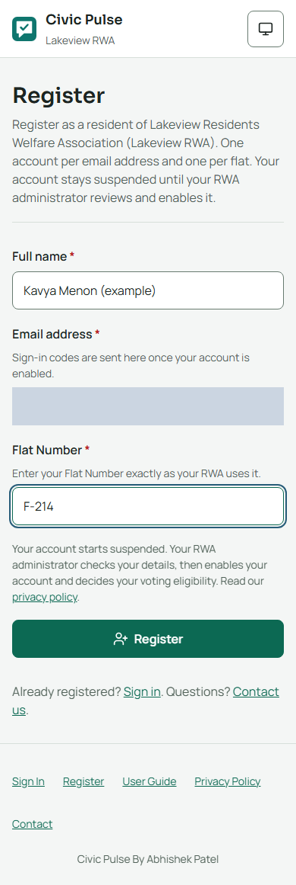

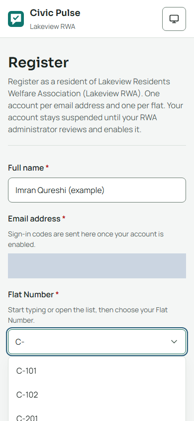

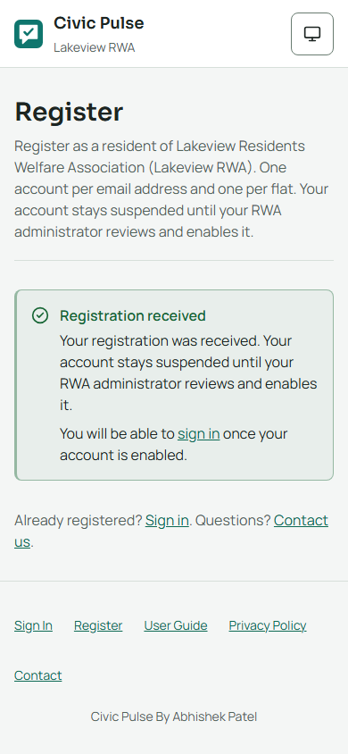

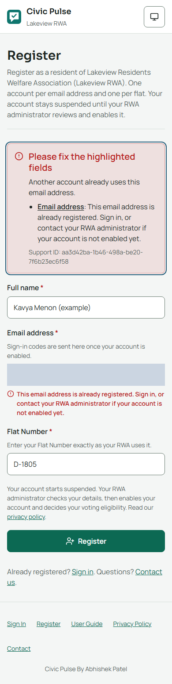

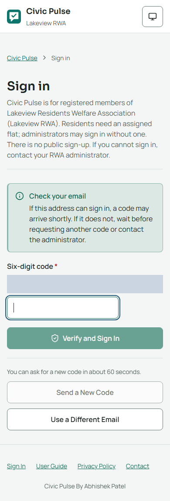

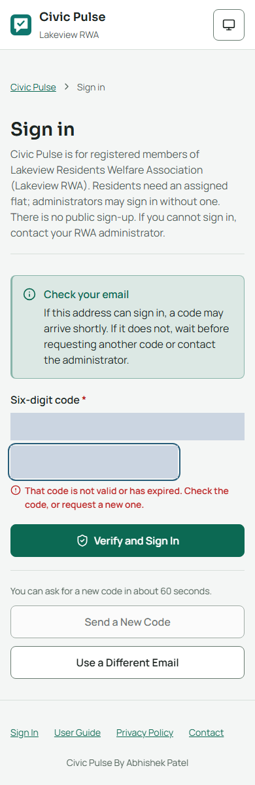

The header's **Appearance** control offers **Light** (Platinum), **Dark** (Obsidian), and **System**. It works before and after sign-in, is saved only in this browser, and is separate from the RWA accent colour and analytics consent. Print and PDFs remain light. Clearing browser storage restores System; if storage is blocked, the choice lasts until reload.

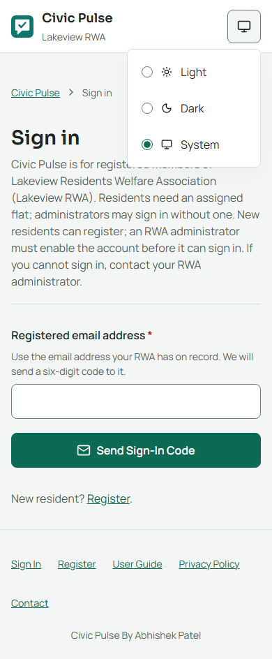

Before or after sign-in, the footer links to **Sign In**, **Register**, **User Guide**, **Privacy Policy** and **Contact**. The Contact page keeps these links in the footer instead of repeating them in the page. Signed-in enabled RWA members can see the names of enabled RWA Admins; visitors and App Support cannot. No contact details are shown. If the names are unavailable, contact your RWA administrator directly. Online contact may be unavailable if the RWA has not set it up. When available, enter a reply email and message. **Message accepted** means the mail service accepted it, not that it reached the administrator. Do not include ballot choices, codes, passwords or identity documents. Optional Google Analytics is used only on public information pages after you allow it. You can turn it off from the same privacy/contact control.

The public Privacy Policy groups information into clear sections: what is
collected and why, how voting privacy works, cookies and browser storage,
sharing, retention, security and privacy requests.

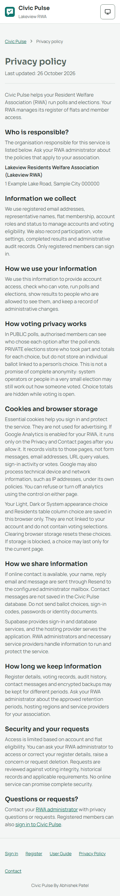

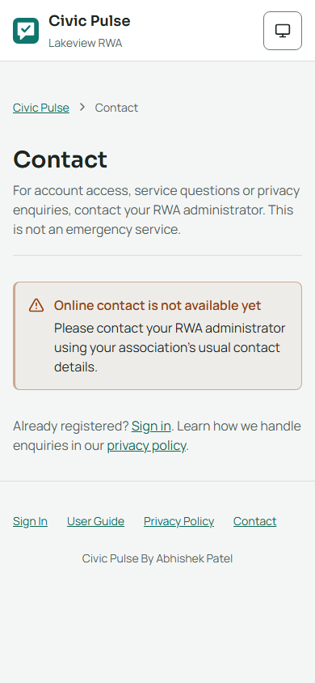

The pictures show an example RWA named **Lakeview Residents Welfare Association**, alias **Lakeview RWA**, with **Flat** as its household label and **Number** as its identifier wording. Your RWA can use different names, contact details, accent and wording. Screenshots are examples, not population counts, capacity promises or proof of email delivery.

All names, addresses, identifiers, choices and counts are synthetic. Counts may accumulate between disposable capture runs and are not an RWA size or product limit. Dates and time zones are examples; read each live vote's displayed deadline. Countdown values are snapshots. A confirmation-dialog image shows the confirmation step, not necessarily an executed action. A few sign-in/submission error states are intentionally simulated.
Resident captures use a 390px mobile viewport. RWA Admin and RWA ReadOnly full-page captures use laptop-width viewports; confirmation dialogs are cropped for legibility. Open or zoom an image to read small text. Use the written steps and the live screen as the authority for your RWA's data and deadlines.

Confirmation popups appear in the centre of the screen on phones, tablets and
laptops, even when the page behind them is scrolled. Long confirmations scroll
inside the popup so Cancel and Confirm remain reachable. Cancel or Escape
closes a confirmation without acting (except while an operation is processing).
Dropdown menus and flat-picker suggestions stay beside their fields.

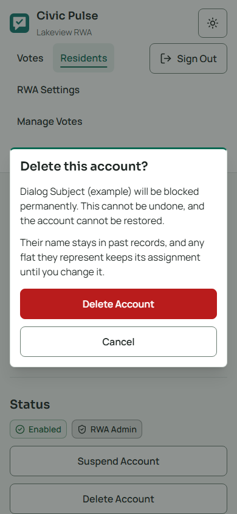

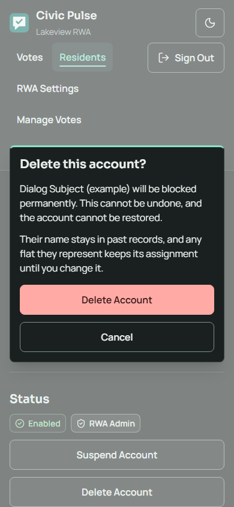

Long lists use the same controls on **Votes**, **Residents**, **Manage Votes**,
**Audit History**, **Participation** and the **Who chose what** section of
completed PUBLIC results:

- **Page 2 of 6 · 143 results** shows your position and exact matching record
  total, not every record in the association. The separate record-range line
  is omitted.
- Icon-only **First**, **Previous**, **Next** and **Last** controls let you move
  through the list. Hover or assistive technology identifies each direction.
  Unavailable directions are disabled.
- Choose **10**, **25**, **50** or **100** under **Per page** to apply the size
  immediately, return to page 1 and keep your filters. No apply button is needed.
- Applying filters also returns to page 1. Empty lists show
  **Page 1 of 1 · 0 results**. If the last page shrinks, a stale page number opens the
  new last page instead.
- Totals can change as records change; refresh when reviewing concurrent edits.
  Resident selection is only for the current page and clears when you change
  pages or page size. Downloads still include the complete authorized result.

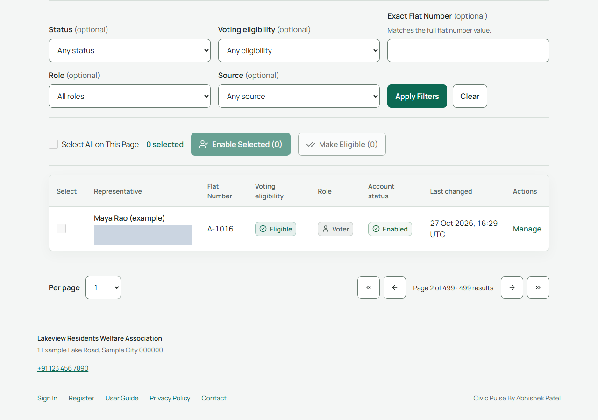

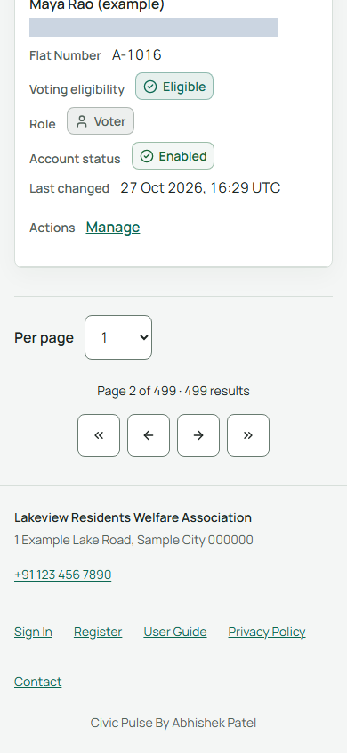

## Resident Persona

### Find your votes

The **Votes** page lists only votes available to your frozen household entitlement. Its three figures are **Active votes**, **Scheduled**, and **Your responses**; they cover your household entitlements across pages and type filters, not the whole association. Filters include All, Active, Scheduled and Completed; the voting-type menu also includes cancelled votes and Clear Filters. A missing vote may mean the household was not in that vote's frozen electorate. Clear filters, then contact the RWA administrator if it still appears missing.

One designated representative votes for each household. Your account does not add a vote for every device or family member, and an administrator/observer role does not permit voting for another household.

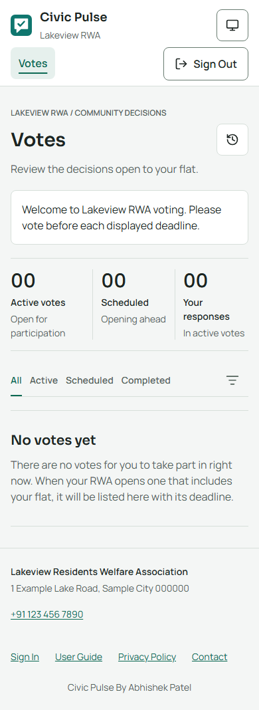

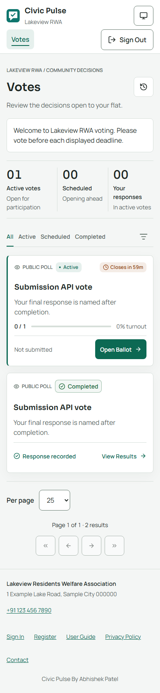

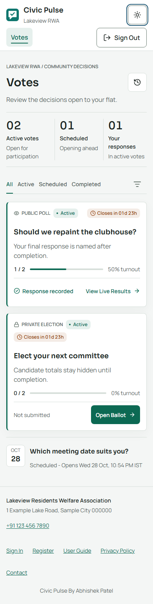

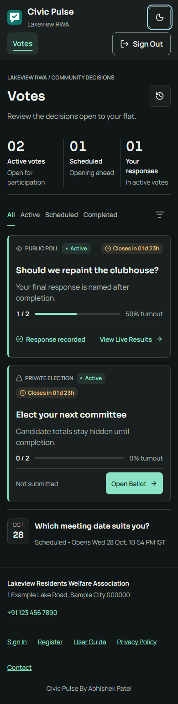

A scheduled vote shows its summary and opening/closing times, but no options, candidates or ballot controls until database time opens it. No reminder is sent. The countdown is informational; the database decides whether a vote is open or closed.

On an active vote, the live deadline countdown remains visible before and after submission. At zero the page refreshes its status; a browser countdown never decides whether a ballot is accepted. A changed deadline appears on the next page load or after the page refreshes at the old deadline.

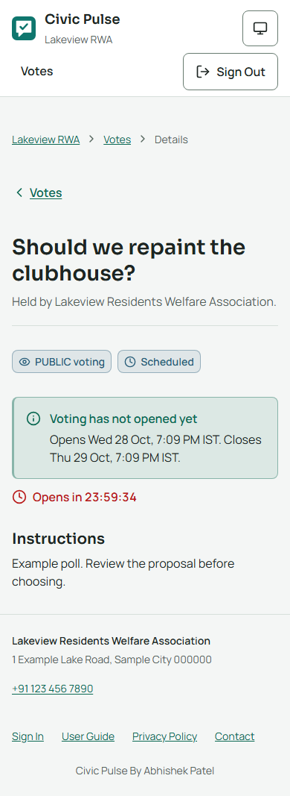

Votes and representatives freeze when a vote is activated or scheduled. A later household reassignment does not transfer an existing entitlement.

### Cast a PUBLIC poll ballot

Read the question, deadline and privacy notice. Select one option, or check multiple options when the ballot offers checkboxes. Multi-select requires at least one choice and may set a maximum. Review before submitting. PUBLIC responses can be replaced while the poll remains active; only the latest option set counts and the household is counted once in turnout.

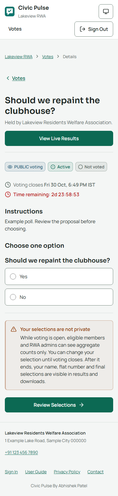

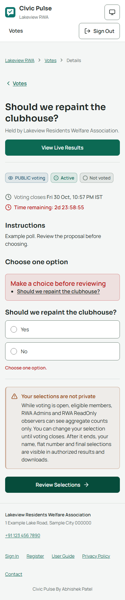

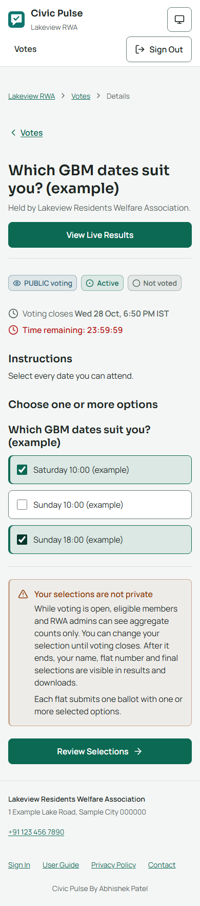

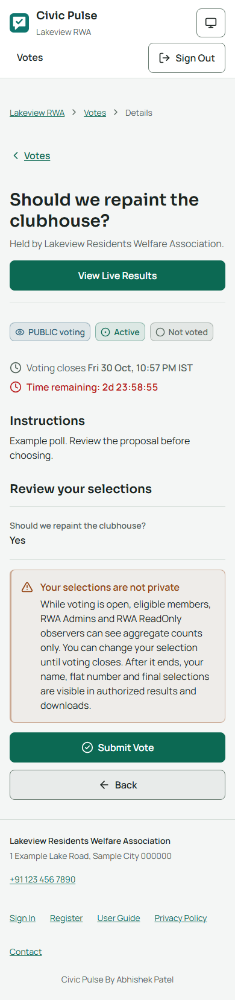

Wait for the acknowledgement. **Your vote is recorded** confirms accepted participation. During an active PUBLIC poll, results show aggregates, not individual selections. After completion, authorized results show named household responses. PUBLIC voting is not private.

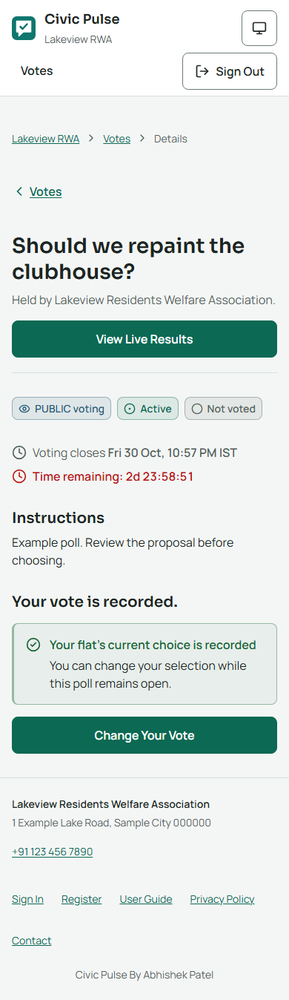

### Cast a PRIVATE election ballot

For each office choose one candidate or **NOTA (None of the Above)**. NOTA is counted separately and cannot win. The highest-count candidate is elected even if NOTA receives more votes; candidate ties remain ties. If no candidate receives a vote, no candidate is elected. Review each office before submitting. A PRIVATE submission is final; there is no selection receipt or history of individual choices.

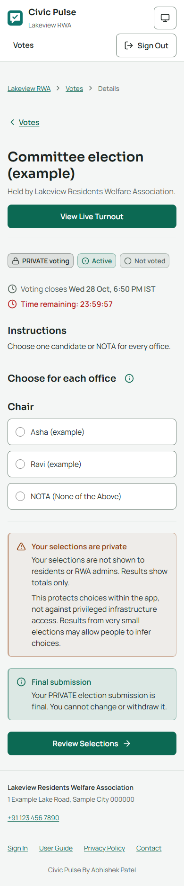

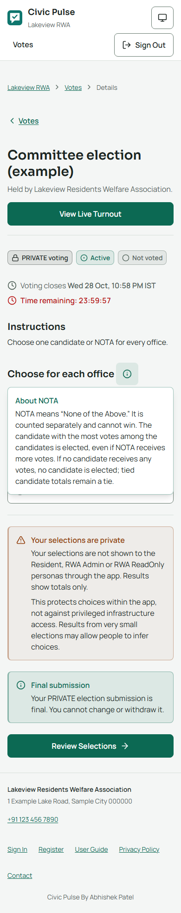

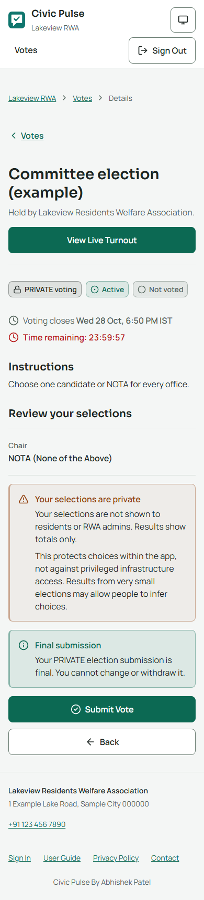

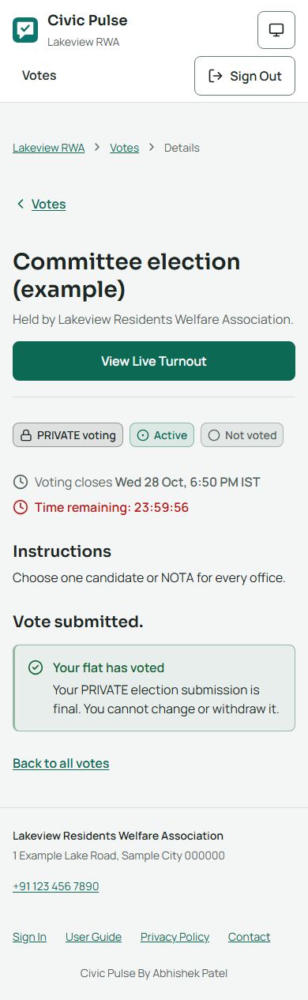

During an active PRIVATE election, members see aggregate turnout only. Candidate and NOTA totals remain hidden until completion. Very small totals may allow inference; this is application-level privacy, not cryptographic anonymity against privileged infrastructure operators.

### Recover from an uncertain submission

A connection failure does not prove that a ballot was rejected. Keep the page open and choose **Check Again**. If the confirmed status is not recorded and the vote is still open, use **Review and Try Again**. Do not blindly repeat an uncertain submission. A deadline cannot be extended by retrying.

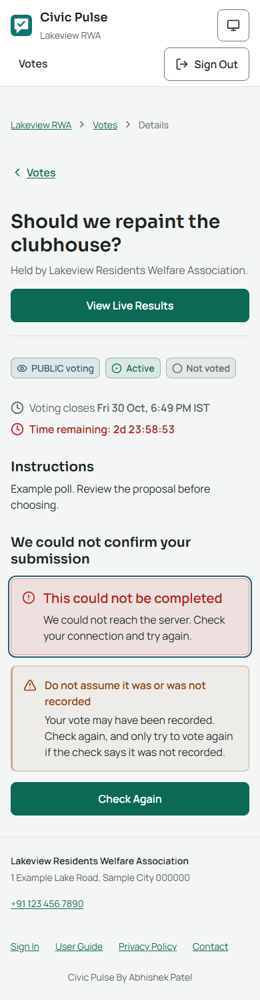

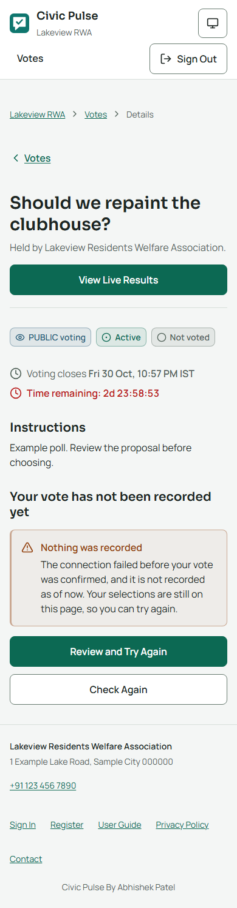

### View results and downloads

The results page and browser tab show the vote title. When the vote has background (PUBLIC) or instructions for voters (PRIVATE), a collapsed **Background** or **Instructions for voters** link under the heading reveals it. On completed results, the (i) beside **Voting ended** explains that eligibility was fixed at activation, and a short note in the **Download** section says the files match the page and cannot be recalled once downloaded. The downloaded CSV and PDF state that the record is not a signature, legal certification or spending authorization. The PUBLIC totals card matches the width of one PRIVATE office card; **Who chose what** spans the available results width. PRIVATE office cards use the full available results width in a two-column layout on laptops; if there is an odd number of positions, the final card is centered at the same width, including when there is only one position. On narrower screens, cards stack at full width.

For an active PUBLIC poll, **View Live Results** shows aggregate option counts and turnout whether or not you have voted. A row such as **Yes 2/4 50%** means two selected households out of four eligible; the leading option is marked **Leading** or **Tied**. Multi-select percentages are shares of eligible households and may add up to more than 100%. For an active PRIVATE election, **View Live Turnout** shows aggregate turnout only. Results refresh about every ten seconds; they never show active choices.

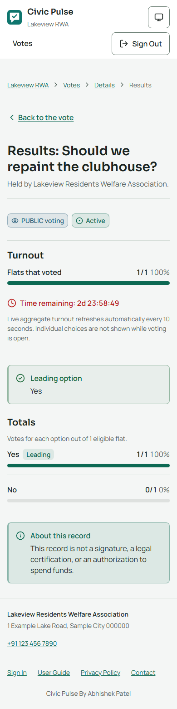

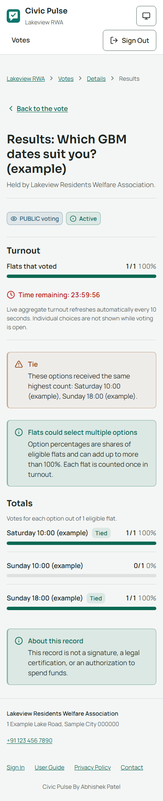

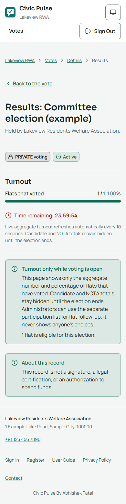

Completed PUBLIC results group the outcome and option totals in one centered card the same width as a PRIVATE office card, followed by unframed authorized named household responses. The **Who chose what** section spans the available results width, and its description aligns with its table. The table stays in table format on phones and larger screens; its contained area can scroll horizontally on narrow screens. PRIVATE office cards use the full available results width in a two-column layout on laptops; when positions are odd, the final card is centered at the same width. A single position is centered at the same card width. On narrower screens, cards stack at full width. Follow pagination when present; downloads contain the complete authorized result, not only the visible page. Completed PRIVATE results contain aggregate totals only. CSV is for spreadsheet use; PDF is a printable copy and may be disabled. PUBLIC downloads contain named household choices; share them only with authorized people. Downloads are ordinary browser links with no separate progress panel or guaranteed inline retry message. Avoid repeatedly starting a download; return to results and retry later. Downloads are not backups or legal signatures, and saved copies cannot be recalled. If PDF is unavailable or cannot print a character, use CSV.

Each result row reads like **Yes 2/4 50%**: count, frozen eligible-household denominator and whole-number percentage. A zero denominator has no meaningful percentage. Candidate ties remain ties; NOTA never wins. PUBLIC multi-select option percentages can sum to more than 100%. The result page labels leaders/elected candidates explicitly. The PDF uses the same totals and bars. If PDF cannot represent a character used in a record, download CSV instead; text is not silently discarded.

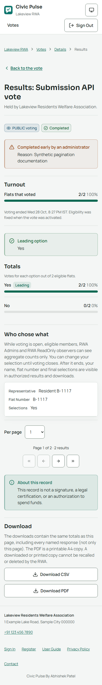

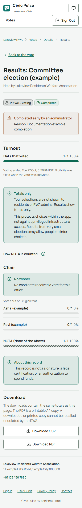

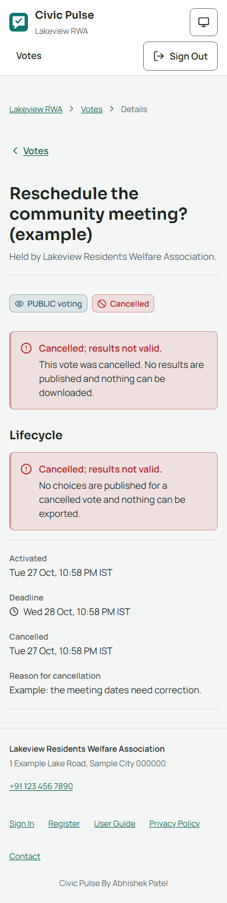

Select **Sign Out** on shared devices. Signing out cannot remove files already downloaded. A voter opening an administrator URL receives a plain not-found response; a URL does not grant a role.

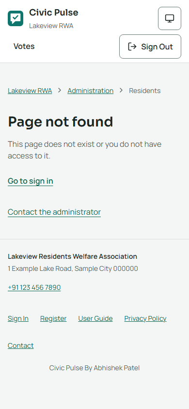

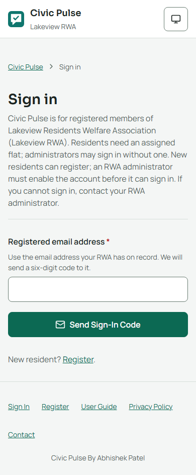

## RWA Admin Persona

### Management access and role assignment

The administrator navigation includes Residents and Manage Votes. On the right, the gear icon opens **Settings**, followed by the **Audit History** icon for the administrative event log; hover over either icon to see its label. Administrators may manage these records; they do not get extra votes or vote on behalf of another household. If an administrator has an assigned eligible household included in a vote's frozen electorate, that administrator can also vote only as that household.

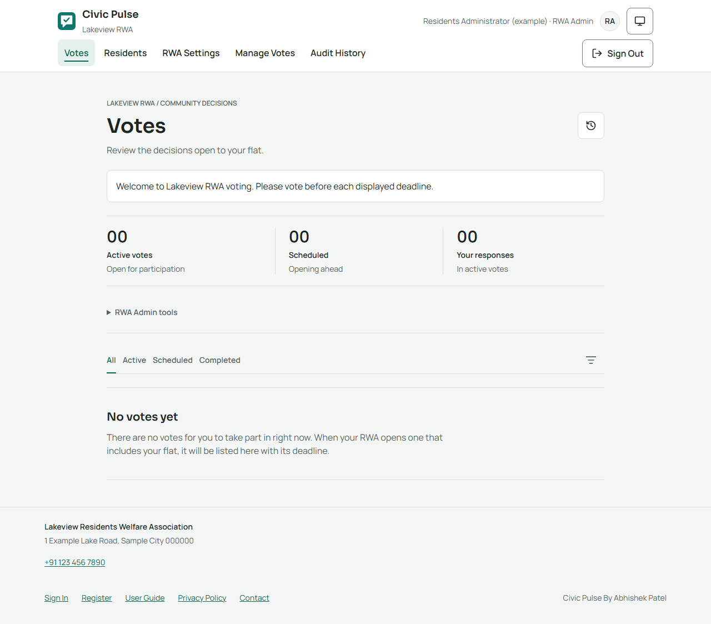

The **Role** selector shows **Voter**, **RWA Admin** and **RWA ReadOnly**, without repeating their internal codes. The same labels are used when adding or editing a resident and filtering the Residents list. Only an enabled RWA Admin can change roles. A household is optional for an RWA ReadOnly account, just as for an RWA Admin: it can be enabled without one, in which case it reads the authorized management scope but has no ballot. Account role is separate from household eligibility and frozen vote entitlement. The database protects the final enabled RWA Admin from removal.

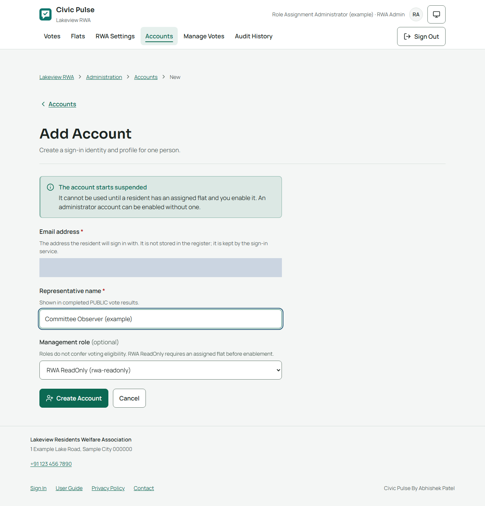

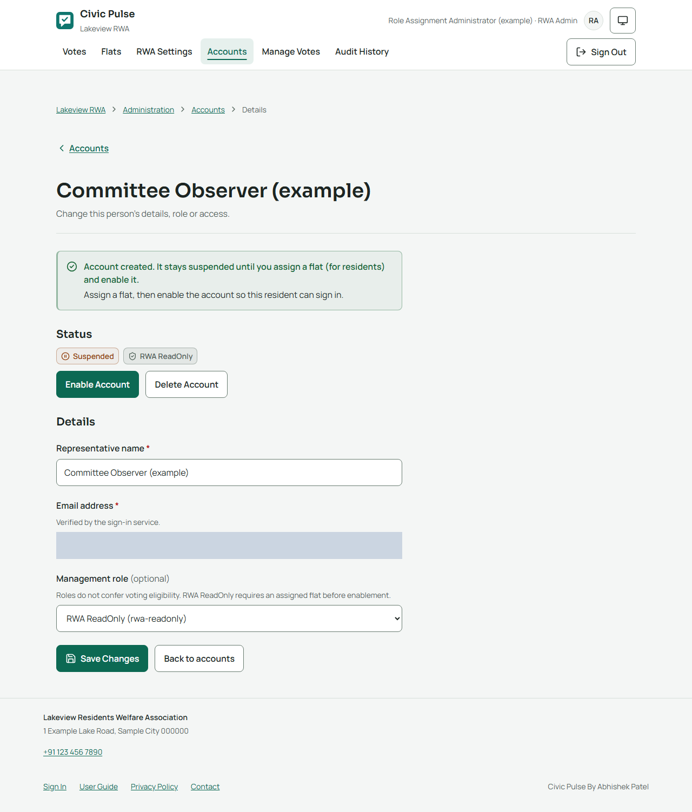

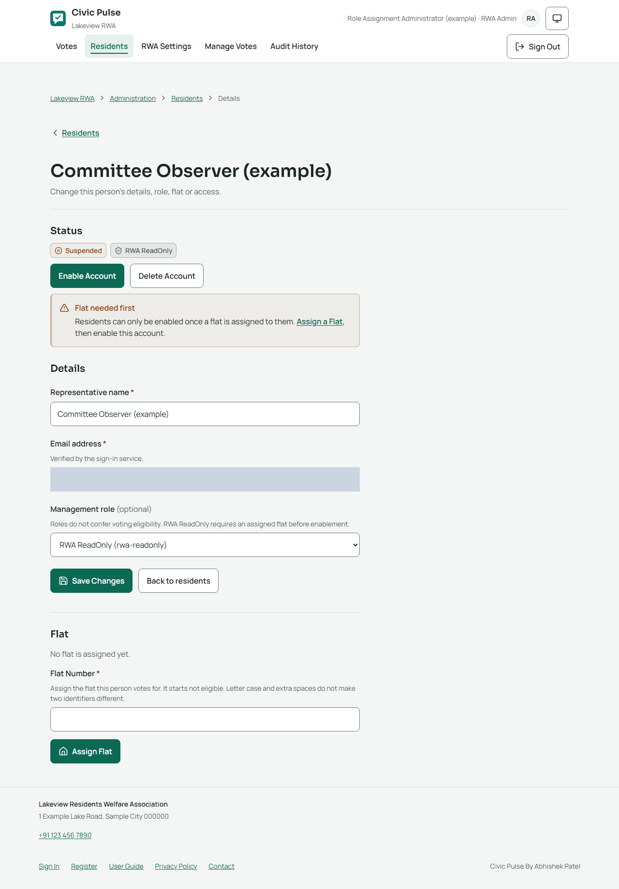

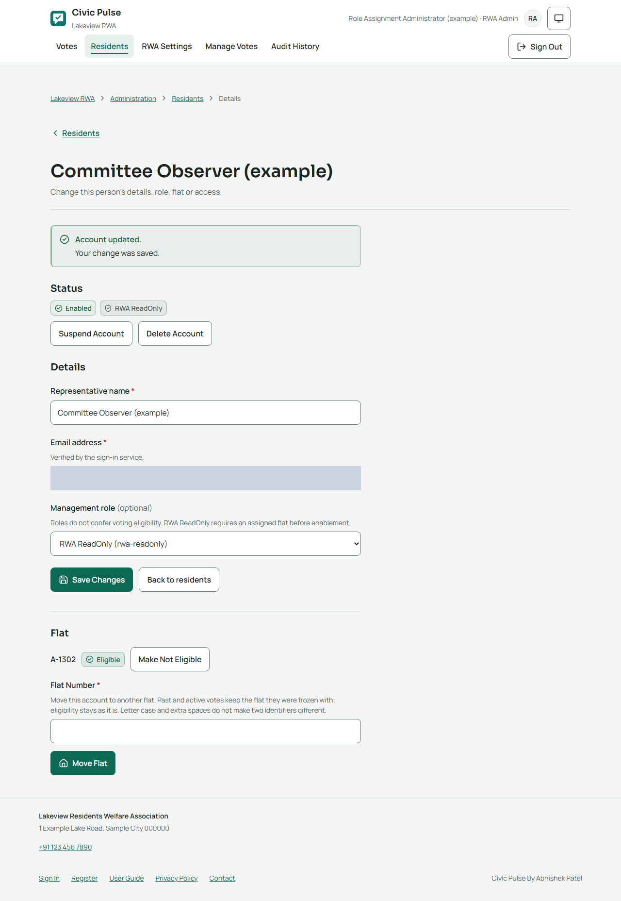

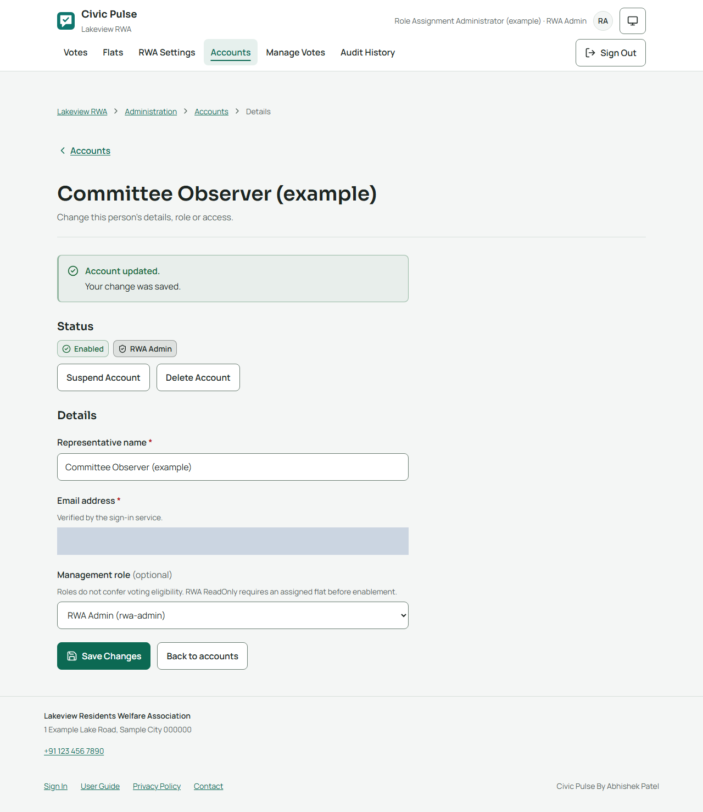

### Residents: accounts and flats together

Use **Residents → Add Resident** to create the account and its household in one step. Enter the email and resident name, choose the role, then choose the household by its **Flat Number** field. A voter must have a household selected before this form can save; RWA Admin and RWA ReadOnly accounts can leave it blank. When Settings → Default Households is set, start typing or open the list and pick an unassigned entry. Settings defines allowed identifiers, not resident assignments; saving creates the assignment. Add a missing identifier in Settings first. With no list, type the identifier. Each household has one representative account; assigned identifiers cannot be chosen again.

Tick **Eligible to vote** if the household may take part in new votes, and independently tick **Enable account now** if the person may sign in immediately. Both are off initially; access never implies eligibility. A household conflict prevents combined profile/assignment creation. Auth provisioning is a separate service step; if enablement is incomplete, the saved resident stays suspended and the page explains recovery.
The complete Add Resident form has a subtle border. The two checkboxes share a
row when space permits and wrap on narrow screens; their **(i)** help remains
available. Existing screenshots predate this border and checkbox-row adjustment.

The **Before you add a resident** summary is collapsed initially. Open it for three short reminders about household assignment, sign-in access and voting eligibility. Field-specific guidance remains available beside each label through its **(i)** control.

Choose **Manage** in Residents to edit details, role or access. The household section assigns a missing household on an existing account or **moves** it to an unassigned identifier. Moving preserves eligibility, frees the old identifier, and never rewrites scheduled, active or past vote assignments. **Change eligibility** expands an **Eligible to vote** checkbox with **Save Changes / Cancel** inside this section. Save stays on the resident page and updates the badge; Cancel discards the edit. The move controls return after saving or cancelling. Eligibility affects future votes only, never existing electorates or account access. There is no separate eligibility screen. An RWA Admin or RWA ReadOnly account may intentionally have no household, but receives no ballot without its own frozen entitlement.

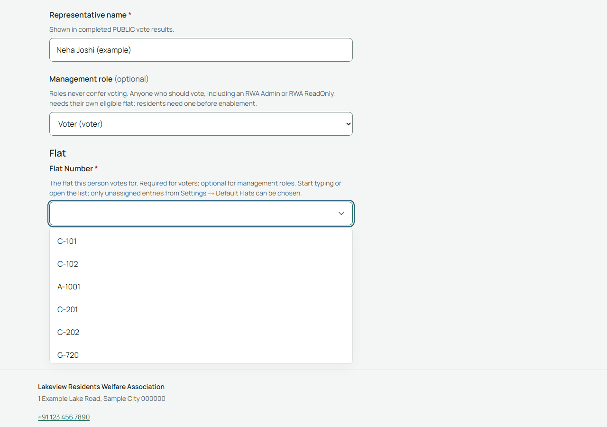

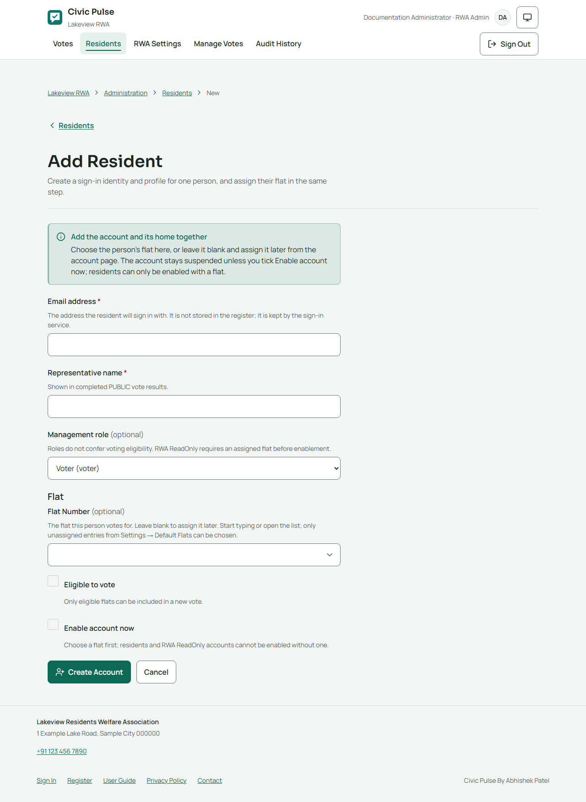

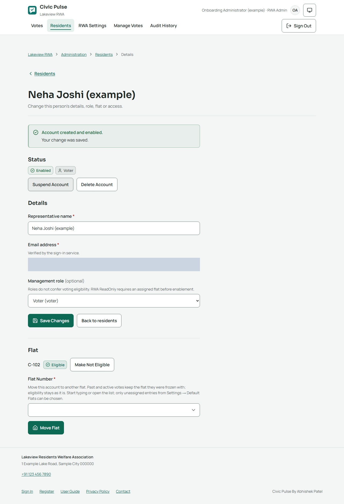

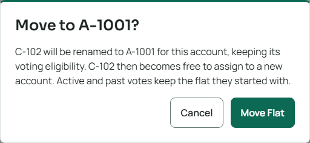

The pictures below show the step-by-step path: an account created without a flat, refused enablement, then a flat assigned from the account page. Residents screenshots retain the earlier filter layout; use the current column controls described below.

Use the **Sort & Filter** toolbar button (a funnel with up/down arrows) to find
people and their assignments together. **Representative** searches names (not email); **Status**,
**Role**, **Voting Eligibility**, the configured identifier (for example
**Flat Number**) and **Last Changed** have their own filters. Date ranges use your
browser time zone: **Changed From** includes that instant, **Changed Before**
excludes it. **Source**, immediately before Actions, has its own sortable heading
and column filter, not a separate top filter. Its icon shows **Self-registered**
or **Admin-registered** on hover or click/tap (person and shield icons,
respectively); ascending puts Admin-registered
first and descending puts Self-registered first. The old self-registration
caption below a name is replaced by this column. Existing screenshots predate it.
The matching funnel-with-circled-X **Clear filters** button sits beside Select All and
the selection count in the same toolbar as the right-aligned bulk actions,
rather than in a separate row.
Role badges use green for Voter, amber for RWA ReadOnly (including App Support)
and red for RWA Admin, with text and icons retained. These colours describe the
role, not whether the account is enabled or eligible. Existing screenshots
predate these role colours.
Single-field popups show **Filter [column]** and the control directly, without
repeating the field label (for example **Filter Flat** followed by its input).
Date ranges retain **Changed From / Changed Before** labels; the multi-field
phone panel still labels each field.
Representative and identifier filters match text anywhere, ignoring case:
**Abhi** matches **abhijin**, **Abhishek**, **ABHILASH** and **Dhvabhi**.
Type the text without `*` or `%`; those characters are literal, not wildcards.
Other active filters still restrict the results. Identifier suggestions come from
Default Households in Settings, including already assigned entries, but you
can enter any partial identifier without choosing a suggestion. With no Settings
list, the field is a plain text box. Leave it blank to include all identifiers.
Existing bookmarked identifier filters now use contains matching too.
On phones, open **Sort & Filter** for all filters and ordering. The old separate
top filter form is removed. Filter panels have labels above full-width controls
and no redundant optional markers. The identifier filter
has no **(i)** control. Source choices are **Any source**, **Self-registered** and
**Admin-registered**.
The list defaults to Voters; choose All Roles to include management accounts.
An unassigned account matches neither Eligible nor Not eligible; choose **No
assignment** (worded with your configured household label) to find only those
accounts, or Any eligibility to include them. Select a sortable column heading to
order all matching residents; select it again to reverse the direction. Sorting
and filtering apply across pages, not only the visible rows, and restart at
page 1. Applied filters show an asterisk beside their button. **Clear filters**
removes active filters and returns to the default Voter view and page 1 while
preserving the current sort, direction and page size. **Import CSV** is available
on this same page. ReadOnly observers can use the table controls but cannot
select or change residents.
Use **Residents** directly. Former Accounts and Flats page links are no longer
supported and show Page not found; replace any bookmarks with Residents.

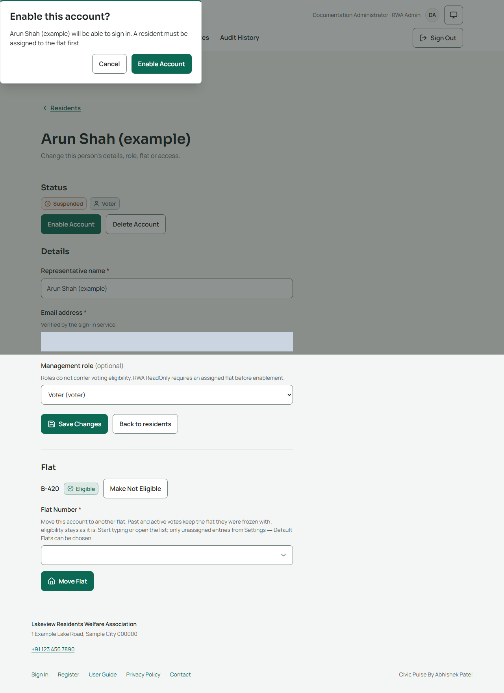

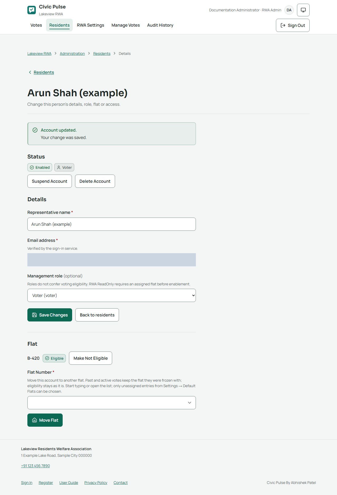

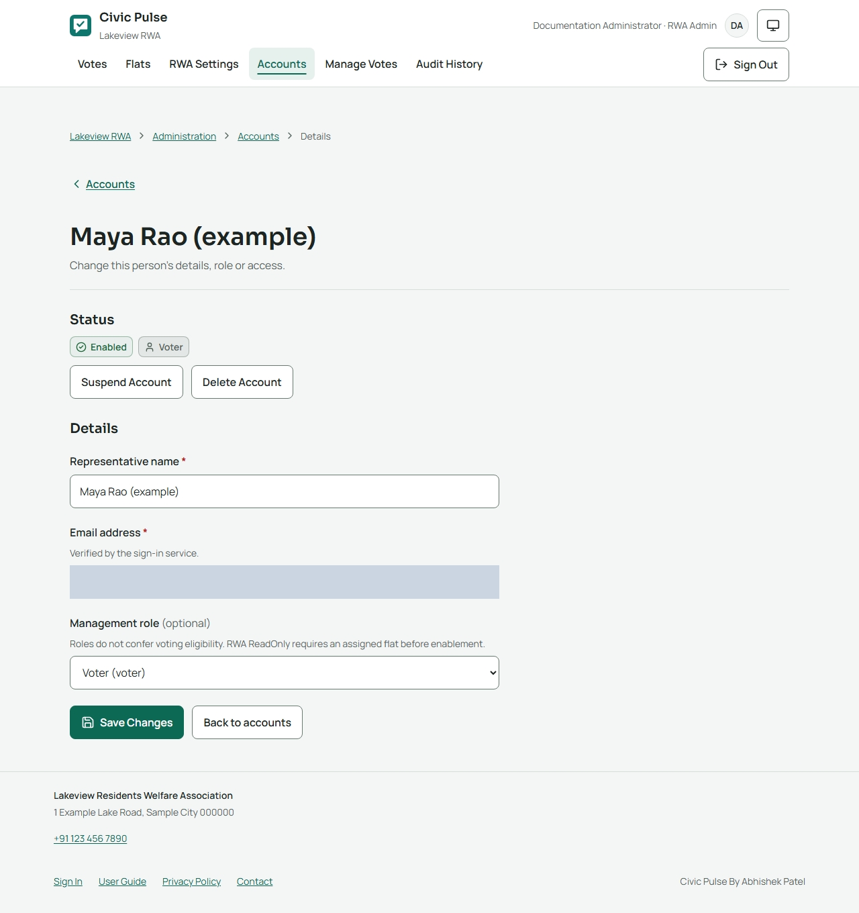

The toolbar shows **Select All** and the selection count on the left, with action buttons right-aligned. Select individual residents with the checkbox in the **Select** column, or use **Select All** for actionable residents on the current page only.

The Residents columns are **Select**, **Representative**, **Flat** (or your configured household name), **Status**, **Role**, **Voting Eligibility**, **Last Changed**, **Source** and **Actions**. Last Changed uses your browser/device time zone without repeating a zone suffix; hover over a date to see the zone. Until the browser loads, dates are explicitly labelled UTC. It tracks changes to the account profile, not separate household eligibility edits. Voting deadlines still use the RWA time zone.

On narrow screens the register remains a table. **Select**, **Representative**, **Flat**, **Status** and **Actions** stay visible. Use **Columns** to show or hide **Role**, **Voting Eligibility**, **Last Changed** and **Source**. Your choice is saved in this browser, not in your account. If the columns do not fit, scroll within the table; the page itself stays within the screen width. Use the toolbar’s funnel icon to sort or filter any field, including hidden columns, and the clear-filter icon to reset filters. Table headings stay plain to avoid duplicating those controls. Selection, filters, bulk actions and the Columns chooser stay on one row; swipe or use keyboard focus to scroll the row on very narrow screens.
Pages throughout the app now use the available window width with small side
gutters, giving tables more room on wide screens. Individual forms and ballots
keep their narrower readable layout. Existing guide screenshots predate this
width adjustment.
Form-focused pages center their title, description, guidance and controls
together in a readable column: Add/Manage Resident, CSV import, eligibility,
Settings, vote setup/detail, ballot preview and voting. Sign-in, registration
and contact already follow this layout. Text remains left-aligned within the
centered column; tables and results workspaces retain the wider layout.
When a page has a top action, it sits to the right of the title. The description
appears below that row and uses the available page width, wrapping to fit the
screen.
Status uses a check, pause or ban icon for Enabled, Suspended or Deleted. Hover for its name, or tap/click the icon (Enter/Space with keyboard focus) to reveal the label; screen readers retain the full name.
In **Actions**, select the person/edit icon to manage that resident. Hover for
**Manage [resident name]**; keyboard and screen-reader navigation retain the same
named link. ReadOnly observers can open it to inspect details without editing.

After selecting residents, **Enable Selected** turns on sign-in access; it does not change voting eligibility. **Make Eligible** marks the selected residents' households eligible for future votes; it does not enable sign-in. Scheduled, active and past votes keep their frozen assignments. The button counts show how many selected residents can receive each action. Selections cover the current page and clear when sorting, filtering, changing pages or page size. The default role filter is Voters (`voter`). Choose All Roles or RWA Admin (`rwa-admin`) explicitly before selecting an RWA Admin for enablement. Each account is processed separately; a failure stops later rows, and completed changes are not rolled back. Refresh and review before retrying.

Residents who registered themselves at `/register` appear as suspended Voters with their household already assigned and **not eligible**; their row is marked **Self-registered**. Set **Source** to **Self-registered** (and **Status** to Suspended) to review them. Check the name, email and household against your records, then use **Enable Selected** for access and **Make Eligible** for voting. A wrong or unknown registration can be left suspended or set to Deleted from **Manage**. Each one is recorded in Audit History as **Profile self registered** by **System**.

Use list filters and pagination to find records rather than creating duplicates. Changing a registered email uses both Auth and the application profile and is not one cross-service transaction. If a partial-failure warning appears, resolve that state before asking the resident to use the new address.

A resident CSV import accepts up to 500 records/256 KiB with `identifier,representative_name,email,is_eligible`. Use **Browse files** to select a CSV; its filename appears beside the button and the file is parsed in your browser. Choose **Check Register** to add a preview/results table at the available page width, while the file controls remain centered. The table stacks labelled rows on phones and wraps long values at larger widths. Nothing is imported until you confirm **Import Residents**. Exact matches are skipped; conflicts never overwrite resident details, roles, flat assignments, eligibility or access. Newly imported residents cannot sign in until separately enabled. Partial provider/connection failures stop processing; recheck before retrying. CSV content remains in page memory, not browser storage.

Use the household register to add/change identifiers, assignments and eligibility for future votes. Reassignment never transfers a scheduled/active vote entitlement. **Suspend Account** blocks access without deleting historical participation. **Delete Account** is irreversible in the application UI and retains referenced audit/vote history. Hover over either button on resident details for an explanation: after confirmation the resident cannot sign in, vote or view signed-in pages, including through an existing session. Suspension can be reversed by enabling the account; a deleted account cannot be restored. These explanations are also available to screen readers; on touch devices, the confirmation dialog explains the consequences before any change. The last enabled administrator cannot be removed.

The **Delete Account** confirmation explicitly lists the loss of sign-in, voting, PUBLIC response changes and signed-in votes/results access, including existing sessions. It recommends **Cancel → Suspend Account** when a reversible access block is sufficient. Deletion cannot be undone and does not erase submitted votes, audit history or the current household assignment. Cancel is selected initially; nothing changes until you confirm deletion. The existing dialog screenshots predate this expanded warning; replacement captures remain on hold.

### Configure RWA settings

Forms across the app use a consistent subtle rounded border with comfortable
padding. On Manage Resident, Status and its badges share a row, with account
actions below; smaller screens wrap when needed. Existing screenshots predate
this shared form framing.
Manage Resident groups **Save Changes**, **Suspend/Enable Account**
and **Delete Account** in a left-aligned row below Details when space permits. The circled close icon at
the top-right beside Details returns to Residents without saving, replacing
the bottom Cancel link. Suspend is amber and Delete is red; Enable retains its
neutral appearance. Account-state actions still require their
existing confirmations and do not save pending detail edits. The top Residents
link is also navigation back to the directory. Screenshots predate this grouping.

**Settings** controls the full name, alias, address, email, phone, optional website, one of six contrast-checked accent colours, welcome message, household label, Number/ID identifier wording and administrator-only suggestion lists. Required fields are marked; blank optional fields are hidden. Display wording changes do not rename stored household identifiers or alter matching. Changes apply immediately, including to older votes/results. Only `rwa-admin` can save settings.

The alias appears in the compact header; the full name appears on vote/result pages and exports. Address and configured contacts appear only in their documented footer/privacy/PDF locations. The household-label suggestions are display values, not aliases for stored identifiers. **Default Households** offers up to 1000 unique identifiers (up to 100 characters each); **RWA Positions** offers up to 50 unique office names (up to 200 characters each). These are suggestions only and never create register entries or offices until an administrator selects the relevant action. When **Default Households** is not empty it is also the list residents choose from on the public **Register** page and the list administrators choose from when adding or moving an account's household (anyone opening that page can see the identifiers, but not names or which are taken), and self-registration accepts only those entries; leave it blank to let residents type their identifier.

More specifically, the alias appears below the compact Civic Pulse brand and in the sign-in identity; the full name appears on vote/results/home pages, exports and the footer. Address, email, phone and website are shown only in configured public/signed-in contact locations. Accent colour changes links/buttons/highlights. The welcome message appears only on the resident-facing Votes page, not Residents or Manage Votes. Empty optional values stay hidden. Changing these values applies to existing results as well as future screens; the vote's saved RWA name is internal history, not the current display name. Existing guide screenshots predate this message-placement change.

### Turn App Support Access on or off

Settings also has an **App Support Access** control. When your deployment is
set up with a developer/support contact (`APP_SUPPORT_EMAIL`), you can turn this
on to let the developer check your setup, then turn it off when help is no longer
needed. Support signs in with its own email code and can view settings, the
register, votes, participation, results and audit history. It cannot change
anything or vote, has no household, and cannot see PRIVATE ballot choices.
Turning access on or off is recorded in Audit History. The control shows the
support email and whether access is on. If no support contact is configured,
access is unavailable. Residents (choose All Roles) lists the support identity
with an **App Support (ReadOnly)** badge and shows that it is managed from this
control rather than the account editor.

### Prepare, preview and open a vote

Under **Manage Votes**, create a PUBLIC poll or PRIVATE election. PUBLIC ballots use options and may be single- or multi-select. PRIVATE ballots use offices/candidates and the built-in NOTA choice. Select the intended currently eligible households, set a future deadline in the RWA time zone, save, then preview. A ready preview is a check, not production approval. Drafts are not visible to voters.

On **New Vote**, the blue **PUBLIC Voting** and dark **PRIVATE Voting** cards use matching colours to help distinguish the types. Each shows its description, example and privacy summary. Choose **PUBLIC Voting** for a community poll, such as **“Should we repaint the clubhouse?” — Yes or No**. While open, eligible voters, RWA Admins and read-only RWA observers see totals; voters can change their choice until closing. After closing, authorized results may show who voted and their final choices. Choose **PRIVATE Voting** for an RWA role election, such as **“Who should be chair?”** While open, Civic Pulse shows how many people voted; after closing, results show totals, never how an individual voted.

Choose the voting type on **New Vote**. The draft editor begins with **1. Details** and does not repeat the type selector. If you chose the wrong type, **Cancel Vote** rolls back a just-created draft; otherwise it discards unsaved edits and returns to Manage Votes, keeping the last saved version as a draft. Use the right-aligned bin-with-X icon to permanently delete a saved draft after confirmation. With unsaved edits, **Save and Preview** saves the draft and opens its preview in one step; if saving fails, you stay on the editor to fix the problem.

In **Details**, the PUBLIC **Question** and PRIVATE **Title** fields use a full-width input below the label, without an extra (i) help popover.

The PUBLIC **Background** field is optional; its label omits an optional marker and help icon. In the PUBLIC ballot, **Select exactly one option** and **Select multiple options** sit side by side on wider screens and stack on narrow screens.

The Manage Votes list has plain column headings for Vote, Type, Status, Deadline
and Last Changed. Use the **Sort & Filter** button for title, type, status and
date filters and to choose **Sort By** and **Sort Direction**. The matching
funnel-with-circled-X **Clear filters** icon sits beside it. Vote title matching
is literal and case-insensitive; Type and Status match selected options.
Deadline date ranges match the closing deadline only, including scheduled votes
that also show an opening time. Date ranges use your browser's local time zone,
include **From**, and exclude **Before**. Sorting and filters apply across the
full list before pagination; the default is newest Last Changed first.
The screenshot below predates the shared toolbar and compact **Columns**
chooser; use the written steps above for the current controls.

The final **Turnout** column shows **submitted / eligible (percent)** for Active and Completed votes. Eligible is the frozen electorate, not the current register. Draft and Scheduled votes show **Not open**; Cancelled votes show **Not available**. These are aggregate participation figures only: the column never shows candidate or option counts.

On phones and other narrow screens, **Vote**, **Status** and **Turnout** stay
visible. Use **Columns** to show or hide **Type**, **Deadline** and **Last
Changed**. Your choice is saved in this browser; wider screens always show all
columns.

A PUBLIC poll needs at least two distinct options. A PRIVATE election needs at least one office and at least one named candidate per office; unopposed offices are allowed. NOTA is supplied automatically and must not be added as a candidate.

Each PUBLIC option is shown on one row as a drag handle, **Opt 1** label, text box and remove icon. Drag the grip beside an option, office or candidate field to change its sequence. Keyboard users can focus that grip and press **Alt+Arrow Up** or **Alt+Arrow Down**. Use the adjacent trash icon to remove the item.

For PUBLIC multi-select, require at least one choice and optionally set a maximum from 2 to 100; no maximum is also allowed. For PRIVATE, provide every office and candidates; office suggestions come from RWA Positions. **Add All Positions** creates eligible suggestions as offices, skipping positions already present. In **Who Can Vote**, a filter changes the rows displayed; a lock marks a representative whose account is not enabled, and hovering or focusing it explains why. **Select all eligible** can include more households than the visible page, so check the final selected count and representatives. Draft revision conflicts require reload and review of the latest version. Activation blockers can include missing content/deadline/eligible electorate and required policy approvals or retention settings.

Set **Voting opens** and **Voting closes** in the draft's Deadline section using the calendar picker. Choose a month and year, select a date, enter the hour, minute and second, choose **AM** or **PM**, then choose **Apply**. Both fields show `hh:mm:ss AM/PM` in the RWA time zone. **Cancel** closes it without changing the field, and **Clear** removes a saved value. If no closing deadline is saved, the editor suggests 11:59:59 PM seven local calendar days after the draft was created; save the draft to persist that suggestion or adjust it first. Leave the opening time blank for immediate activation, or save a planned opening time. The plan does not schedule or freeze the vote. On the preview, the **Summary** card shows readiness, the Who can vote count, the saved opening and closing times and what freezes. Collapse **What residents will see** to shorten the page. On wide screens, the summary and **Ready to start** actions stay beside the ballot while you scroll. **Schedule Vote** uses the saved opening time; no second opening-time field is needed. If no opening time is saved, the summary shows **When activated**, and **Schedule Vote** is disabled with guidance. Scheduling freezes ballot/type, electorate, representative snapshots and deadline immediately. Activate immediately only after review. Before opening, **Return to Draft** requires a reason. At/after opening, withdrawal is refused.

Both opening and closure use database time. A delayed scheduled job never permits early voting or extends the deadline; if service processing is delayed through the full window, the vote completes at its original closing time without late submissions. No reminder/notification is sent to households.

### Monitor, finish and audit

The active vote page provides lifecycle controls, deadline change, and participation follow-up. Participation uses the same header as Results: the heading reads **Participation:** followed by the vote's title, a collapsed **Background** (or PRIVATE **Instructions for voters**) link sits beneath it, then the PUBLIC/PRIVATE and status badges and the turnout line, whose (i) **About this list** button explains that the list shows which households have voted for reminders and never anyone's choices; the title also appears in the browser tab. The list reveals frozen household/name and submitted status, never choices. Choosing an option in **Show** (all, submitted, not submitted) updates the list immediately; **Clear** returns to all. Active PUBLIC pages show aggregate counts; active PRIVATE pages show aggregate turnout only. PRIVATE candidate/NOTA totals are hidden until completion. Deadline changes require a reason, must be at least five minutes in the future, and are allowed only while the vote is active and before its current deadline. There is no maximum extension or limit on how many changes can be made. The reason and old/new deadlines are audited; residents are not notified and see the new time on their next load or refresh.

Complete early only when authorized; enter a meaningful reason, which is recorded with the final result context. To observe an active PUBLIC poll, use live results rather than ending it early. Cancel an active vote only with the actual reason. Completion is final; cancellation invalidates the vote and publishes no results.

Use **Audit History** to review administrative actors/actions, targets and times. The columns are **When**, **Who**, **Target**, **Action** and **Details**. Times and the inclusive **From** / exclusive **Before** filters use your browser's local time zone. Filter **Who**, **Target**, **Action** or **Details**. Details includes any reason an action required, and its filter searches both the reason and the details shown in the log; text matching is case-insensitive. Actions without a reason have no Reason entry. Target record IDs and effective/processed times in Details are hidden by default; use **Show Target IDs**, **Show Effective Time** and **Show Processed Time** above the list to reveal them independently. Expand **About this history** for explanations of reasons, effective/processed times and target IDs. On a phone, open **Filter Audit History** to access all filters. Results remain newest first; **Clear filters** keeps the selected page size. Audit History does not contain OTPs or PRIVATE selections. Authorized completed results use the same projections as downloads. PUBLIC reports include named household responses; PRIVATE reports include aggregates only.

## RWA ReadOnly Persona

### What you can read

An enabled `rwa-readonly` account sees the same authorized management destinations and read scope as an administrator: the account directory and emails, household register, RWA settings, drafts and previews, vote lifecycle detail, participation, audit history, results and completed downloads. It can inspect PRIVATE participation status but never PRIVATE choices. While active, PUBLIC choices are not exposed; authorized aggregate results follow the same projection as an administrator.

Management controls remain visible but disabled. Navigation, filters, read-only previews, result pages, and CSV/PDF downloads remain available. A disabled button is only a usability cue: APIs and PostgreSQL independently reject management writes. Only an administrator can assign/change roles.

### Your own household vote still works

Management read access does not make a vote for you or grant another household's entitlement. A household is optional for an observer: if you were enabled without one, you read the committee scope but have no ballot. If your enabled account does represent a selected household, its frozen ballot remains available. PUBLIC replacement remains allowed only while that poll is open; PRIVATE submission remains final.

### Results and mobile access

An observer may read completed PUBLIC named responses and PRIVATE aggregate results even when its own household was not in that vote's electorate, subject to the same authorization/integrity rules as an administrator. Active choices and individual PRIVATE selections remain unavailable. Completed downloads remain enabled; protect PUBLIC named files.

## Troubleshooting and shared limits

| Situation | Safe next step |
| --- | --- |
| Sign-in code missing/expired | Check the entered address and newest message, wait for the cooldown, and ask an administrator to verify provisioning/SMTP. Do not share codes. |
| Too many requests | Follow the displayed wait/retry guidance; repeated attempts do not improve delivery and may prolong disruption. |
| Account suspended or incomplete | A fresh code cannot restore access. An administrator must resolve account status and any required household assignment. A new self-registration always starts suspended. |
| Email/profile change reported incomplete | Do not assume the new address works or create a replacement identity. Ask the administrator to finish/review the Auth and profile recovery steps. |
| Expected vote missing | Clear filters. The current household assignment does not transfer a frozen entitlement. Ask an administrator to check that vote's frozen electorate. |
| Required choice missing | Choose at least one PUBLIC option, or select a candidate/NOTA for every PRIVATE office, then review. |
| Unknown submission outcome | Use Check Again; do not blindly repeat. Retry only when the app confirms not recorded and still offers the action before closure. |
| Already submitted | Do not switch accounts/devices to cast again. PRIVATE ballots are final; PUBLIC changes are possible only while the poll remains open. |
| Vote closed or cancelled | A deadline cannot be extended by retrying. Cancelled votes have no valid results and cannot reopen. |
| Result integrity warning | Stop relying on the result and contact the operations team. Never infer or repair totals yourself. |
| Download unavailable | Use CSV if enabled, retry later, and report recurring errors. Downloads are not backups. |
| Management control disabled | For a voter, that is expected. For an observer, request an administrator to make the change; the observer cannot self-promote. |
| Session expires or role/access changes | Sign in again if allowed. Unsaved selections are not a stored draft and may need to be re-entered. |
| Draft changed by another administrator | Reload the latest version, reconcile changes and preview again before activation. |
| Activation blocked | Correct the listed ballot/register/policy/retention blockers. Only authorized approvers can record real policy approvals. |
| Service/maintenance failure | Follow the displayed support reference and retry later. Maintenance is not another voting channel. |

When contacting support, include the vote title, action, approximate time, device/browser and visible support reference. Do not send OTPs, cookies, PUBLIC/PRIVATE selections, or another household's personal data.

## Limits and approvals

These pictures use real application screens and synthetic data; some network failures are deliberately simulated. They do not prove SMTP delivery, production capacity, Cron operation, restore readiness, manual accessibility acceptance, or governance approval. The app does not provide self-registration that grants access without administrator review, delegated voting, reminders, ballot reopening, PRIVATE selection retrieval, cryptographic anonymity, or legal signatures. CSV import does not enable new accounts; schedule and register changes do not alter an already frozen electorate. See [pilot readiness](./PILOT_READINESS.md) and [launch audit](./LAUNCH_AUDIT.md) before real use.

Screenshots cover the core screens and actions available to each persona, not every possible data/state combination. Not individually pictured are a real SMTP outage/cooldown, every stale-draft conflict, deadline lock races, maintenance mode, every provider failure, final-enabled-admin refusal, every export failure, and every possible multi-office ballot layout. These safeguards and recovery rules remain covered in the written steps above and the technical/security test suite; captures are examples, not proof of those edge conditions.
