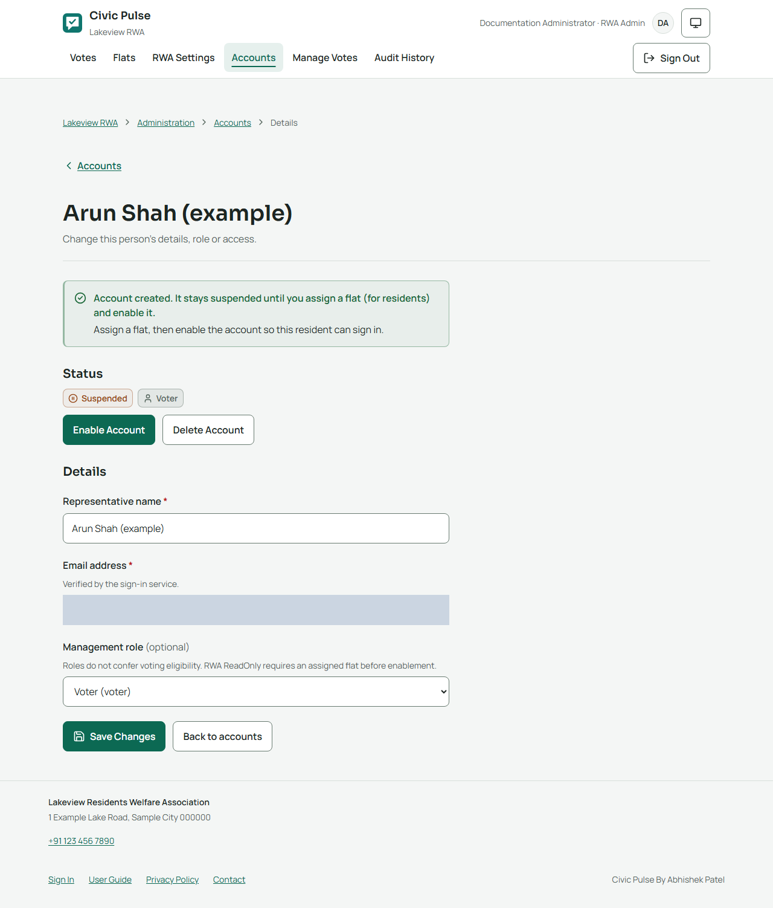
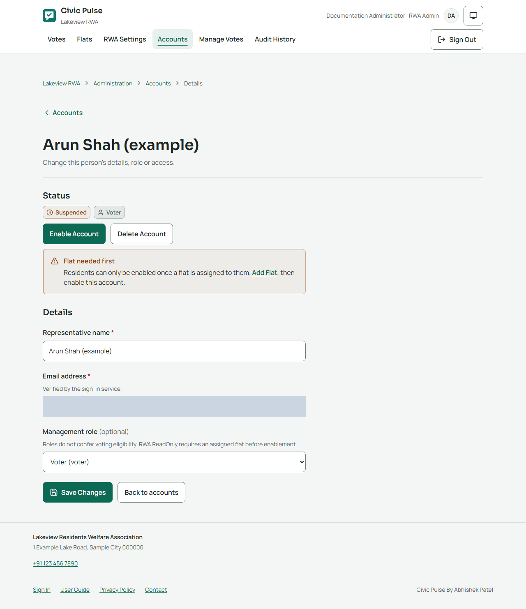
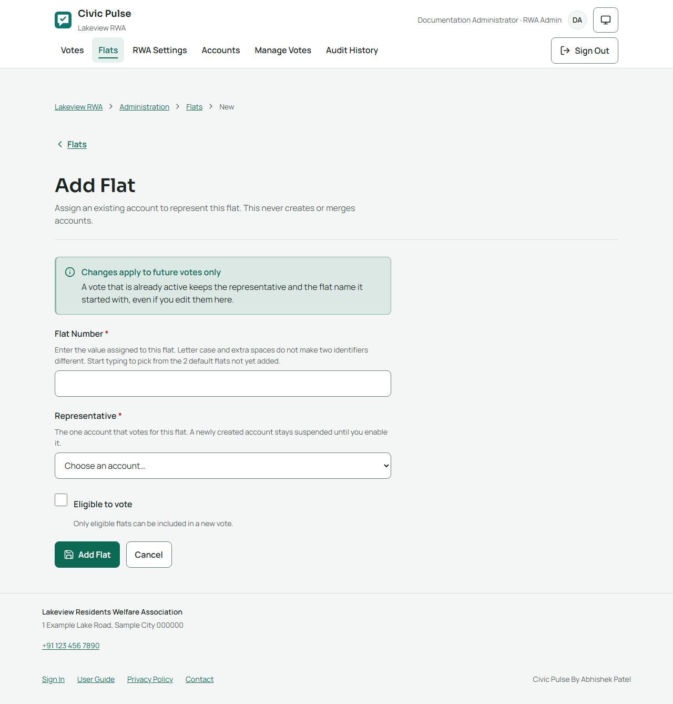
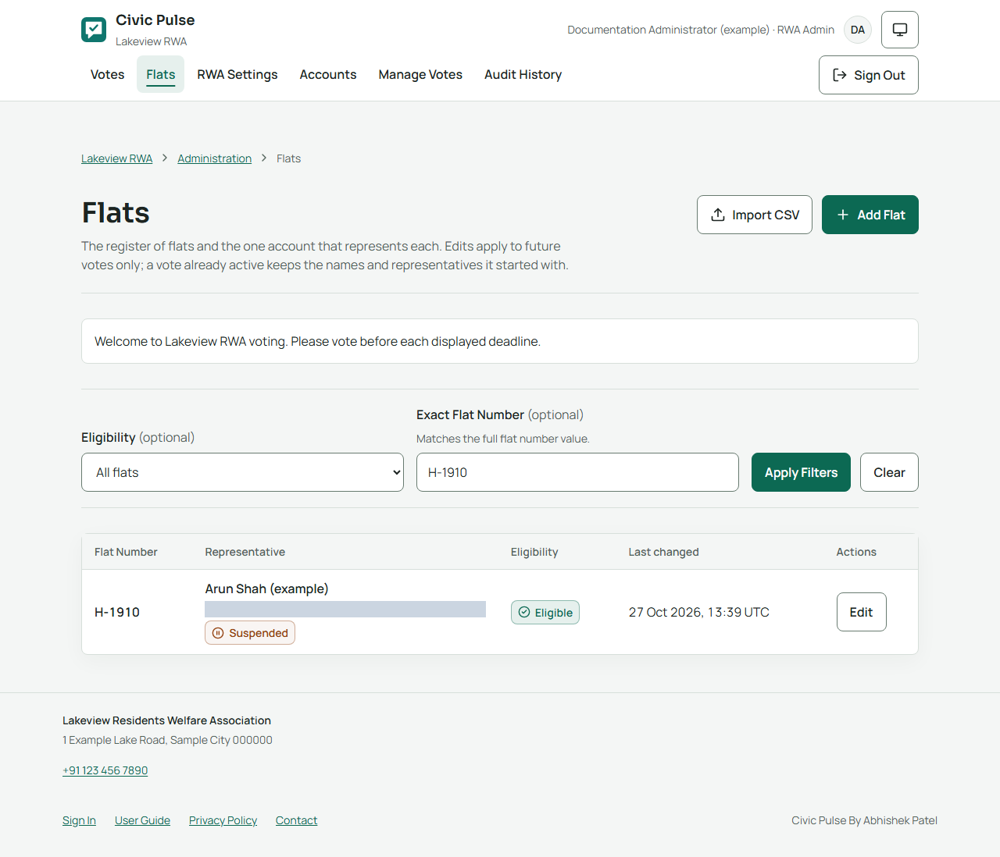
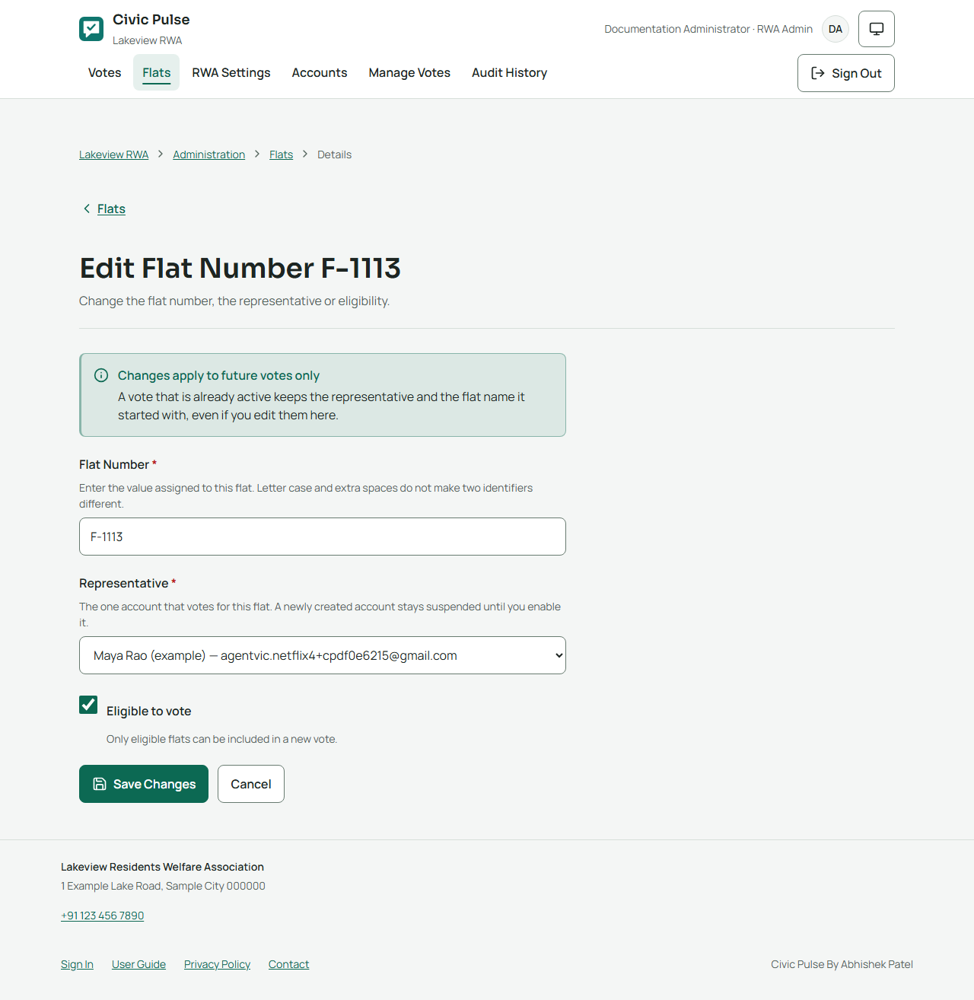
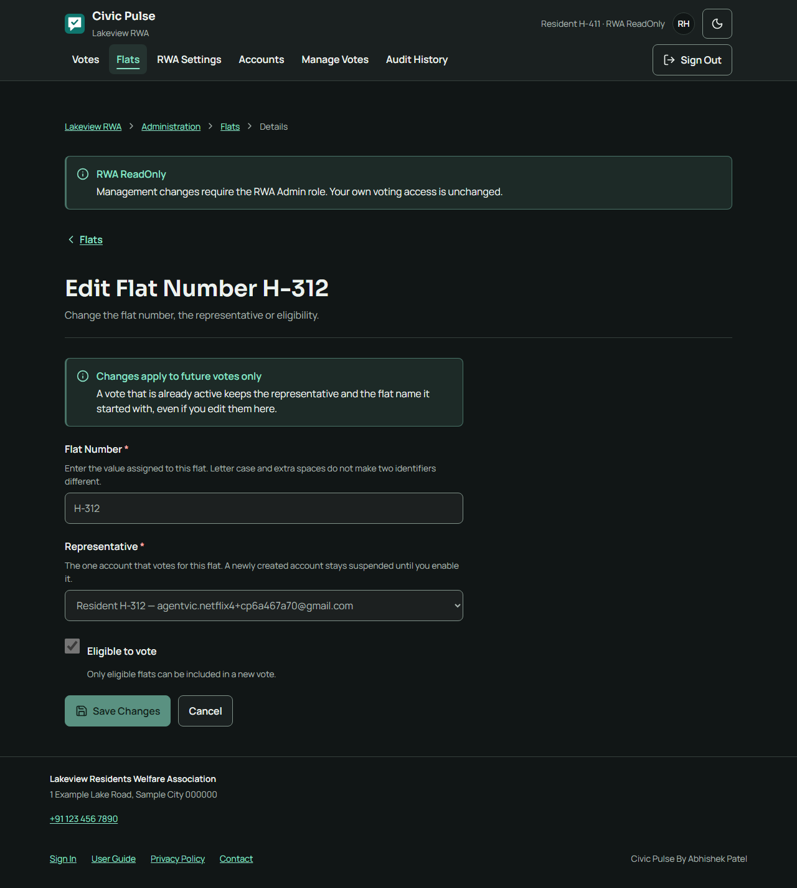

# Civic Pulse - User Guide

This guide is organized around what each signed-in persona can do. Choose your role below and go directly to that section. The screenshots use synthetic accounts and voting data; email addresses and codes are masked. Production use remains subject to the open approvals and checks in the [launch audit](./LAUNCH_AUDIT.md) and [pilot readiness register](./PILOT_READINESS.md).

**Navigation after rollback:** Accounts and Households (shown as Flats when configured)
are separate tabs again. Some retained screenshots show the reverted Residents
tab; follow the navigation in the written steps instead. Those images await a
fresh capture on an explicitly authorized disposable environment.

Open **User Guide** in the application footer to read the self-contained public edition without signing in. The repository copy is [USER_GUIDE.html](./USER_GUIDE.html).

## Choose Your Persona

| Persona | Role code | You can | You cannot |
| --- | --- | --- | --- |
| Resident | `voter` | See votes frozen for your household, cast its ballot, review its own participation, and access results allowed to that household. | See management pages, another household's ballot access, active individual choices, or PRIVATE selections. |
| RWA Admin | `rwa-admin` | Manage accounts, households, settings, drafts, schedules, voting lifecycle, audit history, participation, authorized results and downloads. | Vote for another household, change a frozen electorate, edit an accepted PRIVATE ballot, or retrieve PRIVATE individual choices. |
| RWA ReadOnly | `rwa-readonly` | Read the authorized management register, emails, settings, drafts, participation, audit history, results and downloads; vote for its own household if entitled. | Change management data, assign roles, or gain another household's voting entitlement. Management controls are visible but disabled. |

`voter`, `rwa-admin` and `rwa-readonly` are the lowercase role codes; **Resident**, **RWA Admin** and **RWA ReadOnly** are the corresponding persona names. The `voter` role is the normal member role; only the two mutually exclusive management roles change administrative access. Only an enabled `rwa-admin` may assign roles. A household is optional for an `rwa-readonly` account, just as for `rwa-admin`: without one it reads its authorized scope but has no ballot. No role itself grants a vote: an enabled account votes only through its own frozen household entitlement.

## Shared Sign-In and Appearance

There is no application password. Use the email address already registered for your account and enter the newest six-digit code sent to that inbox. The generic request message does not confirm whether an address is registered. Never share a sign-in code.

### Register yourself as a new resident

If your RWA has not created an account for you, open **Register** from the sign-in page (**New resident? Register**) or the footer. Enter your full name, the email address you will sign in with, and your household identifier (for example your **Flat Number**). If your RWA has set up its list of flats, start typing or open the list with the arrow, then choose your flat; only entries from the list are accepted, and if yours is missing ask your administrator to add it. Otherwise type it exactly as your RWA uses it. Then select **Register**. **Registration received** means your details were stored: your account stays **suspended** and your household is **not yet eligible to vote** until an RWA administrator checks and enables them. You cannot sign in until then; ask your administrator if it takes too long.

Each email address and each household can be registered only once. If you see **This email address is already registered**, you already have an account (it may still be waiting for review): sign in, or contact your administrator. If the household identifier is already registered to another resident, contact your administrator rather than registering a variation of it.

The header's **Appearance** control offers **Light** (Platinum), **Dark** (Obsidian), and **System**. It works before and after sign-in, is saved only in this browser, and is separate from the RWA accent colour and analytics consent. Print and PDFs remain light. Clearing browser storage restores System; if storage is blocked, the choice lasts until reload.

Before or after sign-in, the footer links to **Sign In**, **Register**, **User Guide**, **Privacy Policy** and **Contact**. Contact may be unavailable if the RWA has not configured support email. When enabled, enter a reply address and short message; **Message accepted** means the mail service accepted it, not that it reached the administrator. Do not include ballot choices, codes, passwords or identity documents. Optional Google Analytics is consent-gated on public information pages only and is off until allowed; consent can be withdrawn from the same privacy/contact control.

The pictures show an example RWA named **Lakeview Residents Welfare Association**, alias **Lakeview RWA**, with **Flat** as its household label and **Number** as its identifier wording. Your RWA can use different names, contact details, accent and wording. Screenshots are examples, not population counts, capacity promises or proof of email delivery.

All names, addresses, identifiers, choices and counts are synthetic. Counts may accumulate between disposable capture runs and are not an RWA size or product limit. Dates and time zones are examples; read each live vote's displayed deadline. Countdown values are snapshots. A confirmation-dialog image shows the confirmation step, not necessarily an executed action. A few sign-in/submission error states are intentionally simulated.
Resident captures use a 390px mobile viewport. RWA Admin and RWA ReadOnly full-page captures use laptop-width viewports; confirmation dialogs are cropped for legibility. Open or zoom an image to read small text. Use the written steps and the live screen as the authority for your RWA's data and deadlines.

## Resident Persona

### Find your votes

The **Votes** page lists only votes available to your frozen household entitlement. Its three figures are **Active votes**, **Scheduled**, and **Your responses**; they cover your household entitlements across pages and type filters, not the whole association. Filters include All, Active, Scheduled and Completed; the voting-type menu also includes cancelled votes and Clear Filters. A missing vote may mean the household was not in that vote's frozen electorate. Clear filters, then contact the RWA administrator if it still appears missing.

One designated representative votes for each household. Your account does not add a vote for every device or family member, and an administrator/observer role does not permit voting for another household.

A scheduled vote shows its summary and opening/closing times, but no options, candidates or ballot controls until database time opens it. No reminder is sent. The countdown is informational; the database decides whether a vote is open or closed.

On an active vote, the live deadline countdown remains visible before and after submission. At zero the page refreshes its status; a browser countdown never decides whether a ballot is accepted. A changed deadline appears on the next page load or after the page refreshes at the old deadline.

Votes and representatives freeze when a vote is activated or scheduled. A later household reassignment does not transfer an existing entitlement.

### Cast a PUBLIC poll ballot

Read the question, deadline and privacy notice. Select one option, or check multiple options when the ballot offers checkboxes. Multi-select requires at least one choice and may set a maximum. Review before submitting. PUBLIC responses can be replaced while the poll remains active; only the latest option set counts and the household is counted once in turnout.

Wait for the acknowledgement. **Your vote is recorded** confirms accepted participation. During an active PUBLIC poll, results show aggregates, not individual selections. After completion, authorized results show named household responses. PUBLIC voting is not private.

### Cast a PRIVATE election ballot

For each office choose one candidate or **NOTA (None of the Above)**. NOTA is counted separately and cannot win. The highest-count candidate is elected even if NOTA receives more votes; candidate ties remain ties. If no candidate receives a vote, no candidate is elected. Review each office before submitting. A PRIVATE submission is final; there is no selection receipt or history of individual choices.

During an active PRIVATE election, members see aggregate turnout only. Candidate and NOTA totals remain hidden until completion. Very small totals may allow inference; this is application-level privacy, not cryptographic anonymity against privileged infrastructure operators.

### Recover from an uncertain submission

A connection failure does not prove that a ballot was rejected. Keep the page open and choose **Check Again**. If the confirmed status is not recorded and the vote is still open, use **Review and Try Again**. Do not blindly repeat an uncertain submission. A deadline cannot be extended by retrying.

### View results and downloads

For an active PUBLIC poll, **View Live Results** shows aggregate option counts and turnout whether or not you have voted. A row such as **Yes 2/4 50%** means two selected households out of four eligible; the leading option is marked **Leading** or **Tied**. Multi-select percentages are shares of eligible households and may add up to more than 100%. For an active PRIVATE election, **View Live Turnout** shows aggregate turnout only. Results refresh about every ten seconds; they never show active choices.

Completed PUBLIC results include totals and authorized named household responses. Follow pagination when present; downloads contain the complete authorized result, not only the visible page. Completed PRIVATE results contain aggregate totals only. CSV is for spreadsheet use; PDF is a printable copy and may be disabled. PUBLIC downloads contain named household choices; share them only with authorized people. Downloads are ordinary browser links with no separate progress panel or guaranteed inline retry message. Avoid repeatedly starting a download; return to results and retry later. Downloads are not backups or legal signatures, and saved copies cannot be recalled. If PDF is unavailable or cannot print a character, use CSV.

Each result row reads like **Yes 2/4 50%**: count, frozen eligible-household denominator and whole-number percentage. A zero denominator has no meaningful percentage. Candidate ties remain ties; NOTA never wins. PUBLIC multi-select option percentages can sum to more than 100%. The result page labels leaders/elected candidates explicitly. The PDF uses the same totals and bars. If PDF cannot represent a character used in a record, download CSV instead; text is not silently discarded.

Select **Sign Out** on shared devices. Signing out cannot remove files already downloaded. A voter opening an administrator URL receives a plain not-found response; a URL does not grant a role.

## RWA Admin Persona

### Management access and role assignment

The administrator navigation includes Households, RWA Settings, Accounts, Manage Votes and Audit History. Administrators may manage these records; they do not get extra votes or vote on behalf of another household. If an administrator has an assigned eligible household included in a vote's frozen electorate, that administrator can also vote only as that household.

The **Management role** selector assigns exactly one of Voter (`voter`), RWA Admin (`rwa-admin`) or RWA ReadOnly (`rwa-readonly`). Only an enabled RWA Admin can change roles. A household is optional for an RWA ReadOnly account, just as for an RWA Admin: it can be enabled without one, in which case it reads the authorized management scope but has no ballot. Account role is separate from household eligibility and frozen vote entitlement. The database protects the final enabled RWA Admin from removal.

### Register and accounts

Use **Accounts → Add Account** to create the account and its household in one step. Enter the email and name, choose the role, then choose the household: when Settings → Default Households is set, start typing or open the list and pick one of the households not yet assigned (anything else is refused, so add a missing one to Settings first); with no list, type the identifier. Tick **Eligible to vote** if the household may take part in new votes, and **Enable account now** if the person may sign in straight away (only residents need a household for this). If the household is already taken or anything fails, nothing is created. You may leave the household blank and assign it later.

Each account page has a **Household** section. An account without a household can be given one there; an account with one can be **moved** to another unassigned household. Moving renames the account's household record: its eligibility stays the same, the old identifier becomes free for a new account, and past or active votes keep the household they were frozen with. Example: move Asha from A-101 to A-205, then add the new A-101 resident with Add Account. The **Households** page lists the register; its edit screen changes eligibility only. Residents cannot be enabled before assignment; an RWA Admin or RWA ReadOnly account may intentionally have no household, but still receives no voting entitlement without one.

The pictures below show the step-by-step path: an account created without a flat, refused enablement, then a flat assigned from the account page.

**Enable Selected** and **Make Eligible** are separate page-local operations. Selections cover the current page; they do not alter a frozen electorate. The default role filter is Voters (`voter`). Choose All Roles or RWA Admin (`rwa-admin`) explicitly before selecting an RWA Admin for enablement. Each account commits separately; after a failure, refresh and review before retrying.

Residents who registered themselves at `/register` appear as suspended Voters with their household already assigned and **not eligible**; their row is marked **Self-registered**. Set **Source** to **Self-registered** (and **Status** to Suspended) to review them. Check the name, email and household against your records, then use **Enable Selected** for access and **Make Eligible** for voting. A wrong or unknown registration can be left suspended or set to Deleted from **Manage**. Each one is recorded in Audit History as **Profile self registered** by **System**.

Use list filters and pagination to find records rather than creating duplicates. Changing a registered email uses both Auth and the application profile and is not one cross-service transaction. If a partial-failure warning appears, resolve that state before asking the resident to use the new address.

A CSV import accepts up to 500 records/256 KiB with `identifier,representative_name,email,is_eligible`. Check and review every row first. Exact matches are skipped; conflicts never overwrite names, roles, assignments, eligibility or access. Imports leave new accounts suspended. Partial provider/connection failures stop processing; recheck before retrying. CSV content remains in page memory, not browser storage.

Use the household register to add/change identifiers, assignments and eligibility for future votes. Reassignment never transfers a scheduled/active vote entitlement. **Suspend Account** blocks access without deleting historical participation. **Delete Account** is irreversible in the application UI and retains referenced audit/vote history. The last enabled administrator cannot be removed.

### Configure RWA settings

**RWA Settings** controls the full name, alias, address, email, phone, optional website, accent, welcome message, household label, Number/ID identifier wording and administrator-only suggestion lists. Required fields are marked; blank optional fields are hidden. Display wording changes do not rename stored household identifiers or alter matching. Changes apply immediately, including to older votes/results. Only `rwa-admin` can save settings.

The alias appears in the compact header; the full name appears on vote/result pages and exports. Address and configured contacts appear only in their documented footer/privacy/PDF locations. The household-label suggestions are display values, not aliases for stored identifiers. **Default Households** offers up to 1000 unique identifiers (up to 100 characters each); **RWA Positions** offers up to 50 unique office names (up to 200 characters each). These are suggestions only and never create register entries or offices until an administrator selects the relevant action. When **Default Households** is not empty it is also the list residents choose from on the public **Register** page and the list administrators choose from when adding or moving an account's household (anyone opening that page can see the identifiers, but not names or which are taken), and self-registration accepts only those entries; leave it blank to let residents type their identifier.

More specifically, the alias appears below the compact Civic Pulse brand and in the sign-in identity; the full name appears on vote/results/home pages, exports and the footer. Address, email, phone and website are shown only in configured public/signed-in contact locations. Accent colour changes links/buttons/highlights. The welcome message appears on Votes, Households and Manage Votes. Empty optional values stay hidden. Changing these values applies to existing results as well as future screens; the vote's saved RWA name is internal history, not the current display name.

### Turn App Support Access on or off

RWA Settings also has an **App Support Access** control. When your deployment is
set up with a developer/support contact (`APP_SUPPORT_EMAIL`), you can turn this
on if you would like the developer to look at your configuration from inside the
app while you get started, and turn it off again whenever you no longer need the
help. While it is on, the support contact signs in with their own email code and
gets the same read-only view as an RWA ReadOnly observer: they can look at
settings, accounts, households, participation and audit history, but they have no
household, so they can never vote, change data or assign themselves anything. The
control shows whether access is on, the configured support email, and a single
On/Off button; both turning it on and off are recorded in Audit History. If no
support contact is configured, the control explains that and no access is granted.
Accounts lists the support identity with an **App Support (ReadOnly)** badge and
shows that it is managed from this control rather than the account editor.

### Prepare, preview and open a vote

Under **Manage Votes**, create a PUBLIC poll or PRIVATE election. PUBLIC ballots use options and may be single- or multi-select. PRIVATE ballots use offices/candidates and the built-in NOTA choice. Select the intended currently eligible households, set a future deadline in the RWA time zone, save, then preview. A ready preview is a check, not production approval. Drafts are not visible to voters.

A PUBLIC poll needs at least two distinct options. A PRIVATE election needs at least one office and at least one named candidate per office; unopposed offices are allowed. NOTA is supplied automatically and must not be added as a candidate.

For PUBLIC multi-select, require at least one choice and optionally set a maximum from 2 to 100; no maximum is also allowed. For PRIVATE, provide every office and candidates; office suggestions come from RWA Positions. **Add All Positions** creates eligible suggestions as offices, skipping positions already present. Changing draft type removes the other type's ballot content. In Electorate, a filter changes the rows displayed; **Select all eligible** can include more households than the visible page, so check the final selected count and representatives. Draft revision conflicts require reload and review of the latest version. Activation blockers can include missing content/deadline/eligible electorate and required policy approvals or retention settings.

For PUBLIC multi-select, require at least one choice and optionally set a maximum from 2 to 100; no maximum is also allowed. For PRIVATE, provide every office and candidates; office suggestions come from RWA Positions. **Add All Positions** creates eligible suggestions as offices, skipping positions already present. Changing draft type removes the other type's ballot content. In Electorate, a filter changes the rows displayed; **Select all eligible** can include more households than the visible page, so check the final selected count and representatives. Draft revision conflicts require reload and review of the latest version. Activation blockers can include missing content/deadline/eligible electorate and required policy approvals or retention settings.

Activate immediately only after review. Activation freezes ballot/type, electorate, representative snapshots and deadline. To open later, schedule from the ready preview: scheduling freezes the same information immediately. Before opening, **Return to Draft** requires a reason. At/after opening, withdrawal is refused.

Both opening and closure use database time. A delayed scheduled job never permits early voting or extends the deadline; if service processing is delayed through the full window, the vote completes at its original closing time without late submissions. No reminder/notification is sent to households.

### Monitor, finish and audit

The active vote page provides lifecycle controls, deadline change, and participation follow-up. Participation reveals frozen household/name and submitted status, never choices. Active PUBLIC pages show aggregate counts; active PRIVATE pages show aggregate turnout only. PRIVATE candidate/NOTA totals are hidden until completion. Deadline changes require a reason, must be at least five minutes in the future, and are allowed only while the vote is active and before its current deadline. There is no maximum extension or limit on how many changes can be made. The reason and old/new deadlines are audited; residents are not notified and see the new time on their next load or refresh.

Complete early only when authorized; enter a meaningful reason, which is recorded with the final result context. To observe an active PUBLIC poll, use live results rather than ending it early. Cancel an active vote only with the actual reason. Completion is final; cancellation invalidates the vote and publishes no results.

Use **Audit History** to review administrative actors/actions, targets and times. It does not contain OTPs or PRIVATE selections. Authorized completed results use the same projections as downloads. PUBLIC reports include named household responses; PRIVATE reports include aggregates only.

## RWA ReadOnly Persona

### What you can read

An enabled `rwa-readonly` account sees the same authorized management destinations and read scope as an administrator: the account directory and emails, household register, RWA settings, drafts and previews, vote lifecycle detail, participation, audit history, results and completed downloads. It can inspect PRIVATE participation status but never PRIVATE choices. While active, PUBLIC choices are not exposed; authorized aggregate results follow the same projection as an administrator.

Management controls remain visible but disabled. Navigation, filters, read-only previews, result pages, and CSV/PDF downloads remain available. A disabled button is only a usability cue: APIs and PostgreSQL independently reject management writes. Only an administrator can assign/change roles.

### Your own household vote still works

Management read access does not make a vote for you or grant another household's entitlement. A household is optional for an observer: if you were enabled without one, you read the committee scope but have no ballot. If your enabled account does represent a selected household, its frozen ballot remains available. PUBLIC replacement remains allowed only while that poll is open; PRIVATE submission remains final.

### Results and mobile access

An observer may read completed PUBLIC named responses and PRIVATE aggregate results even when its own household was not in that vote's electorate, subject to the same authorization/integrity rules as an administrator. Active choices and individual PRIVATE selections remain unavailable. Completed downloads remain enabled; protect PUBLIC named files.

## Troubleshooting and shared limits

| Situation | Safe next step |
| --- | --- |
| Sign-in code missing/expired | Check the entered address and newest message, wait for the cooldown, and ask an administrator to verify provisioning/SMTP. Do not share codes. |
| Too many requests | Follow the displayed wait/retry guidance; repeated attempts do not improve delivery and may prolong disruption. |
| Account suspended or incomplete | A fresh code cannot restore access. An administrator must resolve account status and any required household assignment. A new self-registration always starts suspended. |
| Email/profile change reported incomplete | Do not assume the new address works or create a replacement identity. Ask the administrator to finish/review the Auth and profile recovery steps. |
| Expected vote missing | Clear filters. The current household assignment does not transfer a frozen entitlement. Ask an administrator to check that vote's frozen electorate. |
| Required choice missing | Choose at least one PUBLIC option, or select a candidate/NOTA for every PRIVATE office, then review. |
| Unknown submission outcome | Use Check Again; do not blindly repeat. Retry only when the app confirms not recorded and still offers the action before closure. |
| Already submitted | Do not switch accounts/devices to cast again. PRIVATE ballots are final; PUBLIC changes are possible only while the poll remains open. |
| Vote closed or cancelled | A deadline cannot be extended by retrying. Cancelled votes have no valid results and cannot reopen. |
| Result integrity warning | Stop relying on the result and contact the operations team. Never infer or repair totals yourself. |
| Download unavailable | Use CSV if enabled, retry later, and report recurring errors. Downloads are not backups. |
| Management control disabled | For a voter, that is expected. For an observer, request an administrator to make the change; the observer cannot self-promote. |
| Session expires or role/access changes | Sign in again if allowed. Unsaved selections are not a stored draft and may need to be re-entered. |
| Draft changed by another administrator | Reload the latest version, reconcile changes and preview again before activation. |
| Activation blocked | Correct the listed ballot/register/policy/retention blockers. Only authorized approvers can record real policy approvals. |
| Service/maintenance failure | Follow the displayed support reference and retry later. Maintenance is not another voting channel. |

When contacting support, include the vote title, action, approximate time, device/browser and visible support reference. Do not send OTPs, cookies, PUBLIC/PRIVATE selections, or another household's personal data.

## Limits and approvals

These pictures use real application screens and synthetic data; some network failures are deliberately simulated. They do not prove SMTP delivery, production capacity, Cron operation, restore readiness, manual accessibility acceptance, or governance approval. The app does not provide self-registration that grants access without administrator review, delegated voting, reminders, ballot reopening, PRIVATE selection retrieval, cryptographic anonymity, or legal signatures. CSV import does not enable new accounts; schedule and register changes do not alter an already frozen electorate. See [pilot readiness](./PILOT_READINESS.md) and [launch audit](./LAUNCH_AUDIT.md) before real use.

Screenshots cover the core screens and actions available to each persona, not every possible data/state combination. Not individually pictured are a real SMTP outage/cooldown, every stale-draft conflict, deadline lock races, maintenance mode, every provider failure, final-enabled-admin refusal, every export failure, and every possible multi-office ballot layout. These safeguards and recovery rules remain covered in the written steps above and the technical/security test suite; captures are examples, not proof of those edge conditions.
